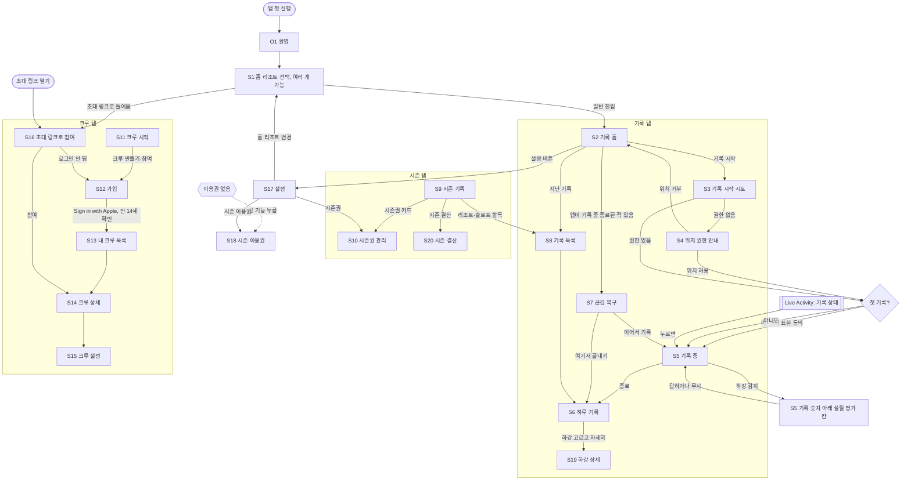
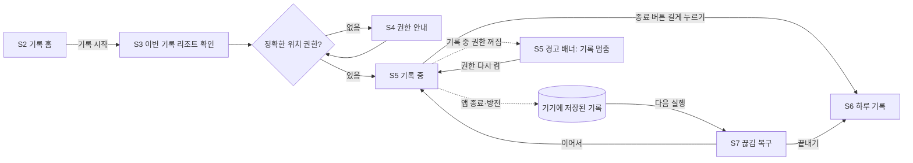

# 04. 화면 흐름

작성: 2026-11-08 · 깊이: 가볍게 · 상태: 검토 대기

03-requirements의 P0(R1~R22)를 화면으로 옮긴다. 화면 디자인이 아니라 화면의 목적, 주요 동작, 빈 상태와 오류 상태를 정한다.

## 1. 전체 구조

탭 3개: **기록 · 시즌 · 크루**. 설정은 기록 탭 오른쪽 위 버튼으로 연다.

## 2. 기록 흐름 (가장 중요한 흐름)

## 3. 화면별 정의

### O1 환영 (R51)
- **목적:** 처음 연 사람에게 앱이 무엇을 하는지 한 번 알린다.
- **보이는 것:** 한 줄 소개, 핵심 세 가지(시작하면 하강과 리프트를 자동으로 구분 · 야간·심야 기록 · 시즌권 본전), "GPS 기록은 우리 서버로 보내지 않아요".
- **주요 동작:** 시작 → S1. 권한은 묻지 않는다.
- **다시 보기:** 설정(S17)의 "처음 안내 다시 보기"로 이 화면만 다시 연다. 다른 설정이나 완료 상태는 그대로다.

### S1 홈 리조트 선택 (R1)
- **목적:** 주로 가는 리조트를 고른다. **여러 개를 고를 수 있다** (예: 시즌권 리조트 + 가끔 가는 곳). GPS로 미리 고르지 않는다.
- **주요 동작:** 리조트 목록에서 여러 개 선택. 고른 순서가 S3의 목록 순서가 된다. "자주 가는 곳이 없어요"를 고르면 홈 리조트 없이 시작하고, 기록할 때마다 전체 목록에서 고른다.
- **온보딩 완료 (R51):** 저장하거나 "자주 가는 곳이 없어요"를 누른 순간 완료다. 일반 진입은 홈(S2), 초대 링크로 들어왔으면 받아 둔 초대로 바로 S16을 연다(홈을 거치지 않음).
- **빈 상태:** 해당 없음 (리조트 목록은 앱에 내장).
- **오류:** 해당 없음.

### S2 기록 홈 (R2, R8, R31, R33, R34, R35, R39)
- **목적:** 기록을 시작한다. 이번 시즌 요약과 오늘 날씨·예상 설질을 한눈에 본다.
- **주요 동작:** 기록 시작 (탭 막대 위 화면 폭 캡슐, 기록·시즌 탭 첫 화면에 보임. 크루 탭은 S11의 아래 큰 버튼과 겹쳐 두지 않고, 들어간 화면에도 두지 않는다. 기록 중에는 같은 자리가 "기록 중 · 경과 시간" 막대가 되어 누르면 S5), 최근 기록 열기, 지난 기록 목록, 날씨 눌러 자세히 보기, 설정.
- **보이는 것 (위에서부터):** 홈 리조트 이름들, 기준 리조트의 오늘(리조트 이름과 영업일 날짜, 날씨·예상 설질, 강풍 안내, 오늘 운영 시간과 공식 링크), 옆으로 넘기는 기록 카드(최근 하루 기록 1개 → 이번 시즌 방문일·횟수 → 시즌권, 시즌권은 등록했을 때만). 오늘 기록이 있으면 첫 카드가 오늘 기록이다.
- **날씨·예상 설질 요약:**
    - **기준 리조트:** 마지막으로 기록한 리조트가 홈 목록에 있으면 그곳, 없으면 첫 번째 홈 리조트. 홈 리조트가 없으면 요약을 숨긴다.
    - **날씨:** 지금 기온, 하늘 상태. 바람, 최고·최저 기온, 시간대별·7일은 날씨 상세에서 본다. Apple Weather 마크와 법적 출처 링크 자리를 둔다.
    - **예상 설질 (R39):** "예상" 표시와 계산 근거(예: "밤사이 영하 8도, 낮 최고 3도")를 붙인다. 사용자가 남기는 설질 평가(R11)와 다른 모양으로 보여 구분한다.
    - **강풍 안내 (R35):** 오늘 시간표가 확인돼 있으면 지금 이후 남은 운영 구간(심야 포함, 운영 사이 정설 시간은 빼되 1시간 예보가 운영과 조금이라도 겹치면 포함), 확인돼 있지 않으면 "향후 24시간 예보" 범위를 밝히고, 그 구간의 시간대별 예보 풍속 최댓값이 기준 이상이면 바람을 강조하고 "리프트 운행은 공식 현황에서 확인하세요"와 공식 현황 링크를 붙인다. 운휴를 예측하지 않는다. 확인된 시간표에서 오늘 운영이 끝났거나 그날 구간이 없으면 안내하지 않는다.
    - **불러오는 중:** 자리만 잡아 두고 흐리게 표시.
    - **조회 실패:** "날씨를 불러오지 못했어요" + 다시 시도. 기록 시작은 그대로 쓸 수 있다.
    - **데이터 없음:** 예상 설질을 계산할 날씨 값이 부족하면 예상 설질만 숨기고 날씨는 보여준다.
- **운영 시간과 공식 링크 (R34):** 날씨 아래 작은 제목 "오늘 운영"으로 묶는다. 기준 리조트의 오늘 운영 시간(주간·야간·심야, 시작·끝 시각이 영업일 날짜의 다음 날이면 "다음 날" 표시. `00:00–02:00`처럼 따로 적은 심야도 해당)과 "슬로프 현황", "웹캠" 링크. 링크는 앱 안 브라우저로 연다. 이번 시즌 기준으로 확인하지 못한 리조트는 운영 시간을 숨기고 링크만 둔다. 그날이 시간표 적용 기간 밖이어도 숨긴다. 시간이 없다고 휴장으로 표시하지 않는다. 예보를 받지 못하면 강풍 안내를 띄우지 않는다("강풍 없음"으로 보지 않음). 링크가 없는 리조트는 그 버튼을 숨긴다.
- **시즌권 (R51):** 등록(S10) 때 대상 리조트는 홈 리조트를 자동으로 고르지 않고 목록 위에 후보로만 보여준다.
- **빈 상태:** 기록이 없으면 기록 카드 자리에 "스키장에 도착하면 아래 기록 시작을 누르세요"와 기록 방법 3줄.
- **오류:** 저장 공간 부족이면 홈 맨 위(헤더 아래)에 경고 배너 하나. 시작 캡슐에는 따로 표시하지 않는다 (R4).

### S3 기록 시작 시트 (R1)
- **목적:** 이번 기록의 리조트를 고른다.
- **주요 동작:** 홈 리조트 목록에서 하나를 골라 시작. 마지막으로 기록한 리조트가 기본으로 선택돼 있다 (GPS로 정하지 않음). 홈 리조트가 하나뿐이면 바로 시작할 수 있다. "다른 리조트"를 고르면 전체 목록에서 고르고, 이번 기록에만 적용된다.
- **빈 상태:** 홈 리조트가 없으면 전체 리조트 목록이 바로 열린다.
- **오류:** 해당 없음.

### S4 위치 권한 안내 (R18)
- **목적:** 권한을 요청하기 전에 이유를 설명한다.
- **보이는 것:** "하강 횟수와 거리를 재려고 위치를 씁니다. GPS 기록은 우리 서버로 보내지 않습니다."
- **주요 동작:** "계속" 하나만 둔다. 누르면 iOS 권한 창이 뜨고, 허용 여부는 거기서 고른다(Apple 지침: 사전 설명에는 시스템 창을 여는 버튼 하나, 별도 취소·닫기 없음). 사용자는 이미 기록 시작을 누른 상태다.
- **순서 (R12, R18):** S3 → 권한이 없으면 S4(위치 → 동작) → 첫 기록이면 익명 표본 동의 → S5. 위치를 거부하면 뒤의 질문을 띄우지 않고 홈으로 돌아간다. "한 번만"은 안내와 동의 이력에만 적용하고, 기록할 수 있는지는 매번 현재 권한으로 판단한다.
- **오류 상태별 안내:**
    - 거부됨: "위치 권한이 없으면 기록할 수 없어요" + 설정 열기
    - 정확한 위치 꺼짐: "정확한 위치를 켜야 슬로프를 셀 수 있어요" + 설정 열기
    - 위치 서비스 전체 꺼짐: 설정 경로 안내
- **동작 및 피트니스 권한:** 위치 권한 다음에 "기압계로 고도를 재고, 차를 탄 구간을 기록에서 빼요"라고 설명하고 요청한다. 거부해도 기록은 시작되고, 하루 기록에 "고도 정확도 낮음"이 표시된다.

### S5 기록 중 (R2, R3, R4)
- **목적:** 기록이 잘 되고 있는지 확인한다. 대부분은 화면을 보지 않는다.
- **보이는 것:** 경과 시간, 지금까지 하강 횟수, 거리, 현재 상태(내려가는 중 / 리프트 / 멈춤), 마지막 위치 수신 시각. 그 아래에 설질 평가 칸(R11). 숫자가 먼저 보이고, 설질 칸은 엄지가 닿는 화면 아래쪽에 온다.
- **자동으로 이어서 기록 중 (R4):** 앱이 짧게 끊겼다가 자동으로 이어 기록하면 "자동으로 이어서 기록 중 · 끊긴 n분은 기록 없음"과 종료 버튼을 보여준다.
- **주요 동작:** 종료 (길게 눌러야 동작, 실수 방지). 첫 기록에서는 종료 버튼에 "길게 눌러 종료"를 함께 표시한다(R51).
- **종료 잊음 알림 (R49):** 알림 권한을 아직 묻지 않았으면 기록 중 화면에 선택 카드 "기록을 켜 두고 떠나면 알려 드릴까요?"를 한 번 띄운다. 누르면 iOS 알림 권한 창. 거부하거나 닫아도 기록은 계속된다. 기록 시작을 막지 않는다.
- **빈 상태:** 첫 하강 전에는 "첫 하강을 기다리는 중".
- **오류:**
    - GPS 신호 약함: "위치 신호가 약해요" 배너. 기록은 계속.
    - 기록 중 권한 꺼짐: "위치 권한이 꺼져 기록이 멈췄어요" 배너 + 설정 열기. 멈춘 구간은 "기록 없음".
    - 배터리 낮음(예: 15%): "배터리가 부족해요. 지금까지 기록은 저장돼 있어요".
    - 저장 실패(공간 부족 등, R4): "저장하지 못해 기록을 멈췄어요. 마지막으로 저장된 기록은 ‘하루 기록 보기’에서 확인할 수 있어요" + 원인 안내, 버튼은 "닫기"·"하루 기록 보기"(기록은 이미 끝남). 조용히 계속하지 않는다.

### Live Activity: 기록 상태 (R23)
- **목적:** 앱을 열지 않고도 기록이 잘 되고 있는지 보여준다.
- **어디에:** 잠금 화면과 다이나믹 아일랜드. 알림이 아니라 기록하는 동안 고정돼 있는 카드다.
- **보이는 것:** 경과 시간, 하강 횟수, 거리.
- **주요 동작:** 누르면 앱의 기록 중 화면(S5)이 열린다. 버튼은 넣지 않는다 (장갑 낀 손으로 잘못 누를 위험, Apple 지침상 상태 표시 중심).
- **상태 흐름:**
    1. **기록 중:** 기록을 시작할 때(앱이 화면에 떠 있을 때) 시작하고, 소리 없이 갱신한다.
    2. **기록 멈춤:** 권한 꺼짐이나 저장 실패로 기록이 멈추면 "기록 멈춤"과 원인을 보여준다.
    3. **8시간 뒤:** Live Activity는 8시간까지만 갱신되므로 "기록 중 · 앱을 열면 다시 표시"로 끝낸다. 이 카드가 계속 남는다고 약속하지 않는다. 기록은 계속된다.
    4. **앱을 열면:** 기록이 진행 중이면 새 Live Activity를 시작한다.
    5. **기록 종료:** 하루 합계를 잠깐 보여주고 끝낸다.
- **오류:** 사용자가 Live Activity를 꺼 두어도 기록은 계속된다.

### 설질 평가 칸 (R11, R12)
- **목적:** 방금 탄 슬로프의 설질을 받는다. 설질은 시간마다 바뀌므로 하루가 끝난 뒤가 아니라 그때 받는다.
- **어디에:** 앱 안 기록 중 화면(S5)의 기록 숫자 아래. 종료 버튼과는 띄워 둔다. 리프트에서 기록을 보려고 앱을 열었을 때만 보인다.
- **보이는 것:** "방금: ○○ 슬로프 · 설질 [아이스] [적당함] [슬러시]". 슬로프 이름 표시가 꺼진 리조트에서는 "방금 하강의 설질"로 묻는다(슬로프는 기기 안에서 식별해 붙인다).
- **주요 동작:** 버튼으로 답하거나 무시한다. 다음 하강을 감지하면 새 슬로프로 바뀐다.
- **규칙:** 알림, 소리, 진동 없음. 슬로프를 식별하지 못한 하강은 묻지 않는다. 하강 후 30분이 지나면 칸을 닫는다.
- **동의:** 첫 기록을 시작할 때 권한(S4) 다음에 익명 표본 전송 동의를 받는다(위치를 거부하면 묻지 않음). 보내는 것(리조트, 슬로프, 15분 시간대, 설질)과 보내지 않는 것(계정, 좌표, 정확한 시각)을 보여준다. 거부하면 답은 기기에만 남는다.
- **참여율:** 앱을 열어야 답할 수 있어 낮을 수 있다. 출시 후 응답률이 너무 낮으면 Live Activity 버튼 방식을 일부 사용자에게 시험한다.

### S6 하루 기록 (R5, R6, R7, R9, R31, R32, R50, R52)
- **목적:** 오늘 하루를 돌아본다.
- **구조:** 전체 화면 지도 위에 아래 시트. 이 화면에서는 탭 막대를 숨긴다. 위에는 뒤로·지도 표시·3D 전환·공유 버튼과 날짜·리조트.
- **지도:** 처음 열면 리조트 전체 슬로프·리프트가 한 화면에 들어온다. 슬로프는 난이도 색 실선(초급 초록, 중급 파랑, 상급 빨강, 최상급 검정, 정보 없으면 회색), 리프트는 점선이다. 오늘 경로를 겹친다(하강은 강조색 실선, 탄 리프트는 점선, "기록 없음" 구간은 끊김). 두 손가락으로 확대·이동. 지도는 시트 높이와 상관없이 전체 화면 크기를 유지하고, 시트 위 보이는 영역에 리조트가 들어오도록 중심만 옮긴다. 재생 점이 시트 뒤로 가면 지도가 따라간다. 슬로프 선 아래에 지형 음영·등고선을 깐다(고도 파일이 있는 리조트만). 모서리에 "© OpenStreetMap"(지형이 있으면 "© OpenStreetMap · Copernicus DEM") 출처 표시.
- **지도 표시 메뉴:** 3D 전환 버튼 왼쪽의 버튼을 누르면 메뉴가 열린다. "슬로프"·"리프트"를 각각 끄고 켠다(기본 둘 다 켜짐, 선택은 기억). 그 아래 난이도 색 범례(초급·중급·상급·최상급·정보 없음). 슬로프를 끄면 2D는 슬로프 선이 사라지고, 3D는 색 선만 사라지고 눈 띠는 남는다. 리프트를 끄면 리프트 점선과 승·하차장 점이 사라진다. 내 경로는 꺼지지 않는다. 2D·3D 공통이고 이용권과 상관없다.
- **슬로프 누르기:** 슬로프 선을 누르면(가까운 슬로프, 22pt 안) 그 위에 작은 말풍선이 뜬다: 난이도 색 점, OSM 이름, 난이도("레인보우 1 · 상급"). 이름이 없으면 "이름 정보 없음", 난이도가 없으면 난이도를 뺀다. 빈 곳을 누르거나 지도를 움직이거나 2D ↔ 3D를 바꾸면 닫힌다. 슬로프를 꺼 두면 뜨지 않는다. 직접 누른 슬로프의 이름이라 모든 리조트에서 보인다(하강 목록의 이름은 R9 그대로). 2D·3D 공통.
- **3D 보기 (시즌 이용권):** 이용권이 없으면 전환 버튼에 자물쇠를 붙이고, 누르면 S18을 연다. 고도 파일이 있는 리조트는 위쪽 전환 버튼으로 지도를 3D 지형으로 바꾼다. 열 때는 항상 2D다. 처음 시점은 2D와 같은 방향(산 위가 화면 위)에서 낮게(34도) 내려다봐 위쪽에 하늘과 먼 능선이 보인다. S6를 열고 3D를 처음 켤 때는 1.1초 동안 돌며 날아 들어온다(손을 대면 멈춤, 동작 줄이기면 생략). 슬로프는 숲 사이 흰 눈 띠와 그 가운데 난이도 색 선으로, 리프트는 점선과 양 끝 승·하차장 점으로 보인다. 밝게·어둡게는 시스템 설정을 따르고 어둡게는 해 진 직후의 남청색이다. 한 손가락으로 돌리고 기울이고, 두 손가락으로 확대·이동하고, 두 번 누르면 처음 시점으로 돌아간다. 아래 시트·재생·하강 선택·출처 표시는 2D와 같고, 재생 점이 시트 뒤로 가면 3D도 따라간다. 이름 상시 라벨은 2D·3D 모두 없고 등고선은 3D에 없다(이름은 눌러서 본다). 3D에서 공유해도 동영상은 2D 지도로 만들고, 공유 메뉴의 동영상 설명에 "2D 지도"를 적는다.
- **아래 시트:** 기본 약 25%: 재생 막대(재생·일시정지, 시간 막대, 현재 시각)와 합계 한 줄(횟수, 거리, 고도차, 최고 속도). 끌어서 50%: 세션별(주간·야간·심야·미분류) 묶음과 하강 목록(시각, 슬로프 이름 또는 "하강 n", 거리, 속도). 목록은 시트 안에서 스크롤되고 세션 머리줄이 위에 붙는다. 시트는 닫히지 않는다.
- **주요 동작:**
    - 재생: 하루 이동을 약 30초로 압축해 점이 경로를 따라 움직인다. 재생 중인 하강 행을 목록에서 강조한다. 하강 행을 누르면 지도에서 그 하강을 강조하고 그 시각으로 이동한다. 강조한 행에 "자세히"가 생기고 누르면 S19(이용권이 없으면 S18).
    - 공유: "이미지"와 "동영상" 중 고른다. 이미지(R31)는 요약 한 장(날짜, 리조트, 횟수, 거리, 세션)이고 GPS 좌표·경로·위치 메타데이터는 넣지 않는다. 동영상은 재생을 10~15초 세로 영상으로 만들어 공유 시트를 연다. 동영상에는 리조트 슬로프·리프트 선 없이 지형 바탕과 내 경로만 담는다(지도 표시 메뉴 선택과 상관없음). 무료는 720×1280에 워터마크, 이용권은 1080×1920에 워터마크 없음. 무료일 때 동영상 항목 아래에 "이용권: 고화질·워터마크 없이"를 작게 적고 누르면 S18. 만드는 동안 진행 표시. 동영상을 처음 공유할 때 "오늘 경로가 담겨요"를 알린다.
    - 내 리프트 대기(R32, 켜진 뒤, 이용권): 50% 시트의 합계 아래 "리프트 대기 n분" 한 줄, 누르면 리프트별. 이용권이 없으면 자물쇠 줄.
    - 하강 목록에서 그때 남긴 설질을 볼 수 있다 (하루가 끝난 뒤에는 새로 남기지 않는다).
    - (TestFlight 빌드만) 기록 파일 내보내기 (R22). 위치 기록 포함 경고 후 공유 시트.
- **빈 상태:** 리조트에 OSM 데이터가 없거나 부족하면 지도 대신 합계와 목록만 있는 화면을 보여주고, 공유는 이미지만 제공한다. 하강 0회면 "하강이 기록되지 않았어요"와 가능한 원인(실내, 신호, 리프트만 탐). 이 기록은 방문일로 세지 않는다.
- **오류:** 끊긴 구간이 있으면 목록에 "기록 없음 13:02~13:40" 행. GPS 고도로 대신 기록했으면(동작 권한 거부, 기압계 없음) 합계 옆에 "고도 정확도 낮음"을 표시한다. 동영상 만들기에 실패하면 "동영상을 만들지 못했어요" + 다시 시도.

### S7 끊김 복구 (R4)
- **목적:** 앱이 기록 중에 종료됐을 때 이어갈지 정한다.
- **보이는 것:** "기록이 중간에 끊겼어요. 마지막 저장 13:02".
- **주요 동작:** 이어서 기록 (같은 하루 기록에 붙음, 중복 없음), 여기서 끝내기.
- **규칙:** 영업일이 바뀌었으면(06:00 지남) "이어서"를 보여주지 않고 끝내기만 둔다.

### S8 기록 목록
- **목적:** 지난 하루 기록을 찾는다.
- **주요 동작:** 날짜순 목록, 리조트로 거르기, 하루 기록 열기, 기록 삭제.
- **빈 상태:** "아직 기록이 없어요".
- **오류:** 해당 없음.

### S9 시즌 기록 (R6, R8, R32, R36, R53)
- **목적:** 이번 시즌 얼마나 탔는지 본다.
- **보이는 것:** 방문일, 횟수, 거리, 리조트별 합계, 슬로프 이름이 켜진 리조트는 슬로프별 횟수, 시즌권 카드. 시즌권을 등록하지 않았으면 시즌권 카드를 숨긴다(R8). 대상 리조트 방문일이 0일인 시즌권은 계산하지 않고 "아직 방문 기록이 없어요"로 둔다.
- **이용권 카드:** 시즌 결산(R53) 카드가 맨 위("지금까지 결산 보기", 4월 30일 뒤에는 "최종 결산"), 내 리프트 대기 시즌 합계(R32, 켜진 뒤). 이용권이 없으면 결산은 열리되 첫 카드만 보이고, 대기는 자물쇠 카드로 두고 누르면 S18. 시즌 목표(R36)는 무료라 이용권과 상관없이 보인다.
- **주요 동작:** 지난 시즌 보기, 리조트·슬로프 눌러 해당 기록 목록 열기, 시즌권 관리.
- **빈 상태:** 방문일 0일이면 "이번 시즌 첫 기록을 남겨 보세요". 시즌권 등록은 시즌 화면의 "시즌권 관리"에서 한다.
- **오류:** 해당 없음.

### S10 시즌권 관리 (R8)
- **목적:** 본전 계산에 필요한 시즌권을 등록한다. 여러 장을 살 수 있다.
- **주요 동작:** 시즌권 추가(이름, 가격, 하루 리프트권 가격, 대상 리조트 여러 개), 수정, 삭제, 목록 순서 바꾸기.
- **결과:** S9에 시즌권마다 "○○ 시즌권 · 12일 · 1회 방문당 41,000원"과 "리프트권으로 샀다면 쓴 금액". 2장 이상이면 전체 합계 카드도 보여준다.
- **규칙:** 한 리조트가 두 시즌권에 모두 들어 있으면 목록에서 위에 있는 시즌권에만 센다. 등록할 때 "곤지암은 이미 '곤지암 시즌권'에 들어 있어요. 위에 있는 시즌권에만 세요"라고 알린다.
- **빈 상태:** "시즌권 가격을 넣으면 1회 방문당 금액을 알려 드려요".
- **오류:** 0원이나 숫자가 아닌 값은 저장하지 않는다. 대상 리조트가 없으면 저장하지 않는다.

### S11 크루 시작 (R13, R14)
- **목적:** 크루가 무엇인지 알리고 가입으로 이끈다.
- **보이는 것:** "친구들과 이번 시즌 기록을 비교해요. 보이는 것: 방문일, 하강 횟수, 거리, 선택한 리조트별 방문일. 보이지 않는 것: 경로와 위치."
- **주요 동작:** 크루 만들기, 초대 링크로 참여. 크루 만들기는 이름(20자까지)을 넣는 시트에서 끝나고, 만든 뒤 혼자인 크루 상세(S14)로 간다. 부적절한 이름은 "쓸 수 없는 단어가 있어요", 이미 5개를 만들었으면 "크루는 5개까지 만들 수 있어요"(R14, R16).
- **빈 상태:** 이 화면 자체가 크루 탭의 빈 상태.

### S12 가입 (R13, R20)
- **목적:** 크루를 쓰기 위해 계정을 만든다.
- **주요 동작:** 만 14세 이상 확인, 크루에서 쓸 표시 이름 입력, Sign in with Apple.
- **오류:** 만 14세 미만 선택 시 "크루는 만 14세부터 쓸 수 있어요. 기록은 계속 쓸 수 있어요". Apple 로그인 실패 시 다시 시도.

### S13 내 크루 목록
- **목적:** 속한 크루를 고른다.
- **주요 동작:** 크루 열기, 새 크루 만들기.
- **빈 상태:** S11로 보낸다.

### S14 크루 상세 (R14, R15)
- **목적:** 크루원끼리 이번 시즌 기록을 비교한다.
- **보이는 것:** 순위 기준 선택(방문일 · 하강 횟수 · 거리), 크루원별 값, 마지막 갱신 시각.
- **주요 동작:** 기준 바꾸기, 초대 링크 공유, 크루 설정.
- **빈 상태:** 크루원이 나 혼자면 "초대 링크를 보내 크루원을 모아 보세요"와 공유 버튼.
- **오류:** 동기화 실패 시 "최신 기록을 올리지 못했어요. 마지막 갱신 10:42" 배너. 인터넷이 없으면 마지막으로 받은 순위를 보여주고 갱신 시각을 표시.

### S15 크루 설정 (R14, R16)
- **주요 동작:**
    - 크루장: 크루 이름 바꾸기, 초대 링크 새로 만들기(이전 링크 무효), 크루원 내보내기
    - 모두: 크루 이름·표시 이름 신고, 크루 나가기(내 기록이 크루에서 사라진다는 확인)
- **규칙:** 크루장이 나가면 다음 가입자가 크루장이 된다. 마지막 한 명이 나가면 크루가 사라진다.

### S16 초대 링크로 참여 (R14)
- **목적:** 링크로 들어온 사람이 크루에 들어온다.
- **보이는 것:** 크루 이름, 크루원 수, "가입 전 이번 시즌 기록도 크루원에게 보여요".
- **주요 동작:** 참여, 취소. 가입하지 않은 사람만 참여 전에 S12를 거친다. 이미 가입했으면 S16 → 참여 성공 → S14.
- **오류:** 링크가 무효(새로 만들어졌거나 크루가 사라짐)면 "이 초대 링크는 더 이상 쓸 수 없어요". 크루가 50명이면 "크루가 가득 찼어요". 앱이 없으면 크루 이름과 앱스토어 링크가 있는 웹페이지가 열린다.

### S17 설정 (R9, R11, R12, R13, R17, R19, R54)
- **항목:** 홈 리조트, 시즌권, 종료 잊음 알림(켜짐/꺼짐, R49; 아직 묻지 않았으면 권한 창, 물었으면 iOS 설정), 설질 질문 표시(켜기/끄기, R11), 설질·대기 시간 익명으로 보내기(켜기/끄기, R12; "GPS 좌표와 이동 경로는 보내지 않아요"), 시즌 이용권(상태: "2027년 4월 30일까지" 또는 "없음", 누르면 S18), 개인정보처리방침, 이용약관, 지도 데이터 출처(OpenStreetMap, Copernicus: 고도 데이터 출처 문구·면책 문장 원문과 번역), 처음 안내 다시 보기(R51), 문의, 계정 삭제(로그인했을 때만).
- **계정 삭제:** 무엇이 지워지는지(계정, 활동 합계, 크루 소속) 안내 → 확인 → 완료 안내. 기기의 기록은 남는다고 알린다.
- **오류:** 삭제 실패 시 다시 시도, 문의하기, 닫기.

### S18 시즌 이용권 (R54)
- **목적:** 이용권으로 무엇이 열리는지 보고 산다.
- **보이는 것:** 맨 위 가격·기간 카드, 그 아래 여는 기능을 화면 폭 미리보기 카드로 세로로 내려 본다(3D 지도, 고화질·워터마크 없는 동영상, 하강 상세, 시즌 결산, 켜진 뒤에는 내 리프트 대기. 그림은 실제 앱 화면 전체를 세로로 줄인 휴대폰 모양, 밝게·어둡게). 가격, 쓸 수 있는 기간("2027년 4월 30일까지"), "자동으로 갱신되지 않아요", 이용약관·개인정보처리방침 링크, 환불은 Apple에서 처리한다는 안내. 기록과 기본 기능은 무료라는 한 줄.
- **주요 동작:** 구입(Apple 결제 창, 아래 고정 버튼), 구입 복원·코드 입력(StoreKit 코드 입력 창, 홍보용 일회용 코드)은 구입 버튼 바로 아래 한 줄로 고정하고 가장 큰 글씨(접근성 크기)에서는 스크롤 영역으로 내린다, 닫기. 잠긴 기능에서 왔으면 구입 뒤 그 기능으로 돌아간다.
- **이미 있음:** "2027년 4월 30일까지 쓰고 있어요"와 닫기만.
- **오류:** 안내는 같은 화면의 구입 버튼 위에 한 줄로 얹는다. 구입 실패·취소는 화면에 남아 다시 시도. 결제 대기(보호자 승인 등)는 "승인되면 열려요". 복원할 것이 없으면 "복원할 이용권이 없어요". 상품 정보를 못 받으면 가격 대신 다시 시도.

### S19 하강 상세 (R52)
- **목적:** 한 번의 하강을 자세히 본다.
- **보이는 것:** 위쪽은 그 하강을 3D 지형 위에서 내려오는 재생(3D v4 톤, 고도 파일을 못 읽으면 2D 지도). 아래 시트 3단계: 작게는 재생 막대와 지금 속도·지금 고도, 중간(약 60%)은 재생 위치가 표시된 속도·고도 그래프, 크게는 숫자 4칸(거리, 고도차, 최고 속도와 시각, 멈춘 시간을 뺀 평균)과 시즌 비교. 크게에서는 재생 막대와 지금 속도·고도를 위에 고정하고 아래만 스크롤한다. 슬로프 이름 또는 "하강 n", 시각. 슬로프 이름이 켜진 리조트는 "이번 시즌 이 슬로프 n번째"와 최고·평균 속도 변화.
- **오류:** "기록 없음" 구간이 낀 하강은 3D 경로를 잇지 않고 그래프를 비우며 "기록 없음 10:38~10:39"처럼 표시. GPS 고도로 기록했으면 "고도 정확도 낮음".

### S20 시즌 결산 (R53)
- **목적:** 이번 시즌을 정리해 보고 공유한다.
- **보이는 것:** 넘겨 보는 카드: 방문일·횟수·거리 → 고도차 → 세션별 비율 → 가장 많이 간 리조트 → 가장 많이 탄 날 → 가장 많이 탄 슬로프(이름이 켜진 리조트만) → 시즌권 본전(등록했을 때). 시즌 중에는 제목이 "지금까지", 4월 30일 뒤에는 "최종 결산".
- **주요 동작:** 카드 색 선택(기본은 화면 모드를 따르고 카드 위에서 밝게·어둡게로 바꿈, 고른 값 기억). 카드마다 이미지로 공유(GPS 좌표·경로·위치 메타데이터 없음). 이용권이 없으면 첫 카드 다음에 S18 안내 카드.
- **빈 상태:** 방문일 0일이면 열지 않고 S9에 "첫 기록을 남기면 결산을 볼 수 있어요".

## 4. 요구사항과 화면 대응

| 요구사항 | 화면 |
| --- | --- |
| R1 홈 리조트 | S1, S3, S17 |
| R51 온보딩 | O1, S1, S5(종료 버튼), S10(홈 리조트 후보), S16(초대 진입), S17(다시 보기) |
| R49 종료 잊음 알림 권한 | S5 선택 카드 |
| R2·R3 기록 | S2, S5 |
| R4 기록 보존 | S2(저장 공간), S5(자동 이어 기록, 저장 실패), S6(기록 없음 구간), S7, Live Activity(기록 멈춤) |
| R5 하루 기록 | S6 |
| R50 하루 기록 지도·움직임 재생·동영상 공유 | S6 |
| R6 시즌 기록 | S9 |
| R7 세션 | S6 |
| R8 시즌권 | S2, S9, S10 |
| R9 슬로프 이름, OSM 출처 | S6, S9, S17 |
| R10 리프트 대기 수집 | 화면 없음 (수집만) |
| R11·R12 설질 평가, 익명 동의 | 첫 기록 동의(S4 다음), S5 설질 평가 칸, S17 |
| R23 Live Activity | Live Activity |
| R13 계정 | S12, S17 |
| R14~R16 크루 | S11, S13~S16 |
| R17 전송 제한 | 화면 없음. S4, S11 문구로 고지 |
| R18 권한 | S4, S5, S6(고도 정확도 낮음) |
| R19 고지 | S17 |
| R20 연령 | S12 |
| R21 접근성 | 전체. 특히 S5 종료, S17 계정 삭제 |
| R22 기록 내보내기 | S6 (TestFlight 빌드만) |
| R33 날씨, R39 예상 설질, R35 강풍 안내 | S2 날씨·예상 설질 요약, 날씨 상세 |
| R34 운영 시간·공식 링크 | S2 |
| R31 공유 이미지 | S6 공유 |
| R54 시즌 이용권 | S18, S17, 잠긴 기능(S6 3D·동영상·자세히, S9 카드) |
| R52 하강 상세 | S6 "자세히", S19 |
| R53 시즌 결산 | S9, S20 |
| R36 시즌 목표 | S9 |
| R32 내 리프트 대기 | S6, S9 (켜진 뒤) |

## 5. 정할 것

- ~~탭 이름과 아이콘~~ → **기록 · 시즌 · 크루**, SF Symbols 아이콘 (2026-11-08).
- ~~S5 종료 방식~~ → **길게 눌러 종료** (2026-11-08). VoiceOver를 켰을 때는 버튼을 두 번 탭하면 "기록을 끝낼까요?" 확인 창으로 끝낸다(R21).
- ~~홈 리조트 없이 시작하는 경로를 둘지~~ → **둔다** (2026-11-08). 시즌권 없이 여행으로 가는 사람(예: 2박 3일)도 쓸 수 있어야 한다. 주력 대상은 아니지만 기록, 하루·시즌 기록, 세션 구분은 똑같이 쓴다.
