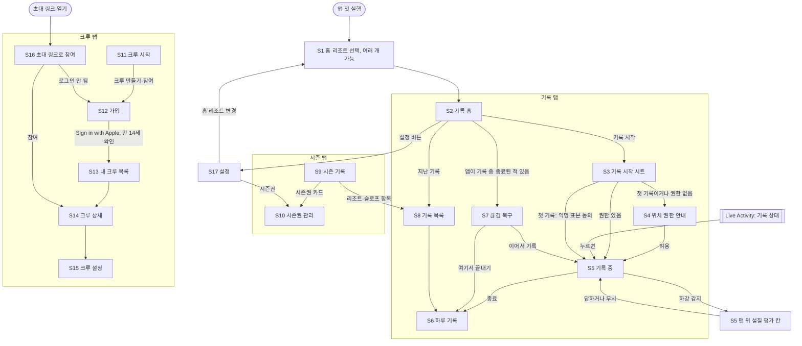
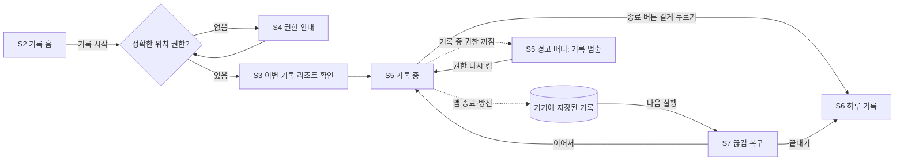

# 04. 화면 흐름

작성: 2026-11-08 · 깊이: 가볍게 · 상태: 검토 대기

03-requirements의 P0(R1~R22)를 화면으로 옮긴다. 화면 디자인이 아니라 화면의 목적, 주요 동작, 빈 상태와 오류 상태를 정한다.

## 1. 전체 구조

탭 3개: **기록 · 시즌 · 크루**. 설정은 기록 탭 오른쪽 위 버튼으로 연다.

## 2. 기록 흐름 (가장 중요한 흐름)

## 3. 화면별 정의

### S1 홈 리조트 선택 (R1)
- **목적:** 주로 가는 리조트를 고른다. **여러 개를 고를 수 있다** (예: 시즌권 리조트 + 가끔 가는 곳). GPS로 미리 고르지 않는다.
- **주요 동작:** 리조트 목록에서 여러 개 선택. 고른 순서가 S3의 목록 순서가 된다. "자주 가는 곳이 없어요"를 고르면 홈 리조트 없이 시작하고, 기록할 때마다 전체 목록에서 고른다.
- **빈 상태:** 해당 없음 (리조트 목록은 앱에 내장).
- **오류:** 해당 없음.

### S2 기록 홈 (R2, R8)
- **목적:** 기록을 시작한다. 이번 시즌 요약을 한눈에 본다.
- **주요 동작:** 기록 시작 (큰 버튼), 최근 기록 열기, 지난 기록 목록, 설정.
- **보이는 것:** 홈 리조트 이름들, 이번 시즌 방문일·횟수, 시즌권 카드(입력했을 때만), 최근 하루 기록 1개.
- **빈 상태:** 기록이 없으면 "스키장에 도착하면 기록 시작을 누르세요"와 기록 방법 3줄.
- **오류:** 저장 공간 부족이면 기록 시작 버튼 아래에 경고 (R4). 앱 안에 "베타" 표시.

### S3 기록 시작 시트 (R1)
- **목적:** 이번 기록의 리조트를 고른다.
- **주요 동작:** 홈 리조트 목록에서 하나를 골라 시작. 마지막으로 기록한 리조트가 기본으로 선택돼 있다 (GPS로 정하지 않음). 홈 리조트가 하나뿐이면 바로 시작할 수 있다. "다른 리조트"를 고르면 전체 목록에서 고르고, 이번 기록에만 적용된다.
- **빈 상태:** 홈 리조트가 없으면 전체 리조트 목록이 바로 열린다.
- **오류:** 해당 없음.

### S4 위치 권한 안내 (R18)
- **목적:** 권한을 요청하기 전에 이유를 설명한다.
- **보이는 것:** "하강 횟수와 거리를 재려고 위치를 씁니다. GPS 기록은 우리 서버로 보내지 않습니다."
- **주요 동작:** 계속 (iOS 권한 창), 나중에.
- **오류 상태별 안내:**
    - 거부됨: "위치 권한이 없으면 기록할 수 없어요" + 설정 열기
    - 정확한 위치 꺼짐: "정확한 위치를 켜야 슬로프를 셀 수 있어요" + 설정 열기
- **동작 및 피트니스 권한:** 위치 권한 다음에 "고도를 정확히 재려고 기압계를 씁니다"라고 설명하고 요청한다. 거부해도 기록은 시작되고, 하루 기록에 "고도 정확도 낮음"이 표시된다.
    - 위치 서비스 전체 꺼짐: 설정 경로 안내

### S5 기록 중 (R2, R3, R4)
- **목적:** 기록이 잘 되고 있는지 확인한다. 대부분은 화면을 보지 않는다.
- **보이는 것:** 경과 시간, 지금까지 하강 횟수, 거리, 현재 상태(내려가는 중 / 리프트 / 멈춤), 마지막 위치 수신 시각.
- **주요 동작:** 종료 (길게 눌러야 동작, 실수 방지).
- **빈 상태:** 첫 하강 전에는 "첫 하강을 기다리는 중".
- **오류:**
    - GPS 신호 약함: "위치 신호가 약해요" 배너. 기록은 계속.
    - 기록 중 권한 꺼짐: "위치 권한이 꺼져 기록이 멈췄어요" 배너 + 설정 열기. 멈춘 구간은 "기록 없음".
    - 배터리 낮음(예: 15%): "배터리가 부족해요. 지금까지 기록은 저장돼 있어요".

### Live Activity: 기록 상태 (R23)
- **목적:** 앱을 열지 않고도 기록이 잘 되고 있는지 보여준다.
- **어디에:** 잠금 화면과 다이나믹 아일랜드. 알림이 아니라 기록하는 동안 고정돼 있는 카드다.
- **보이는 것:** 경과 시간, 하강 횟수, 거리. 기록이 멈추면 "기록 멈춤".
- **주요 동작:** 누르면 앱의 기록 중 화면(S5)이 열린다. 버튼은 넣지 않는다 (장갑 낀 손으로 잘못 누를 위험, Apple 지침상 상태 표시 중심).
- **오류:** 사용자가 Live Activity를 꺼 두어도 기록은 계속된다.

### 설질 평가 칸 (R11, R12)
- **목적:** 방금 탄 슬로프의 설질을 받는다. 설질은 시간마다 바뀌므로 하루가 끝난 뒤가 아니라 그때 받는다.
- **어디에:** 앱 안 기록 중 화면(S5) 맨 위. 리프트에서 기록을 보려고 앱을 열었을 때만 보인다.
- **보이는 것:** "방금: ○○ 슬로프 · 설질 [아이스] [적당함] [슬러시]".
- **주요 동작:** 버튼으로 답하거나 무시한다. 다음 하강을 감지하면 새 슬로프로 바뀐다.
- **규칙:** 알림, 소리, 진동 없음. 슬로프를 식별하지 못한 하강은 묻지 않는다. 하강 후 30분이 지나면 칸을 닫는다.
- **동의:** 첫 기록을 시작할 때(S3) 익명 표본 전송 동의를 받는다. 보내는 것(리조트, 슬로프, 15분 시간대, 설질)과 보내지 않는 것(계정, 좌표, 정확한 시각)을 보여준다. 거부하면 답은 기기에만 남는다.
- **참여율:** 앱을 열어야 답할 수 있어 낮을 수 있다. 출시 후 응답률이 너무 낮으면 Live Activity 버튼 방식을 일부 사용자에게 시험한다.

### S6 하루 기록 (R5, R6, R7, R9)
- **목적:** 오늘 하루를 돌아본다.
- **보이는 것:** 합계(횟수, 거리, 고도차, 최고 속도), 세션별(주간·야간·심야·미분류) 묶음, 하강 목록(시각, 슬로프 이름 또는 "알 수 없는 슬로프", 거리, 속도).
- **주요 동작:**
    - 하강 목록에서 그때 남긴 설질을 볼 수 있다 (하루가 끝난 뒤에는 새로 남기지 않는다).
    - (TestFlight 빌드만) 기록 파일 내보내기 (R22). 위치 기록 포함 경고 후 공유 시트.
- **빈 상태:** 하강 0회면 "하강이 기록되지 않았어요"와 가능한 원인(실내, 신호, 리프트만 탐). 이 기록은 방문일로 세지 않는다.
- **오류:** 끊긴 구간이 있으면 목록에 "기록 없음 13:02~13:40" 행.

### S7 끊김 복구 (R4)
- **목적:** 앱이 기록 중에 종료됐을 때 이어갈지 정한다.
- **보이는 것:** "기록이 중간에 끊겼어요. 마지막 저장 13:02".
- **주요 동작:** 이어서 기록 (같은 하루 기록에 붙음, 중복 없음), 여기서 끝내기.
- **규칙:** 영업일이 바뀌었으면(06:00 지남) "이어서"를 보여주지 않고 끝내기만 둔다.

### S8 기록 목록
- **목적:** 지난 하루 기록을 찾는다.
- **주요 동작:** 날짜순 목록, 리조트로 거르기, 하루 기록 열기, 기록 삭제.
- **빈 상태:** "아직 기록이 없어요".
- **오류:** 해당 없음.

### S9 시즌 기록 (R6, R8)
- **목적:** 이번 시즌 얼마나 탔는지 본다.
- **보이는 것:** 방문일, 횟수, 거리, 리조트별 합계, 슬로프 이름이 켜진 리조트는 슬로프별 횟수, 시즌권 카드.
- **주요 동작:** 지난 시즌 보기, 리조트·슬로프 눌러 해당 기록 목록 열기, 시즌권 관리.
- **빈 상태:** 방문일 0일이면 "이번 시즌 첫 기록을 남겨 보세요". 시즌권 카드는 "시즌권 가격을 넣으면 1회 방문당 금액을 알려 드려요".
- **오류:** 해당 없음.

### S10 시즌권 관리 (R8)
- **목적:** 본전 계산에 필요한 시즌권을 등록한다. 여러 장을 살 수 있다.
- **주요 동작:** 시즌권 추가(이름, 가격, 하루 리프트권 가격, 대상 리조트 여러 개), 수정, 삭제, 목록 순서 바꾸기.
- **결과:** S9에 시즌권마다 "○○ 시즌권 · 12일 · 1회 방문당 41,000원"과 "리프트권으로 샀다면 쓴 금액". 2장 이상이면 전체 합계 카드도 보여준다.
- **규칙:** 한 리조트가 두 시즌권에 모두 들어 있으면 목록에서 위에 있는 시즌권에만 센다. 등록할 때 "곤지암은 이미 '곤지암 시즌권'에 들어 있어요. 위에 있는 시즌권에만 세요"라고 알린다.
- **빈 상태:** "시즌권 가격을 넣으면 1회 방문당 금액을 알려 드려요".
- **오류:** 0원이나 숫자가 아닌 값은 저장하지 않는다. 대상 리조트가 없으면 저장하지 않는다.

### S11 크루 시작 (R13, R14)
- **목적:** 크루가 무엇인지 알리고 가입으로 이끈다.
- **보이는 것:** "친구들과 이번 시즌 기록을 비교해요. 보이는 것: 방문일, 횟수, 거리, 고른 리조트. 보이지 않는 것: 경로와 위치."
- **주요 동작:** 크루 만들기, 초대 링크로 참여.
- **빈 상태:** 이 화면 자체가 크루 탭의 빈 상태.

### S12 가입 (R13, R20)
- **목적:** 크루를 쓰기 위해 계정을 만든다.
- **주요 동작:** 만 14세 이상 확인, 크루에서 쓸 표시 이름 입력, Sign in with Apple.
- **오류:** 만 14세 미만 선택 시 "크루는 만 14세부터 쓸 수 있어요. 기록은 계속 쓸 수 있어요". Apple 로그인 실패 시 다시 시도.

### S13 내 크루 목록
- **목적:** 속한 크루를 고른다.
- **주요 동작:** 크루 열기, 새 크루 만들기.
- **빈 상태:** S11로 보낸다.

### S14 크루 상세 (R14, R15)
- **목적:** 크루원끼리 이번 시즌 기록을 비교한다.
- **보이는 것:** 순위 기준 선택(방문일 · 횟수 · 거리), 크루원별 값, 마지막 갱신 시각.
- **주요 동작:** 기준 바꾸기, 초대 링크 공유, 크루 설정.
- **빈 상태:** 크루원이 나 혼자면 "초대 링크를 보내 크루원을 모아 보세요"와 공유 버튼.
- **오류:** 동기화 실패 시 "최신 기록을 올리지 못했어요. 마지막 갱신 10:42" 배너. 인터넷이 없으면 마지막으로 받은 순위를 보여주고 갱신 시각을 표시.

### S15 크루 설정 (R14, R16)
- **주요 동작:**
    - 크루장: 크루 이름 바꾸기, 초대 링크 새로 만들기(이전 링크 무효), 크루원 내보내기
    - 모두: 크루 이름·표시 이름 신고, 크루 나가기(내 기록이 크루에서 사라진다는 확인)
- **규칙:** 크루장이 나가면 다음 가입자가 크루장이 된다. 마지막 한 명이 나가면 크루가 사라진다.

### S16 초대 링크로 참여 (R14)
- **목적:** 링크로 들어온 사람이 크루에 들어온다.
- **보이는 것:** 크루 이름, 크루원 수, "가입 전 이번 시즌 기록도 크루원에게 보여요".
- **주요 동작:** 참여, 취소.
- **오류:** 링크가 무효(새로 만들어졌거나 크루가 사라짐)면 "이 초대 링크는 더 이상 쓸 수 없어요". 크루가 50명이면 "크루가 가득 찼어요". 앱이 없으면 크루 이름과 앱스토어 링크가 있는 웹페이지가 열린다.

### S17 설정 (R12, R13, R17, R19, R9)
- **항목:** 홈 리조트, 시즌권, 익명 표본 보내기(켜기/끄기), 개인정보처리방침, 지도 데이터 출처(OpenStreetMap), 문의, 계정 삭제(로그인했을 때만).
- **계정 삭제:** 무엇이 지워지는지(계정, 활동 합계, 크루 소속) 안내 → 확인 → 완료 안내. 기기의 기록은 남는다고 알린다.
- **오류:** 삭제 실패 시 다시 시도와 문의 연락처.

## 4. 요구사항과 화면 대응

| 요구사항 | 화면 |
| --- | --- |
| R1 홈 리조트 | S1, S3, S17 |
| R2·R3 기록 | S2, S5 |
| R4 기록 보존 | S2(저장 공간), S5, S6(기록 없음 구간), S7 |
| R5 하루 기록 | S6 |
| R6 시즌 기록 | S9 |
| R7 세션 | S6 |
| R8 시즌권 | S2, S9, S10 |
| R9 슬로프 이름, OSM 출처 | S6, S9, S17 |
| R10 리프트 대기 수집 | 화면 없음 (수집만) |
| R11·R12 설질 평가, 익명 동의 | S3(첫 기록 동의), S5 설질 평가 칸, S17 |
| R23 Live Activity | Live Activity |
| R13 계정 | S12, S17 |
| R14~R16 크루 | S11, S13~S16 |
| R17 전송 제한 | 화면 없음. S4, S11 문구로 고지 |
| R18 권한 | S4, S5 |
| R19 고지 | S17 |
| R20 연령 | S12 |
| R21 접근성 | 전체. 특히 S5 종료, S17 계정 삭제 |
| R22 기록 내보내기 | S6 (TestFlight 빌드만) |

## 5. 정할 것

- 탭 이름과 아이콘은 디자인 단계에서 정한다.
- S5 종료를 "길게 누르기"로 할지 "확인 창"으로 할지: VoiceOver에서 길게 누르기가 불편할 수 있어 R21과 함께 정한다.
- ~~홈 리조트 없이 시작하는 경로를 둘지~~ → **둔다** (2026-11-08). 시즌권 없이 여행으로 가는 사람(예: 2박 3일)도 쓸 수 있어야 한다. 주력 대상은 아니지만 기록, 하루·시즌 기록, 세션 구분은 똑같이 쓴다.
