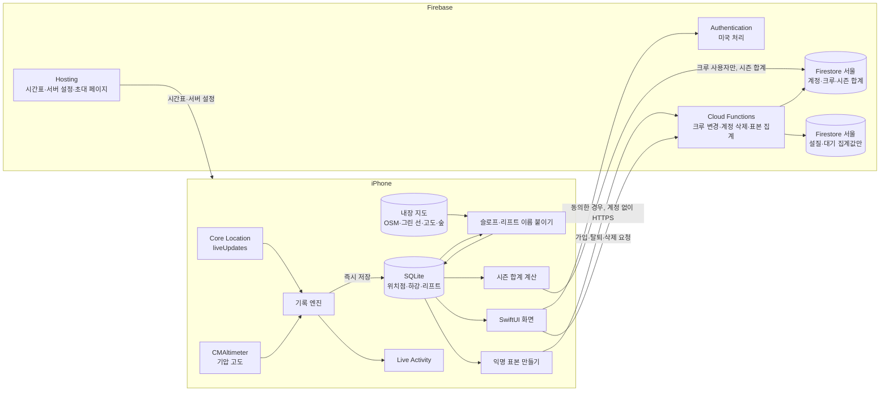
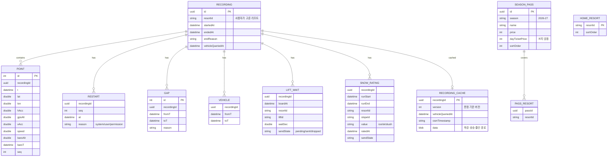
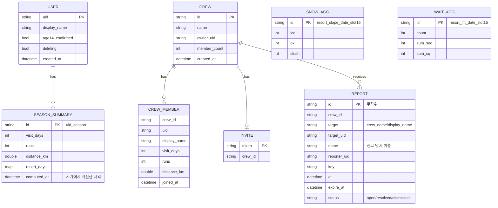
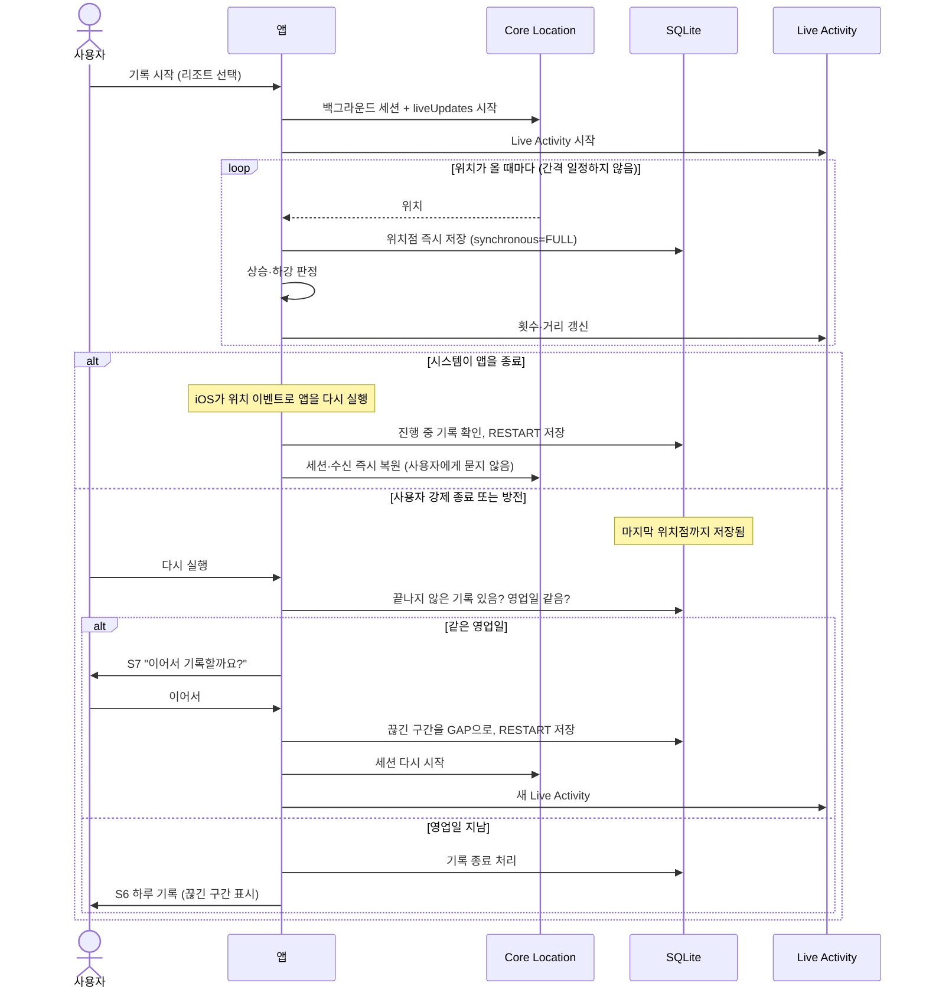

# 05. 기술 설계

작성: 2026-11-08 · 깊이: 충실히 · 상태: 승인 (2026-11-08)

03-requirements의 요구사항을 만들기 위한 구조, 데이터, 외부 서비스, 개인정보 보호를 정한다. 기술 선택은 승인 후 decisions.md에 기록한다. 화면 모양과 색 값은 07-visual-design, 확인 기준은 06-verification에 둔다.

## 1. 기술 선택 요약

| 영역 | 선택 (제안) | 주된 이유 | 기각한 대안 |
| --- | --- | --- | --- |
| 앱 | **Swift + SwiftUI (iOS 17.6 이상)** | 백그라운드 위치, 기압계, Live Activity가 모두 Apple 고유 API. Live Activity UI는 SwiftUI로만 만듦 | Flutter, React Native: 핵심 기능이 전부 네이티브 연동이라 이점이 작음 |
| 기기 저장소 | **SQLite (GRDB 라이브러리), WAL + `synchronous=FULL`** | 하강·방문일·시즌 합계를 SQL로 집계하기 쉽고, 트랜잭션과 디스크 동기화 수준을 직접 정할 수 있음(R4) | SwiftData: 명시적 저장은 되지만 대량 위치점 집계와 저장 정책 통제가 GRDB보다 번거로움 |
| 서버 | **Firebase (Authentication + Cloud Firestore 서울 리전)** | 안드로이드도 같은 서버를 씀(R48). Sign in with Apple·Google 지원. Firestore는 서울 리전. **Authentication은 미국에서 처리되므로 국외 이전 고지 필요** (6장) | CloudKit: iPhone 전용(R48 위반). Supabase: 무료 프로젝트는 활동이 없으면 일시 정지. 자체 서버: 1인 개발에 운영 부담 |
| 서버 함수 | **Cloud Functions (Blaze 요금제)** | 크루 가입·탈퇴·소유권 같은 권한 변경과 계정 삭제를 서버 트랜잭션으로 처리. 익명 표본 집계 | 클라이언트 직접 쓰기: 동시 가입, 부분 삭제를 막기 어려움 |
| 지도 데이터 | **OpenStreetMap 가공본, 직접 그린 슬로프 선, 고도 격자, 숲 지도를 앱에 내장** | 산에서 인터넷이 없어도 슬로프 식별과 지도. 고칠 때는 앱 업데이트로 낸다. OSM 가공본은 ODbL로 따로 공개 | 실시간 Overpass 조회: 느리고 공용 서버 과부하(조회 실패 경험 있음) |
| 운영 시간표 | **정적 JSON (Firebase Hosting), 버전 포함** | 앱 업데이트 없이 시간표를 고침(R7) | 앱 내장만: 고칠 때마다 앱 심사 |
| 3D 지형 보기 (R50) | **SceneKit** (`SCNView`) | iOS 17.6에서 동작. 격자를 메시로 만드는 API가 단순하고 기기 안에서만 그림. 타일·네트워크 없음 | RealityKit `RealityView`: iOS 18 이상. MapKit 3D 지형: 타일을 받음(R50 오프라인 조건) |
| 날씨 (R33·R39) | **WeatherKit** | 개발자 멤버십에 월 50만 회 포함. REST API가 있어 안드로이드에서도 사용 가능 | OpenWeatherMap: 무료 하루 1,000회. 기상청 단기예보: 정확도 비교 후 결정(06-verification) |
| 시즌 이용권 (R54) | **StoreKit 2, 기간 고정 구독(Non-Renewing) 상품 하나** | 시즌(11월~4월)에 맞는 기간은 자동 갱신 구독으로 만들 수 없음(1주~1년 단위). StoreKit 2 거래 내역은 같은 Apple 계정의 기기에 동기화되므로 로그인·서버 없이 다른 기기와 복원을 지원. 거래는 기기에서 서명(JWS) 확인 | 자동 갱신 1년·6개월: 비시즌 갱신·환불 불만, 시즌과 안 맞음. 서버 영수증 검증·계정 연동: 로그인 없는 사용자 원칙과 맞지 않고 서버 일이 늘어남. RevenueCat 등: 상품 하나에 의존성 추가 |
| 초대 링크 | **Universal Links + Firebase Hosting** | 앱이 있으면 앱으로 열림. 앱이 없으면 웹페이지가 열리므로 그 페이지에 크루 이름과 앱스토어 링크를 둠 | Firebase Dynamic Links: 2025년에 서비스 종료 |
| 분석·오류 수집 | **App Store Connect와 Xcode Organizer만** | 위치가 외부 도구로 새 나갈 경로를 원천 차단(R17). 의존성 없음 | Firebase Analytics, Crashlytics: 로그에 위치가 섞일 위험, 고지 항목 증가 |

## 2. 전체 구조

**경계선:** GPS 좌표, 경로, 하강별 기록은 기기 밖으로 나가지 않는다. 서버로 가는 것은 시즌 합계(계정과 연결)와 익명 표본(계정과 분리, 서버에서 바로 집계하고 개별 표본은 저장하지 않음) 두 가지뿐이다.

## 3. 기록 엔진 (R2~R4, R7, R10, R23)

### 위치 수집
- iOS 17의 `CLLocationUpdate.liveUpdates`와 `CLBackgroundActivitySession`으로 백그라운드에서 받는다. 이 API는 고정 간격을 보장하지 않고, 멈춰 있으면 수신을 자동으로 쉬었다가 움직이면 다시 보낸다. 그래서 **거리와 공백은 위치점의 실제 시각으로 계산한다.**
- 수신이 끊긴 이유를 구분해 기록한다: 정상 정지(움직임 없음), 위치 획득 실패(신호), 권한 상실, 앱 종료. 앞의 둘은 "기록 없음" 구간이 아니라 정상 기록이다.
- **시스템이 앱을 종료한 경우:** Apple은 백그라운드 위치 세션이 있던 앱을 위치 이벤트로 다시 실행하고, 앱이 세션과 수신을 새로 만들도록 설명한다(WWDC23 10180). 이때는 사용자에게 묻지 않고 저장된 기록 상태를 읽어 **즉시 수신을 복원**한다. 기종·iOS 버전별 신뢰성은 현장 테스트로 확인한다.
- **사용자가 강제 종료하거나 방전된 경우:** iOS가 다시 깨우지 않는다. 다음 실행 때 S7 끊김 복구로 처리한다.

### 고도
- 기압계(`CMAltimeter`)의 상대 고도를 주 입력으로 쓴다. GPS 고도는 오차가 커서 리프트·하강 판정에 불리하다.
- 기압계는 **동작 및 피트니스 권한**이 별도로 필요하다. 권한이 없거나 기기가 지원하지 않으면 GPS 고도와 수직 정확도로 대신 판정하고, 하루 기록에 "고도 정확도 낮음"을 표시한다.
- 상대 고도는 수신을 시작할 때마다 0에서 다시 시작한다. 재시작 지점을 저장하고, **그 경계를 가로질러 기압 고도차를 계산하지 않는다.** 경계 양쪽의 두 하강을 한 번으로 합칠지는 GPS 고도와 공백 시간으로 정한다(decisions 2026-11-17 "재시작 경계 하강 합치기 기준").

### 저장 (R4)
- 위치점은 받는 즉시 SQLite 트랜잭션으로 쓴다. `synchronous=FULL`로 전원이 갑자기 꺼져도 완료된 쓰기가 되돌아가지 않게 한다.
- 파일 보호 등급은 "첫 잠금 해제 후 접근 가능"으로 둬서, 화면이 잠긴 동안에도 쓸 수 있게 한다. 잠금 상태 쓰기는 현장 테스트로 확인한다.
- 저장에 실패하면(공간 부족 등) 기록을 멈추고 Live Activity와 앱에 알린다. 조용히 계속하지 않는다.
- 앱 업데이트로 데이터베이스 구조를 바꿀 때는 원본 파일을 먼저 복사해 두고, 변환에 실패하면 원본을 보존한다.
- R4의 "최대 1분 손실"은 **받은 위치 데이터를 잃는 범위**다. 앱이 꺼져 있어 받지 못한 시간은 "기록 없음" 구간으로 표시할 뿐 1분 안으로 보장할 수 없다.
- 기록 파일은 iOS 기기 백업에 포함된다(기기 교체 시 옮겨짐). 우리 서버로는 가지 않는다.

### 하강·리프트 판정 (R3, 03 5장)
판정은 **지도 없이도 동작**해야 한다. 모든 리조트에서 횟수와 거리를 기록하기 때문이다(03 리조트별 지원 범위).

1. 고도가 꾸준히 오르는 구간 = **상승(리프트) 구간**. 지도가 있으면 OSM 리프트 선과 맞춰 어느 리프트인지 붙이고, 없으면 "알 수 없는 리프트"로 둔다.
2. 상승 구간이 끝난 뒤 고도가 30m 이상(제안값) 내려가면 **하강 1회**. 다음 상승 구간이나 기록 종료까지.
3. 지도가 있는 리조트에서만 하강 경로를 슬로프 선(4장 "내장 지도 데이터"의 그린 선)과 비교해 이름을 붙인다. 겹침이 기준보다 낮으면 "알 수 없는 슬로프".
4. **리프트 대기(R10):** 리프트를 식별한 상승 구간 직전, 탑승장 50m 안에 들어온 때부터 탑승까지의 시간. 탑승 전에 일행을 기다린 시간도 들어간다. 리프트를 모르거나 탑승으로 이어지지 않은 체류, 30분 넘는 대기는 버린다(decisions 2026-11-20).
5. **종료를 잊은 기록(R49):** `CMMotionActivity`가 차량으로 판단한 구간은 하강·거리에서 뺀다. 60분 무하강 알림은 하강이 생길 때마다 로컬 알림 예약을 새로 걸어 앱이 쉬는 동안에도 울리게 한다. 리조트 이탈 알림과 영업일 끝 닫기는 위치를 받을 때 확인한다.
6. 판정 규칙은 **테스트 기록(R22로 받은 파일)과 기대 결과를 짝지어 저장**해 두고, 코드를 고칠 때마다 같은 결과가 나오는지 확인한다. 안드로이드를 만들 때도 같은 파일로 같은 결과를 확인한다(R48).

### Live Activity (R23)
- 기록 시작 시(앱이 화면에 떠 있을 때) 시작하고, 기록 엔진이 백그라운드에서 내용을 갱신한다(소리 없음).
- **제약:** Live Activity는 최대 8시간까지만 활동 상태로 갱신된다. 끝난 뒤 잠금 화면에는 최대 4시간 더 남을 수 있지만 다이나믹 아일랜드에서는 사라진다(Apple 문서). 앱이 백그라운드에 있을 때 `Activity.request`로 새로 시작하면 오류가 난다. 백그라운드 시작 방법은 서버 푸시(push-to-start), 사용자 동작으로 실행되는 `LiveActivityIntent`, 최신 iOS의 예약 시작이 있다.
- **방식:** 8시간이 지나면 Live Activity를 "기록 중 · 앱을 열면 다시 표시"로 끝낸다. 이 카드가 계속 보인다고 약속하지 않는다. **기록은 계속된다.** 사용자가 앱을 열면 새 Live Activity를 시작한다. 서버 푸시는 쓰지 않는다.

### 배터리 (G4)
- 먼저 `liveUpdates`의 기본 동작(멈추면 자동으로 쉼)만으로 배터리를 잰다. 부족하면 그때 움직임 센서(`CMMotionActivity`)를 이용한 추가 절전을 검토한다.

## 4. 데이터 모델

### 기기 안 (SQLite)

`Application Support/SlopeMate`의 GRDB 데이터베이스 하나다. 리조트·슬로프·리프트·시간표는 테이블이 아니라 앱에 든 파일이다(아래 "내장 지도 데이터", `timetables.json`).

- **ID 규칙:** 슬로프·리프트 ID는 우리가 정한 값이다. OSM ID는 편집 때 바뀔 수 있어 참고용(`osmIds`)으로만 둔다. 어느 OSM 슬로프에도 잇지 못한 그린 선은 `<리조트>-dNN`이고, 선을 지우거나 이으면 뒤 번호가 당겨진다. D3·D4 표본은 우리 ID를 쓴다(R40·R41 대비).
- **시간표(R7):** 시간표마다 버전과 적용 기간이 있다. 세션은 저장하지 않고 읽을 때 계산하므로, 새 버전이 오면 그 적용 기간의 기록이 자동으로 다시 분류된다. 적용 기간이 겹치면 버전이 큰 것을 쓴다. `updated_at`이 지난 시즌이 끝나기(5월 1일) 전이면 "오래됨"으로 보고 세션을 나누지 않는다. **운영 시간 표시(R34)와 강풍 안내 구간(R35)용 유효성:** 시간표 항목에 `verifiedSeason`(예: "2026-27")을 두고, 리조트 공식 안내와 손으로 대조한 뒤에만 채운다. R34·R35는 같은 판단을 쓴다: `verifiedSeason`이 이번 시즌이고 그날이 적용 기간 안이면 유효, 아니면 미확인. 파일 수정일만으로 확인됐다고 보지 않는다. JSON 키는 다른 필드처럼 `verifiedSeason`이다. 영업일을 덮는 시간표 중 버전이 가장 큰 것을 먼저 고른 뒤 확인 여부를 본다(옛 확인본으로 돌아가지 않음). 비시즌은 미확인이다. 홈은 앞에 있는 동안 5분마다 기준 시각을 새로 잡아 다시 계산하므로, 운영 종료·06:00 영업일 전환은 최대 5분 늦게 반영된다.
- **서버 설정 파일(R7, R9):** Firebase Hosting의 `config.json`(슬로프 이름을 켤 리조트 목록 `slopeNames`, 크루 동기화·표본 차단 스위치 `crewSync`·`samples`, S19 출발·도착 리프트 이름 `placeNames`(키가 없으면 켬), 내 리프트 대기(R32) 표시 `liftWait`(키가 없으면 끔))과 `timetables.json`(앱 내장 시간표와 같은 형식). 앱은 앞에 있는 동안 1시간에 한 번 받아 기기에 저장하고, 받지 못하거나 형식이 틀리면 마지막으로 받은 값을 쓴다. 시간표는 내장분과 합쳐 쓰며 겹치면 버전이 큰 것을 쓰므로, 고칠 때는 버전을 올린다. 슬로프 이름은 목록에서 빠지면 꺼진다.
- **시즌권(R8):** 시즌권마다 시즌을 둔다. 다음 시즌 시즌권을 등록하거나 고쳐도 지난 시즌 계산은 바뀌지 않는다. "리프트권으로 샀다면" 금액은 앱에 넣은 리조트별 하루 리프트권 주말 정가(`PassValue.dayTicket`)로 계산하고, 예전에 입력받던 `dayTicketPrice` 열은 쓰지 않는다(decisions 2026-11-18).
- 하강·상승·세션·방문일·시즌 합계는 따로 저장하지 않고 위치점에서 계산한다(규칙 변경 시 재계산). 끝난 기록마다 판정 결과와 줄인 경로(시간 동기 거리 RDP 3m)를 `recording_cache`에 판정 기준 버전(`RunDetector.rulesVersion`)·차량 조회 시각·OSM 데이터 시각과 함께 저장하고, 하나라도 다르면 다시 계산한다. 리프트 대기 표본도 같은 트랜잭션에서 맞춘다. 판정 규칙이나 그린 선 파일을 바꾸면 판정 기준 버전을 올린다.

### 기기 안 파일·설정

| 무엇 | 어디 | 규칙 |
| --- | --- | --- |
| 하루 대표 사진 (R55) | `Application Support/DayPhotos/` | 하루 기록(영업일 × 리조트)마다 JPEG 하나. 긴 변 1600px, 품질 0.8, 위치 등 메타데이터를 모두 뺀다. `PhotosPicker`로 받아 사진 접근 권한을 묻지 않는다. 기록을 지우면 같이 지운다 |
| 서버 시간표 | `Application Support/server-timetables.json` | 마지막으로 받은 `timetables.json` |
| 시즌 목표 (R36) | UserDefaults, 시즌 문자열("2026-27") 키 | 시즌이 바뀌면 새로 정한다 |
| 지도 표시 선택 | UserDefaults `mapShowSlopes`·`mapShowLifts`(S6·S19 2D, 기본 켬), `mapShowSlopes3D`·`mapShowLifts3D`(S6·S19 3D, 기본 끔), `resortMapShowSlopes`·`resortMapShowLifts`와 `…3D`(리조트 화면, 모두 기본 켬) | 리조트·날짜와 상관없는 한 값. 3D 키가 처음 생길 때 예전에 직접 고른 2D 값을 한 번 이어받는다 |
| 홈에서 고른 리조트 | UserDefaults `chosenResortId` | 오늘 날씨 기준이자 기록 시작 기본값(R1) |
| 지형 질감 | `Caches/terrain3d/<리조트>.rgba` | 아래 "3D 지도". 리조트 데이터만 들어간다 |
| 홈 3D 카드 그림 (R58) | `Caches/resort3d-v2-<리조트>-<빌드>.jpg` | 리프트 없이 그린 리조트 3D 한 장. 빌드 번호가 바뀔 때만 다시 만든다. 리조트 데이터만 들어간다 |
| 주 카드 3D 정지 그림 (R55) | `Caches/DayStill/` | 그날 하강 경로를 S19처럼 그린 4:3 그림(늘 밝게, 아래 25% + 24pt는 캡션 자리). 파일 이름에 판정 기준 버전·지도 시각·빌드·기록(차량 재판정 포함) 지문을 넣어 하나라도 바뀌면 다시 만든다. 한 번에 하나씩 만들고 더는 보지 않는 날은 건너뛴다. 기록을 지우면 그날 파일을 지운다. 공유 이미지 3D 판도 같은 방법으로 그린다 |

- 이 가운데 어느 것도 서버로 보내지 않는다. 데이터베이스와 사진은 iOS 기기 백업에 들어가고, Caches는 OS가 지울 수 있어 지워지면 다시 만든다.

### 내장 지도 데이터 (R9, R50, C, K)

| 파일 (`SlopeMate/Resources/maps/`) | 만드는 도구 | 내용 |
| --- | --- | --- |
| `osm-<리조트>.json` | `tools/osm/build.py`(`NOT_SLOPES`로 뺄 OSM 선), 지주는 `tools/osm/pylons.py` | OSM 슬로프·리프트: 우리 ID, OSM ID, 이름, 난이도, 리프트 종류, 공중 리프트 지주. © OpenStreetMap contributors, ODbL |
| `lines-<리조트>.json` | 사용자가 지형 질감 위에 그은 선(`tools/canopy/lines.py`). 이름·난이도·삭제·미운영·잇기 고침은 `tools/canopy/line_fixes.py` | 슬로프마다 그린 선, 난이도(그린 색), 이을 OSM 슬로프 ID, 선택 칸 `name`(OSM 이름 대신)·`closed`(이번 시즌 미운영) |
| `dem-<리조트>.json` | `tools/dem/build.py` | Copernicus DEM GLO-30 고도 격자 |
| `canopy-<리조트>.bin` | `tools/canopy/build.py`, `islands.py`, `open_slopes.py` | Meta·WRI 나무 높이 지도 v2를 줄인 숲 비율 판과 나무 높이 판 |
| `SlopeMate/Resources/resorts.json` | 손으로 | 리조트 기본 정보와 3D 처음 시점 값(`view3D`) |

- **슬로프 = 그린 선:** `SlopeMap.load`가 OSM 파일을 읽은 뒤 그린 선 파일이 있으면 슬로프를 그린 선으로 바꾼다(12곳 모두 있음). OSM 슬로프에 이은 선은 그 ID·이름(선에 `name`이 있으면 그것)·OSM ID를 쓰고 난이도는 그린 색을 따른다. 잇지 않은 선은 새 슬로프(`<리조트>-dNN`)이고 `closed` 선은 뺀다. 그리지 않은 OSM 슬로프는 앱에서 빠지므로 그린 선 리조트에는 면 슬로프가 없다. 하강 이름 판정(R9), 2D·3D 지도, 지형 질감, 숲 열기가 모두 이 선을 쓴다. 이름·난이도는 OSM이 아니라 그린 선 파일에서 고친다(decisions 2026-11-22).
- **리프트:** OSM 리프트 선을 고도로 아래 → 위 방향을 맞춰 쓴다. 공중 리프트(체어·곤돌라)는 OSM 지주(`aerialway=pylon`)로 케이블 높이를 정한다(아래 "3D 지도").
- **고도 격자:** Copernicus DEM GLO-30. 위경도 1초 간격(국내에서 남북 약 31m, 동서 약 25m) 격자를 다시 계산하지 않고 그대로 잘라 쓴다. 나무·건물 높이가 들어간 표면 고도다. 결정과 기각한 대안은 decisions 2026-11-13.
    - 가공: `tools/dem/build.py`가 `osm-<리조트>.json`의 슬로프·리프트 범위에 여백(긴 변의 85%, 최소 1,500m)을 더해 자르되 한 변이 400칸을 넘지 않게 여백을 줄인다(`MARGIN`, `MIN_MARGIN_M`, `MAX_CELLS`). 여백은 2D 기본 배율의 세로 화면과 3D의 낮은 시점을 덮기 위한 값이다. 작은 리조트는 넓어지고(지산 127×152칸), 큰 리조트는 상한 때문에 그대로다(하이원 329×352, 용평 319×358). 원본 타일(1도 단위, 국내 12곳은 4장)은 `tools/dem/cache/`에 받고 저장소에 올리지 않는다. GeoTIFF 읽기는 도구에서만 rasterio를 쓴다(`tools/dem/.venv`에 설치, 저장소에 올리지 않음. 준비 명령은 build.py 주석).
    - 파일: `resort_id`, `source`(출처 문구), `generated`, `north`, `west`, `step`(도), `rows`, `cols`, `heights`(0.1m 단위 Int16 리틀 엔디언을 base64로, 북쪽 행부터 서→동). OSM 파일과 합치지 않는다(라이선스가 다름).
    - 크기 예산: 12곳 합쳐 1.5MB 이하, 한 곳 350KB 이하(실측 2026-11-14: 12개 합계 1,412,743바이트, 가장 큰 하이원 309KB·격자 329×352). 넘으면 여백을 줄인다.
    - 없는 리조트: 파일이 없거나 읽지 못하면 바탕·3D 없이 그린다. 출처 표기에서도 고도 데이터를 뺀다.
- **숲 지도:** 원본은 Meta·World Resources Institute 나무 높이 지도 v2(약 1m, CC BY 4.0)이고 가공할 때만 받는다. `tools/canopy/build.py`가 DEM 칸을 k배로 나눈 칸(용평 k=10, 약 3m)의 높이 4m 이상 나무 비율(숲 비율 판, 0~15)과 약 15m 칸의 숲 평균 높이(나무 높이 판, 2m 단위)로 줄여 `canopy-<리조트>.bin`("CNP2" 머리 + DEFLATE)에 넣는다. 숲 판은 DEM 격자와 크기가 맞을 때만 쓰므로 DEM을 다시 만들면 숲 파일도 다시 만든다. 앱 숲 파일은 직접 고친다: 8방향으로 이어진 넓이 500㎡ 미만 외딴 숲 덩어리 빼기(`islands.py`), 그린 선(미운영 제외) 양쪽 15m 안의 숲 지우기(`open_slopes.py`, 슬로프 폭 30m 보장, 이미 넓은 슬로프는 그대로). 원본이 저장소에 없어 되돌릴 때는 git 이전 판이나 `tools/canopy/review/before/`를 쓴다.
- **지도 방향:** `MapProjection.angle` = 리프트 방위의 원형 중위(다른 방위들과의 각거리 합이 가장 작은 리프트 방위, 합이 같으면 벡터 합에 가까운 쪽). 리프트 2개 이하는 벡터 합, 없으면 0. 2D·3D·질감 음영이 같이 쓴다.

### 2D 지도 (R50, R9, R58, K)

하루 기록(S6), 하강 상세(S19), 리조트 화면(R58)이 같은 그리기(`DayMapDrawing`)를 쓴다. 모양과 색은 07-visual-design 6장.

- **바탕:** 고도 파일이 있으면 3D와 같은 지형 질감(아래 "3D 지도", 숲 지도와 해 음영 포함)을 깔고 밝게는 흰색 30%, 어둡게는 검정 45%를 덮는다(decisions 2026-11-17). 질감이 준비되기 전에는 음영·등고선 바탕, 고도 파일이 없으면 바탕색만이다. 질감 텍셀이 약 4.8m라 크게 확대하면 흐리다.
- **음영·등고선 바탕(질감 전):** `Terrain`이 고도 파일을 읽어 리조트별로 한 번만 계산해 메모리에 둔다(`SlopeMap.cached`와 같은 방식). ① 3×3 평균으로 한 번 고르게 한다(나무 높이 잡음). ② 음영: 칸마다 기울기를 구해 빛 방향과의 각도로 밝기를 정하고 격자 크기의 이미지 한 장으로 만든다. 빛은 **화면 기준** 왼쪽 위에서 온다. `MapProjection`으로 화면의 위쪽이 실제 어느 방위인지 구해 빛 방위를 정한다. 밝게·어둡게 판은 색만 다르게 따로 만든다. ③ 등고선: 음영보다 두 번 더 고른 격자에서 20m 간격으로 선분을 뽑아(marching squares) 격자 좌표의 CGPath 2개(20m 가는 선, 100m 굵은 선)로 둔다. 그리기는 격자 세 모서리를 `MapProjection.point`로 옮겨 만든 아핀 변환 하나로 음영 이미지와 등고선을 함께 그린다(투영이 회전과 배율뿐이라 정확히 맞음). 등고선 굵기는 확대해도 그대로, 선 끝은 butt. 바깥 10%는 바탕색으로 서서히 사라진다. 목표: 가장 큰 리조트에서 읽기와 계산을 합쳐 0.1초 이내.
- **슬로프:** 그린 선을 난이도 단계 색 실선으로 긋는다. 단계는 OSM `piste:difficulty` 값으로 묶는다: novice·easy → 초급, intermediate → 중급, advanced → 상급, expert·freeride·extreme → 최상급, 그 밖과 nil → 정보 없음(`SlopeStyle`). 면 슬로프(그린 선이 없는 리조트)는 같은 색 옅은 채움과 테두리.
- **리프트:** 공중(체어·곤돌라)은 얇은 실선(3D 케이블과 같게), 지면형(견인식·매직카펫)은 점선.
- **내 경로:** 하강은 강조색 실선, 탄 리프트는 점선, "기록 없음" 구간은 잇지 않는다. 표시 설정과 상관없이 늘 그린다.
- **표시 버튼:** S6·S19는 지도 오른쪽 위 원 두 개(슬로프 난이도 선, 리프트)로 바로 켜고 끈다. 2D와 3D 선택을 따로 기억한다(위 "기기 안 파일·설정"). 리조트 화면은 S6과 따로 기억하고 2D·3D 모두 켠다. 서버로 보내지 않는다. 이용권·고도 파일과 상관없고 목록형 S6에는 없다.
    - 슬로프 끔: 2D는 슬로프 선·면 채우기를 그리지 않는다. 3D는 색 선만 숨기고 슬로프 눈(질감)은 남는다. 누르기 판정을 하지 않고 떠 있던 말풍선을 닫는다.
    - 리프트 끔: 2D·3D 리프트 선과 3D 승·하차장 점·지주·케이블을 숨긴다. 내 경로(탄 리프트 포함)는 그대로다.
- **누르기 판정:** 2D와 3D가 같은 함수 `SlopePick.nearest`를 쓰고 투영만 다르게 넘긴다. 슬로프 선의 점을 화면 좌표로 옮긴 뒤 누른 점에서 선분까지의 화면 거리를 재서, 허용 거리 22pt 안에서 가장 가까운 슬로프를 고른다. 면 슬로프는 안쪽이면 거리 0(홀짝 교차). 투영이 nil인 점에 걸친 선분은 건너뛴다. 거리가 같으면 `map.slopes`에서 앞선 것.
    - 2D 투영: `proj.point(lat, lon).applying(확대·이동 변환)`. `Canvas`에 `SpatialTapGesture`.
    - 3D 투영: `SCNView.projectPoint(scene.space.point(lat:lon:))`의 x·y. 카메라 뒤(z ≥ 1)면 nil. `Map3DView`의 한 번 누르기 인식기(두 번 누르기가 실패한 뒤 인식)가 판정한다. 능선 뒤에 가려진 슬로프도 잡힐 수 있다.
- **말풍선:** `SlopeBalloon`을 지도 위에 겹친다. 위치는 누른 자리(`Hit.anchor`) 위 12pt, 좌우 16pt 안으로 밀어 넣는다. 글은 이름, 없으면 "이름 정보 없음"(면은 "슬로프 구역"), 단계 낱말이 있으면 " · 상급". 지도 손짓이 시작되거나, 빈 곳을 누르거나, 2D ↔ 3D를 바꾸거나, 슬로프를 끄면 닫는다. 화면 좌표에 고정이라 지도가 움직이면 닫는다.
- **R9와의 관계:** 하강에 붙이는 이름(`SlopeNames.isShown`)은 R9 통과 리조트만이다. S6·S19 말풍선은 이 값을 보지 않아 모든 리조트에서 뜬다. 리조트 화면(R58) 말풍선은 R9 통과 리조트에서만 뜬다(decisions 2026-11-20).
- **공유 동영상:** `ShareVideo`가 같은 `DayMapDrawing`을 `layers = .none`으로 바꿔 그린다. 지형 바탕·내 경로·출처 표기는 그대로이고 리조트 슬로프·리프트 선과 이름은 그리지 않는다. OSM 출처 줄 아래에 Copernicus 출처 문구와 면책 문장 원문을 넣는다(약 5줄, 오른쪽 맞춤). 3D에서 만들어도 2D 지도로 만들고, 3D일 때만 메뉴 설명을 "오늘 경로 재생(2D 지도), 12초"로 바꾼다.
- **접근성:** 지도는 요소 하나로 읽혀 VoiceOver로는 슬로프를 누를 수 없다. 색만으로 구분하지 않도록 말풍선에 단계 낱말을 함께 적는다.
- **범위 밖:** 이름 상시 라벨(2D·3D 모두, decisions 2026-11-14), 슬로프 번호, 리프트 이름 누르기, 하강 카드, 말풍선이 지도를 따라 움직이기, 등고선 고도 숫자, 봉우리 이름, 고도 격자로 기록 고도 보정.

### 3D 지도 (R50, R52, R58, K)

모양·색·굵기는 07-visual-design 6장("S6 3D 보기 v5"·"v6", "3D 경로 읽힘 v1", "공중 리프트 v1", "3D 장소 이름 v1"), 결정과 기각한 대안은 decisions 2026-11-13~11-22의 3D 항목.

- **쓰는 곳:** S6 하루 기록(툴바 전환 버튼 `view.3d` ↔ `view.2d`, 기본 2D, 선택을 기억하지 않아 S6를 열 때마다 2D), S19 하강 상세, 리조트 화면(R58)과 S1 미리보기, 홈 3D 카드 그림·S8 주 카드 정지 그림·공유 이미지 3D 판(위 "기기 안 파일·설정"). 고도 파일이 없는 리조트와 하루 데이터를 읽기 전에는 3D 버튼이 없다. 하강 0회인 날에도 버튼은 있다.
- **기술:** SceneKit. `SCNView`를 `UIViewRepresentable`로 감싼다. 앱 최소 버전이 iOS 17.6이라 `RealityView`(iOS 18 이상)는 쓰지 못한다. 장면은 내장 고도 격자·숲 지도·슬로프 선과 기기 안 경로로만 만든다. 재생 시계(`PlayClock`), 시간 막대, 아래 시트, 하강 선택, 출처 표시, 공유 메뉴는 2D와 같이 쓰고, 2D의 확대·이동 값과 3D 카메라 값은 따로 둔다.
- **좌표:** 단위는 m. 원점은 슬로프·리프트 경계의 가운데(`MapProjection`과 같은 계산: 모든 점의 위도·경도 최소·최대의 중간). 동쪽 = (경도 − 경도0) × cos(위도0) × 111,320, 북쪽 = (위도 − 위도0) × 111,320. `MapProjection.angle`로 돌린 u(화면 오른쪽)·v(화면 위)를 장면 x = u, z = −v로 둔다. y = (고도 − 격자 최저 고도) × 과장. 카메라가 +z 쪽에서 −z를 보면 2D처럼 산 위가 화면 위다.
- **고도 과장:** 1.5 × clamp(550 ÷ 슬로프·리프트 높이 차(1.5배 기준 m), 1, 1.7). 하이원·용평 1.5배, 지산 2.55배. `Terrain3D`가 리조트마다 정하고 메시·선·숲 면·질감 음영·카메라가 같은 값을 쓴다. 2D 음영은 1.5배 그대로다.
- **지형 메시:** 격자 칸 중심마다 정점 하나(줄이지 않음. 하이원 329×352 = 115,808개, 삼각형 약 23만 개). 칸마다 삼각형 둘: (r,c)·(r+1,c)·(r,c+1)과 (r,c+1)·(r+1,c)·(r+1,c+1)(위에서 볼 때 시계 반대). 정점마다 질감 UV(열 ÷ (cols − 1), 행 ÷ (rows − 1))를 둔다. 법선·정점 색은 넣지 않는다(질감에 음영이 들어 있음).
- **지형 높이 조회:** 메시와 같은 삼각형 분할로 보간한다(선이 면에 묻히지 않게). 칸 안 위치 a(행 방향)·b(열 방향)가 a + b ≤ 1이면 z00 + a(z10 − z00) + b(z01 − z00), 아니면 z11 + (1 − a)(z01 − z11) + (1 − b)(z10 − z11). 격자 밖은 가장 가까운 가장자리 값. `RoutePoint`에는 고도가 없으므로 경로도 이 높이에 붙인다.
- **가장자리(`edge`):** 원형. 격자 중심에서의 수평 거리 ÷ (격자 짧은 변 길이의 절반)이 0.8 → 1.0일 때 1 → 0, 그 밖은 음수. 셰이더가 이 값만큼 안개 색으로 물들이고, 카메라의 낮은 기울기 제한과 처음 시점 확인이 같은 값을 쓴다.
- **지형 질감:** 리조트마다 sRGB RGBA 한 장(`Terrain3D.cachedGroundTexture`). 긴 변 = min(2048, 16 × 격자 긴 변 칸 수), 짧은 변은 격자 가로·세로 길이(m) 비율(하이원 한 텍셀 약 5m, 지산 약 2m). 첫 행이 북쪽이고 메시 UV로 입힌다. 만드는 순서:
    1. 고도: 격자를 Catmull-Rom으로 질감 해상도까지 올리고 텍셀마다 법선을 구한다.
    2. 음영: 해 방향 (−0.58, 0.57, −0.58)(높이 35도, 처음 시점의 화면 왼쪽 위). 빛 = 하늘 (0.55, 0.62, 0.78) × (0.8 + 0.25 × 골 음영 + 0.15 × 잔 골) + 해 (0.95, 0.90, 0.84) × 법선·해 × (1 − 0.75 × 그림자). 그림자는 해 쪽으로 최대 48칸을 걸어 smoothstep(0, 0.3, 기울기 − 0.70). 골 음영은 (내 높이 − 7 × 7칸 평균) ÷ 60m, 잔 골은 5텍셀 떨어진 네 점 평균과의 차 ÷ 6m.
    3. 슬로프 눈 자리: 선 슬로프는 반폭 20m, 가장자리 ±6m. 면 슬로프는 안쪽 가득, 테두리 밖 6m. 지면형 리프트 길은 반폭 6m ± 3m, 농도 0.9. 공중 리프트 아래는 칠하지 않는다(숲 위를 지나기도 함). 베이스·정상 눈밭은 리프트 끝이 모인 곳만 칠한다(`Terrain3D`의 `base…` 상수, 값은 07 "S6 3D 보기 v5").
    4. 숲: 숲 지도가 있으면 숲 비율로 숲을 칠한다. 경계는 숲 면과 같은 값(`Canopy.field`, 숲 판 3×3 이항 평균)의 0.48 → 0.6이고, 키 큰 숲은 어둡게, 해 쪽 8m 앞뒤 나무 높이 차로 굴곡을 준다. 슬로프 띠로 숲을 비우지 않는다(트인 곳은 숲 파일이 정함). 숲 지도가 없는 범위만 스키장 구역(슬로프·리프트 150m 안 1, 250m 밖 0)·평지·능선·급사면·잡음으로 숲 밀도와 나무 점을 정하는 규칙(`zone…` 상수)을 쓴다. 지금 12곳은 숲 지도가 고도 범위를 모두 덮는다.
    5. 합치기: 눈·슬로프 눈·숲 색에 2의 빛을 곱해 sRGB로.
- **질감 입히기와 밝게·어둡게:** 지형 재질은 조명 없음(`.constant`)이고 장면에 빛을 두지 않는다. 가장자리 clamp, 밉맵 선형, 비등방 8. 질감은 한 장이고 셰이더가 질감 밝기(0.03 → 0.8)에 따라 `tintLow` → `tintHigh`를 곱한다(밝게는 둘 다 1, 어둡게 값은 07). 하늘은 세로 그라데이션 이미지이고, 셰이더가 같은 보간으로 원형 가장자리와 거리 안개를 하늘·땅 안개 색에 섞어 이음매가 없다. 모드가 바뀌면 셰이더 인자와 하늘만 바꾼다.
- **질감 캐시:** 항상 쓴다. 리조트마다 파일 하나 `Caches/terrain3d/<resortId>.rgba`(RGBA 다음 끝 16바이트에 키·너비·높이). 읽을 때 키가 다르면 다시 만들어 덮어쓰므로 옛 파일이 쌓이지 않는다. 너비·높이는 4096 이하인지 먼저 본다. 적중하면 파일을 메모리 매핑해 복사 없이 쓴다. 키는 입력의 FNV-1a 64비트 해시다: `textureVersion`, 질감 긴 변, 격자 크기·위치·고도 값, 과장값·바닥 높이, 회전각, 슬로프(면 여부 포함)·리프트 좌표, 숲 지도 파일, 숲 면 여부. 생성 규칙을 바꾸면 `textureVersion`을 올린다. 질감에는 리조트 데이터만 들어가고 내 경로는 들어가지 않는다. 첫 생성 중에는 3D 버튼이 진행 표시로 바뀌고, 준비 중 경로가 바뀌면 결과를 버린다.
- **숲 면:** `Terrain3D.forestMesh`. 숲 경계는 `Canopy.field`의 0.6 등고선(`Terrain3D.forestLevel`)이고 지형 질감도 같은 값으로 숲 색을 칠해(눈 위 숲 그림자 없이) 숲 위 눈 조각·눈 위 숲 얼룩이 없다. DEM 칸 ÷ 2(약 15m) 격자를 marching squares로 잘라 윗면을 나무 높이 판 값(최소 4m)만큼 띄우고 ±2.5m 굴곡을 준다. S19는 하강 경로 250m 안을 DEM 칸 ÷ 6(약 5m)으로 잘게 자른다. 벽은 등고선을 따라 어깨(바깥 0.05칸·높이 75%)에서 꺾여 지형 아래 3m까지, 바깥 0.15칸으로 벌어지고 숲 색 단색 재질(해를 보는 쪽 밝게)이다. 숲 노드는 지형보다 먼저 그리고 지형 재질(안개·모드 색)을 같이 쓴다.
- **선(슬로프·리프트·경로):** 지형에 붙인 납작한 리본. 15m보다 긴 구간은 나눠 지형을 따라가게 하고, 두 가장자리 정점의 높이를 따로 읽은 뒤 중점 기준으로 폭을 다시 맞춘다(기운 면에서도 3D 폭이 같음). 지형 위로 띄우는 높이는 max(2m, 화면 1pt 길이) × 과장 배율(1.5배 대비). 굵기는 2D의 pt 값에 "화면 1pt가 목표점에서 몇 m인지"를 곱한 m 값이고, 확대·축소 손짓이 끝났을 때 그 값이 15% 넘게 바뀌었으면 리본을 다시 만든다. 경로 리본만 Chaikin 2회로 다듬고 `cuts`는 입력 점 기준으로 돌려준다(개수 = 입력 점 수, 늘기만 함, 마지막 = 삼각형 수). 선·표식 재질은 정점을 시선을 따라 (숲 높이 + 4m) ÷ 시선 수직 성분만큼 카메라 쪽으로 당겨 숲에는 가리지 않고 능선에는 가린다. 리본끼리는 깊이를 쓰지 않고 그리는 순서로 겹친다: 숲 면 < 지형 < 슬로프 색 선 < 리프트 < 승·하차장 점 < 경로 테두리 < 옅은 경로 < 진한 경로 < 강조 테두리 < 강조 < 출발·도착 표식 < 재생 점.
    - 슬로프 색 선: 난이도 단계별로 지오메트리 5개(단계마다 단색 재질). 슬로프 눈 위에 그리므로 어둡게에서도 밝게 색을 쓴다. 면 슬로프는 테두리 선만.
    - 리프트: 공중 리프트는 OSM 지주를 이은 케이블 높이(승·하차장은 지면 + 4m, 지주는 지면 + 20m, 둘 다 과장 배율을 곱함)에 실선으로 그린다. 직선이 지면에서 4m 안으로 내려가면 가장 낮은 곳에, 50m 넘게 뜨면 가장 높은 곳에 지지점을 더하고, 지주 데이터가 없는 공중 리프트는 양 끝에서 이 규칙만으로 지지점을 세운다. 지주마다 땅에서 케이블까지 기둥을, 케이블 바로 아래 지면에 그림자 선을 그린다. 지면형 리프트는 지면 점선이다. 양 끝 승·하차장 점은 지형에 가려진다. 탄 리프트 경로와 재생 점도 케이블 높이를 따른다.
    - 경로: S19는 고른 하강만 또렷하게, 리조트 선·다른 하강은 낮춘다. S6은 하루 경로를 가늘고 차분하게 그리고 고르거나 재생 중인 하강만 덧그린다(하강을 고르지 않았고 재생 위치도 없는 첫 화면은 하루 하강을 조금 더 진하게). 경로 조각마다 옅은 전체(알파 0.3배)와 진한 앞부분 두 겹이고, 진한 앞부분은 `cuts`로 그릴 삼각형 수(`SCNGeometryElement.primitiveRange`)만 바꾼다. 재생 시각이 없으면 전체를 진하게 그리고 점을 숨긴다.
    - 재생 점: 2D와 같은 그림에 진행 방향 화살촉을 단 판을 카메라를 보게 두고, 앞뒤 2초 위치를 화면에 투영한 방향으로 돌린다. 지형에 가려지지 않게 맨 위에 그린다.
    - 출발·도착 표식: S19 하강, S6에서 고른 하강의 첫·끝 점. 지형에 가려지지 않는다.
    - 장소 이름(S19): 출발은 하강 첫 점 80m 안의 리프트 하차장, 도착은 끝 점 80m 안의 탑승장이 하나로 정해질 때만 리프트 이름을 단다(`RunDetail.placeNames`, 여럿이면 직전·직후 탄 리프트로 가림). OSM 리프트 이름만 쓰고, R9와 묶지 않으며 서버 설정 `placeNames`로 끌 수 있다. 재생 점·반대 표식과 겹치거나 보이는 영역 밖이면 숨긴다.
- **카메라:** 목표점·거리·방위(yaw)·기울기(pitch) 네 값. 시야각은 세로 30도. 제한: pitch 20~80도, 거리는 구가 들어오는 시점(`Camera3D.home`) 거리의 0.15~1.3배(S19 추적 중에는 추적 거리의 0.8배까지), 목표점은 구 안(높이는 그 자리 지형 높이), 카메라가 지형 + 30m 아래로 내려가면 pitch를 올린다. 손짓으로 34도보다 낮게 기울이면 화면 아래 가운데·양 끝 광선이 닿는 땅의 `edge`가 0.2 이상이 될 때까지 1도씩 세운다(최대 34도. 광선은 거리의 1/32씩 최대 3배 거리까지 걷는다). 시트 높이가 바뀌면 방향·거리는 두고 카메라를 화면 세로로 평행 이동해 목표점이 시트 위 보이는 영역 가운데에 오게 한다. 가려지는 높이는 위 150pt, 아래 시트 + 24pt. 카메라 이동 애니메이션은 0.25초 `SCNTransaction`이고, 동작 줄이기 판단은 부르는 쪽이 한다.
- **처음 시점 맞춤(S6·리조트 화면, decisions 2026-11-14·11-15):**
    - 안전 영역(pt): x 16 ~ W − 16, y 150 + 24 ~ H − (0.25H + 24). 시트 높이는 늘 25% 기준이다.
    - 점: 모든 슬로프·리프트 점(솎지 않음, 먼 점 제외 없음). `view3D.excludeLifts`의 리프트만 뺀다.
    - 풀기: yaw·pitch를 고정하고 최대 8번 반복한다. ① 점을 화면에 투영(실제 그릴 때와 같이 카메라를 보이는 영역 가운데로 내린 상태)해 상자를 구한다 ② 거리 × max(상자 폭 ÷ 영역 폭, 상자 높이 ÷ 영역 높이) ③ 상자 가운데가 영역 가운데에 오게 목표점 이동. 배율이 1 ± 0.002, 가운데 차이가 0.5pt 안이면 끝낸다. 여유 배수(1.05)는 쓰지 않는다.
    - pitch 42도 고정(자동으로 올리지 않음), yaw 0. `view3D.pitch`(30~60도로 제한)·`view3D.yaw`가 있으면 그 값. 맞춘 뒤 `view3D.zoom`(기본 1, 0.4~1.5로 제한)을 거리에 곱하고 다시 가운데로 옮긴다. yaw는 `Camera3D.yaw`와 같은 부호(양수 = 카메라가 오른쪽으로)이고 2D 방향과 질감 음영은 바꾸지 않는다.
    - 고도 원 밖: 시트 뒤(화면 아래 25%)는 허용. 시트 위 선(y = 0.75H)의 가운데·양 끝이 보는 땅은 `edge` 0.5 이상.
    - `resorts.json` 선택 항목: `"view3D": {"yaw": 도, "pitch": 도, "zoom": 배수, "excludeLifts": [리프트 id]}`. 항목과 각 값 모두 없어도 된다(`Resort.view3D: View3D?`, 값도 옵셔널). 리조트별 값은 이 파일이 기준이다.
- **S19 카메라:** 들어오면 하강 점들에 맞춘 높은 시점(pitch 55도, `view3D`는 yaw·pitch만 쓰고 zoom은 곱하지 않음). 재생하면 진행 방향 뒤에서 따라간다: pitch 38도, 거리 800m, 경로를 따라 120m 앞 점을 보고, yaw는 최단각으로 지수 평활하되 초당 40도까지, 목표점은 τ 0.4초로 다가간다(용평 하강 측정으로 정한 첫 시험값). 손짓하면 추적을 멈추고, 처음 시점 버튼이나 처음부터 다시 재생하면 다시 켠다.
- **날아 들어오기:** `Map3DView`가 `SCNView.prepare(_:completionHandler:)`로 장면을 미리 그려 셰이더를 데운 뒤 `onReady`를 부르고, `DayMapView`가 그때 0.2초 겹쳐 바꾼다(그 전까지 2D). 장면을 만든 뒤 첫 표시이고 동작 줄이기가 꺼져 있을 때만 (yaw + 0.38rad, pitch 62도, 거리 × 1.35) → 처음 시점으로 1.1초, 진행 = 1 − (1 − t)³. 프레임마다 `Camera3D` 값을 보간해 제한이 같이 간다. 손짓이 시작되면 그 자리에서 멈춘다.
- **손짓:** 한 손가락 끌기 = 돌리기·기울이기(화면 너비만큼 끌면 180도, 높이만큼 끌면 90도), 두 손가락 벌리기 = 확대, 두 손가락 끌기 = 목표점 이동, 두 번 누르기 = 처음 시점, 한 번 누르기 = 슬로프 말풍선. 관성은 없다. `SCNView.allowsCameraControl`은 쓰지 않는다.
- **S6 재생 중 따라가기:** 2D와 같은 규칙. 재생 점이 시트 위 보이는 영역(안쪽 16pt) 밖으로 나가면 목표점을 점으로 옮긴다. 방위·기울기·거리는 바꾸지 않는다.
- **준비·렌더·배터리:** 전환 버튼을 처음 누를 때 만든다(S6가 바로 열리는 조건을 지킴). `Terrain3D`와 `Map3DTerrain`(메시, 지형 질감, 숲 면)은 메인 스레드 밖(`Task.detached`)에서 만들고 그동안 2D를 그대로 보여 준다. `rendersContinuously`를 끄고 `isPlaying`을 켜지 않아 장면이 바뀔 때(손짓, 재생 시각, 색)만 그린다(날아 들어오기 동안만 계속). 2D로 돌아가면 `SCNView`를 화면에서 빼고(장면 객체는 S6가 열려 있는 동안 둠), S6를 닫으면 장면을 버린다. 계단 현상은 4배 다중 샘플링으로 줄인다.
- **성능 목표(하이원, Release):** 버튼 → 3D 표시 0.5초 이내, 질감 한 장 생성 300ms 이하(두 번째부터는 캐시를 읽음), `setPlayback` 한 번 1ms 이내, 3D를 켠 뒤 메모리 증가 60MB 이하(질감 한 장 약 14~21MB 포함). 숲 면은 시뮬레이터 Release에서 0.10~0.15초, 삼각형 약 77만(S19 약 81만). 측정값과 확인 방법은 06-verification R50. 프레임이 모자라면 큰 격자만 한 칸 건너 정점을 둔다.
- **접근성:** 3D 장면은 2D 지도와 같이 요소 하나("하이원 3D 지형 지도 위 오늘 경로")로 읽히고, 정보는 시트의 합계·목록이 그대로 준다. 전환 버튼 이름은 "3D로 보기"·"2D로 보기". 동작 줄이기를 켜면 전환·시트 맞춤·따라가기·처음 시점의 카메라 애니메이션을 끄고 바로 옮긴다.
- **개인정보:** 타일이나 고도 데이터를 실행 중에 받지 않고 네트워크 요청이 없다. 장면과 카메라 위치는 저장하거나 보내지 않는다(그림 캐시는 위 "기기 안 파일·설정", 6장).
- **범위 밖:** 위성 사진, 나무 한 그루씩·건물의 3D 모형, 마을·도로·논밭 색, 계절·적설량에 따라 바뀌는 질감, 슬로프별 야간 운영 구분, 봉우리 이름, 슬로프 이름 상시 라벨, 3D 등고선, 고도 배지, 재생 점 3D 마커·꼬리, 하강 카드, 속도색 경로, 손짓 관성, 2D·3D 선택 기억, 리조트별 미리 만든 질감 내장, 질감 해상도 선택, S19의 보이는 범위만 다시 그리는 고해상 패치(decisions 2026-11-17 "S19 고해상 패치 빼기". S6 확대 패치는 todo "앞으로 할 일" 후보. `Map3DScene.detailWindow()`와 `Terrain3D.groundTexture(window:)`는 코드에 남아 테스트만 쓴다).

### 기록 화면 기능의 데이터 (R31, R32, R53, R55, R58)

화면 흐름은 04-flows, 모양은 07-visual-design.

- **공유 이미지(R31):** `ShareImage`가 공유를 누를 때만 1080×1350(4:5) 한 장을 새로 그린다. 저장하지 않고 좌표·위치 메타데이터를 넣지 않는다. 그림은 3D 판(이용권, 주 카드 3D 정지 그림과 같은 방법의 세로 그림), 2D 지도 판(지형 바탕 + 내 경로), 붙인 사진 중 하나이고 지도 없는 기록은 바탕만이다. 지도·지형 판은 맨 아래에 OSM·Copernicus 출처와 면책 문장을 넣는다. 경로가 담긴 판을 처음 공유할 때 한 번 알린다(`shareNoticeShown`).
- **내 리프트 대기(R32):** `lift_wait`에 남은 잰 대기를 동의와 상관없이 모두 쓴다(보내지 않은 대기도 내 기록). 하루는 리프트별, 시즌은 리조트별·리프트별로 묶고 긴 순서로 보여 준다. 서버 설정 `liftWait`가 켜지고 그 범위에 잰 대기가 있을 때만 S6 시트 한 줄, S9 넘기는 카드 맨 끝, S18 기능 카드가 보인다. 잠금은 이용권 시즌별 규칙(6장 "시즌 이용권")이다.
- **시즌 결산(R53):** 기기 기록으로 계산하고 이용권과 상관없이 이번·지난 시즌 모두 연다. 방문 0일이면 S9 넘기는 카드에서 결산 카드를 뺀다. 카드 이미지에는 GPS 좌표·경로·위치 메타데이터를 넣지 않는다.
- **기록 달력·사진(R55):** 주는 일요일에 시작하고, "n월 n주"는 그 주 목요일이 속한 달과 그 달의 몇 번째 목요일인지로 정한다(11월 29일 ~ 12월 5일은 12월 1주). 자정 넘은 하강은 영업일을 따른다. 주 카드는 기록마다 1장 3D 정지 그림(무료), 2장 대표 사진이다. 저장은 위 "기기 안 파일·설정".
- **리조트 둘러보기(R58):** 앱에 든 지도·시간표·리조트 데이터와 WeatherKit(리조트 좌표)만 쓰고 내 위치를 쓰지 않는다. 난이도별 슬로프 수는 앱 지도에 그린 OSM 슬로프만 센다(어느 OSM 슬로프에도 이어지지 않은 그린 선 조각은 지도에만 그리고 세지 않음, 0개 단계는 뺌). 리조트 지도 2D·3D는 무료이고 둘 다 작은 시트(25%)로 연다. 홈 3D 카드 그림은 메인 스레드 밖에서 그려 캐시한다(첫 Metal 셰이더 컴파일이 홈을 멈추지 않게).

### 서버 (Firestore)

- **시즌 합계 한 문서만 보낸다.** 날짜별 기록은 서버에 저장하지 않는다. 크루 화면(R14)에 필요한 것은 시즌 합계뿐이다. 다만 합계가 바뀐 시각으로 방문 시점을 짐작할 수는 있다.
- **크루 화면 데이터:** 기기가 `syncSummary` 함수로 이번 시즌 합계를 보내면, 함수가 `SEASON_SUMMARY`를 쓰고 같은 트랜잭션에서 그 사용자가 속한 각 크루의 `CREW_MEMBER` 문서에 합계와 시즌을 복사한다. 크루에 가입하거나 만들 때도 이미 보낸 이번 시즌 합계를 복사한다. 지난 시즌 값이 남은 멤버는 순위에서 0으로 본다. 기기는 크루에 속해 있을 때만 보낸다(앱이 켜질 때, 기록이 끝났을 때, 크루가 생길 때). 크루원은 자기 크루의 `CREW_MEMBER` 목록만 읽는다. 다른 사용자의 `SEASON_SUMMARY`는 아무도 읽지 못한다.
- **오래된 값 덮어쓰기 방지(R15):** 기기는 합계를 매번 기록에서 새로 계산하므로 보내지 못한 값은 최신 값 하나로 합쳐지고, 한 번에 하나씩 보낸다. 함수는 `computed_at`이 저장된 값보다 늦을 때만 받고, 정해진 필드(시즌, 방문일, 하강 횟수, 거리, 리조트별 방문일, 계산 시각) 밖의 값이 오면 거부한다(R17). 클라이언트는 `SEASON_SUMMARY`를 직접 쓰지 못하고 본인 것만 읽는다. 기록을 지우면 합계가 줄 수 있으므로 "큰 값 유지" 방식은 쓰지 않는다.
- **새로 설치했을 때:** 기기에 이번 시즌 기록이 없는데 서버에 합계가 있으면, 0으로 덮어쓰지 않고 "이 기기에는 기록이 없어요. 크루 합계를 이 기기 기준으로 바꿀까요?"라고 묻는다. "그대로 두기"를 고르면 이 기기에 이번 시즌 기록이 생길 때까지 보내지 않는다.
- **익명 표본은 개별로 저장하지 않는다.** 서버 함수가 받은 즉시 `SNOW_AGG`, `WAIT_AGG`의 숫자만 올리고 요청 내용은 버린다. 시간대(`slot15`)는 한국 시간 기준 날짜 + 15분 단위다. 설질 결과 화면(R40)은 이 집계값으로 충분하다. 대기 집계(합·제곱합·개수)로는 중앙값을 낼 수 없어, 대기 결과 화면(R41)을 만들 때 형식을 바꾸고 그때부터 새로 쌓는다(decisions 2026-11-20).
- **크루 인원 상한:** 50명. 가입은 서버 함수의 트랜잭션에서 인원을 확인하므로 동시 가입에도 넘지 않는다. 크루를 새로 만들 때 이미 크루장인 크루가 5개면 막는다. 크루장이 나가 자동으로 넘겨받는 것은 이 상한과 무관하다(넘겨받아 6개가 될 수 있고, 4개 이하가 되어야 다시 만든다). 한 사람이 속하는 크루는 만든 것을 포함해 20개까지다(`joinCrew`·`createCrew`, 오류 `joined-limit`).

## 5. 외부 서비스, 비용, 한도

| 서비스 | 쓰는 곳 | 무료 범위 | 과금 기준 | 출처·확인 |
| --- | --- | --- | --- | --- |
| Apple Developer Program | 앱 배포, WeatherKit | 연회비 | 연 $99 | |
| Firebase Authentication | 로그인 | 일반 사용량 무료 | | Google 공식 가격표 재확인 필요 |
| Cloud Firestore | 계정·크루·합계·집계 | 하루 읽기 5만, 쓰기 2만, 저장 1GiB | 미국 리전 기준 읽기 10만 건당 약 $0.03~0.06, 쓰기 10만 건당 약 $0.09. **서울 단가 미확인** | 2026-11 제3자 가격 정리, [공식 과금 기준](https://firebase.google.com/docs/firestore/pricing) |
| Cloud Functions | 크루 변경, 계정 삭제, 표본 집계, 합계 복사 | Blaze 요금제 무료 할당량 | 호출 수, 실행 시간 | Blaze 전환 필요 |
| Firebase Hosting | 시간표, 서버 설정, 초대·지원 페이지 | 무료 할당량 있음 | 전송량 | 할당량 수치는 출처마다 다름 |
| WeatherKit | 날씨, 예상 설질 | 월 50만 회 | | Apple 공식 (2026-11-07 확인) |
| OpenStreetMap | 슬로프 지도 | 무료 (ODbL) | | 출처 표시, 가공본 공개 의무 |
| Copernicus DEM GLO-30 | 하루 기록 지도의 지형 바탕 (R50) | 무료 | | 복제·배포·가공 허용, 출처 문구와 면책 문장 표시 ([라이선스](https://documentation.dataspace.copernicus.eu/APIs/SentinelHub/Data/DEM/resources/license/License-COPDEM-30.pdf), 2026-11-13 확인). 받는 곳은 AWS 공개 버킷 `copernicus-dem-30m`(익명, 경로는 decisions 2026-11-13, 가공 때만 받고 앱은 받지 않음) |
| Meta·WRI 나무 높이 지도 v2 | 3D 숲 면과 지형 질감 (R50) | 무료 (CC BY 4.0) | | 출처·라이선스 표시와 가공 표시. AWS 공개 데이터(`dataforgood-fb-forestsv2`)에서 가공 때만 받고 앱은 받지 않음 |

**사용량 계산식 (하루 기준)**
- 크루 화면 읽기 = 크루 사용자 수 × 하루 조회 수 × 크루원 수
- 합계 쓰기 = 크루 사용자 중 그날 기록한 수 × (1 + 속한 크루 수)
- 표본 쓰기 = 동의한 기록 사용자 수 × 1인당 표본 수 (집계값 하나 올릴 때마다 쓰기 1건)

**예시:** 크루 사용자 1,000명, 하루 10회 조회, 크루원 10명이면 읽기 하루 10만(무료분 초과 5만 × 30일 = 월 150만 건 유료). 기록 사용자 1,000명이 표본을 하루 30개 보내면 쓰기 하루 3만(무료분 초과). 미국 단가로 둘 다 합쳐 월 수천 원 수준이지만 서울 단가 확인 전에는 확정하지 않는다.

**비용 통제**
- 예산 알림은 지출을 막지 않는다. 월 1만 원을 **알림 기준**으로 건다.
- 실제 차단 수단: 원격 설정 파일(Hosting `config.json`의 `crewSync`·`samples`)로 크루 합계 동기화와 표본 수집을 끌 수 있게 한다. 앱은 앞에 있는 동안 1시간에 한 번(켤 때·다시 볼 때 마지막으로 받은 지 1시간이 지났으면 바로) 받아 기기에 저장한다. 끈 뒤 반영은 앱이 앞에 있으면 약 1시간(파일 캐시 5분 포함) 안, 백그라운드에 있던 앱은 다음에 열 때다. 스위치는 보내기 직전에도 확인한다. Functions에는 Firebase 지출 제한도 건다(적용 지연이 있고 Firestore 전체는 막지 못함).
- 표본 함수는 계정 없이 열려 있으므로 요청 크기, 요청당 표본 1개, 값 범위, 리조트별 허용 슬로프·리프트 ID(내장 지도에서 생성, 지난 판 ID 유지)를 검사하고, App Check(App Attest, 요청마다 일회용 토큰)로 앱이 아닌 요청을 거른다. 일회용 토큰이라 같은 토큰으로 표본끼리 묶이지 않는다. 첫 차단은 `config.json`의 `samples`, 함수 삭제는 최후 수단(그동안 표본은 사라짐).

## 6. 개인정보와 보안

| 항목 | 설계 |
| --- | --- |
| GPS 비전송 (R17) | 위치점·하강 테이블은 서버 전송 코드에서 접근하지 않는다. 서버는 정해진 형식(시즌 합계, 표본) 외 필드를 거부한다 |
| 익명 표본 (R12) | 계정 토큰 없이 일반 HTTPS 요청으로 보낸다(Firebase SDK의 Callable 함수는 로그인 토큰을 자동으로 붙이므로 쓰지 않음). 서버는 받은 즉시 집계값만 올리고 요청 내용을 저장하지 않는다. 함수 요청 로그는 **로그 제외 설정**으로 남기지 않는다(기본 30일, IP 필드 포함). 운영자가 IP와 시각을 볼 수 있는 경로는 막아 둔다: Hosting Cloud Logging 연동 끔, 데이터 액세스 감사 로그 끔, 다른 싱크 없음. Hosting 로그를 켜야 할 일이 생기면 먼저 `config.json` `samples:false`로 내린다. 같은 사람의 하루 표본이 한 요청에 묶이지 않도록 하강 직후가 아니라 하루 기록이 끝난 뒤 표본마다 따로, 무작위 지연을 두고 보낸다 |
| 표본 동의 철회 | 끄면 아직 안 보낸 표본은 버린다(`dropped`). 다시 켜도 과거 표본은 보내지 않는다 |
| 표본 전송 (R12) | 보낼 수 있는 기록은 차량 재조회 대상과 캐시 갱신 대상 어디에도 없는 끝난 기록(동작 권한이 없으면 차량 조회를 기다리지 않음). 설질은 캐시 하강에 겹침 기준(`SnowPrompt.attach`)으로 붙는 답만. 기기 전체에서 같은 리조트·슬로프(리프트)·한국 날짜·정시 1시간에 이미 보낸 표본이 있으면 버린다(먼저 확정된 하나). **최대 한 번:** App Check 토큰을 받은 뒤 `sent`로 저장하고 요청, 연결이 안 된 오류(오프라인·DNS·연결 실패 등)만 `pending`으로 되돌린다. 응답 유실은 버려 중복 집계를 드물게 한다. 한국 날짜 D의 표본은 D+7일 24:00에 버리고, 서버는 오늘−D ≤ 8일·미래 날짜 거부. 백업 복원·기기 이전 때 재전송은 막지 않는다(드묾). 서버가 집계 전에 거부한 응답(401·429·503)은 `pending`으로 되돌린다. **남은 위험:** 개수가 1인 집계 문서는 사실상 표본 하나이고 Firestore 메타데이터(만든·고친 시각)가 남아, 같은 때의 Hosting 접속 기록(IP)과 맞춰 볼 여지가 있다. 보낸 기록을 지우면 그 시간의 중복 제거 기준이 사라진다. 동작 권한이 있으면 종료 15분 뒤 차량 조회로 확정될 때까지 기다리고, 6일이 지나도록 확정되지 않으면 버린다. 기록 뒤 동작 권한을 끄면 판정 없이 바로 보낸다("권한 없으면 바로"의 귀결). 하루 기록을 지운 뒤 같은 시간에 다시 기록하면 그 시간의 중복 제거 기준이 없다(보낸 키를 따로 두면 지운 기록의 흔적이 남아 설질·대기 결과 화면(R40·R41) 전에 다시 정함). **크루 가입자:** 합계 동기화가 계정 문서에 서버 시각과 리조트별 방문일을 남기므로, 그 리조트·시간대 이용자가 적으면 운영자가 시각만으로 표본을 계정과 맞춰 볼 수 있다. 로그 설정으로 막을 수 없어 방침에 "이용자가 적은 시간대에는 한 사람의 답일 수 있음"을 적는다 |
| 크루 권한 | 가입·탈퇴·추방·크루장 넘기기·초대 링크 교체·인원수 변경은 **서버 함수만** 한다. 함수는 보안 규칙을 거치지 않으므로 함수 안에서 권한을 직접 확인한다. 클라이언트는 크루 문서를 쓸 수 없다 |
| 읽기 규칙 | `CREW_MEMBER`는 같은 크루에 내 멤버 문서가 있을 때만 읽는다. 탈퇴·추방되면 즉시 읽을 수 없다. 탈퇴·추방을 서버 응답으로 확인하면 화면과 앱의 Firestore 캐시를 비운다(문서 단위 삭제가 없어 캐시 전체를 비우고 남은 크루는 다시 받는다). 오프라인 중에 내보내진 사람은 다시 연결될 때까지 마지막 순위를 볼 수 있고, 이미 받아 본 순위를 회수할 수 있다고 약속하지 않는다 |
| 신고 (R16) | **거르기:** 크루 이름·표시 이름은 저장 전에 함수가 금지어(욕설·비하·성적 표현, 음절 단위 포함 비교)와 사칭(이름 전체가 "관리자" 등이거나 앱 이름+운영 역할)을 거른다. 비교할 때만 이름을 정규화한다(NFKC, 소문자, 한글 자모·영문 외 문자 제거, 자모를 음절로 다시 묶음: "시 1 발", "시ㅂㅏㄹ"도 걸림). 가입도 `signUp` 함수로만 한다(계정 문서 직접 생성 규칙은 닫음). 가입 화면은 Apple 로그인 전에 `checkName`으로 미리 알린다(안내용, 저장할 때 다시 검사). **신고:** 같은 크루 멤버가 `reportName`으로 크루 이름이나 크루원 표시 이름을 신고한다. 신고 당시 이름을 복사해 두고, 문서 ID에는 uid를 넣지 않는다. 같은 신고자·대상·이름의 미처리 신고는 하나만 두고, 이름이 바뀌면 새 신고다. 5초에 한 번, 새 신고는 하루 10건. 새 신고는 로그(신고 ID만)로 개발자에게 알리고, 개발자는 처리 스크립트(`functions/scripts/moderate.mjs`)로 표시 이름 초기화, 크루 이름 바꾸기, 크루 닫기, 계정 이용 제한, 조치 없음을 한다. 이름 사본(계정, 크루 멤버, 차단 기록)은 신고 당시 이름과 같은 것만 바꾼다. 실제로 바꾼 것이 있으면 조치(resolved), 대상이 이미 이름을 바꿨거나 크루·계정이 없어 바꿀 것이 없으면 검토(dismissed)로 닫는다. 이용 제한은 신고 ID로 해 신고도 함께 닫는다. 조치와 신고 닫기는 한 트랜잭션이고, 이미 닫힌 신고로 다시 실행하면 아무것도 하지 않고 기존 결과를 유지한다. 이용 제한 계정은 만들기·가입·이름 바꾸기·합계·신고를 못 하고(다시 로그인해도 유지), 나가기와 계정 삭제는 된다. 처리 목표는 접수 48시간 안이고, 시즌 중 매일 미처리 목록(가장 오래된 접수 시각 포함)을 본다. 신고가 처리되면 신고자에게 앱을 켤 때 한 번 알린다(조치·검토). 신고는 신고자 본인만 읽고, 접수 90일 뒤 상태와 무관하게 지운다. 가입 전 초대 미리보기의 이름은 앱 안 문의 연락처로 신고한다. **크루장 내보내기:** 크루장은 크루원을 내보낼 수 있다. 내보낸 계정은 크루장만 읽는 `crews/{id}/bans`에 남아 새 초대 링크로도 그 크루에 다시 참여할 수 없고, 크루장이 차단을 풀면 다시 참여할 수 있다(스스로 나간 사람은 링크로 재참여 가능). **사용자 차단:** 누구나 크루원을 차단할 수 있다(순위 행의 메뉴 버튼, 길게 누르기, VoiceOver 동작). 차단한 사람은 모든 크루 순위에서 행을 숨기고(순위 번호는 원래 값), 크루 설정·신고 목록·크루원 내보내기·초대 미리보기에서 이름을 가린다. 차단은 계정별로 기기에만 저장되고 앱을 지우면 풀린다(차단 화면에 안내) |
| 계정 삭제 (R13) | 1) 앱이 Apple 재로그인으로 재인증하고, 기기에 삭제 진행 표시를 남긴 뒤 새 인증 코드로 Apple 연결을 해제한다. 2) `deleteAccount` 함수가 삭제를 접수한다: 처음 접수는 최근 10분 안에 재인증한 토큰만 받고, 계정 문서를 `deleting=true`와 요청 시각만 남기고 덮어쓴다(표시 이름은 이때 사라진다). 이후 이 사용자의 모든 함수 호출은 거부된다(남아 있는 로그인 토큰으로도 쓸 수 없음). 3) 함수가 크루 멤버 문서를 지우고(크루장이면 다음 가입자에게 넘기고, 마지막 멤버면 크루와 초대를 지운다), 모든 시즌 합계와 다른 크루에 남은 차단 기록을 지운다. 4) Firebase Authentication 사용자를 지우고, 계정 문서를 지우면서 `deleted_users/{uid}`에 완료 표시를 남긴다. 지워진 계정의 남은 로그인 토큰은 이 표시가 있는 동안 계정 문서를 다시 만들 수 없고, 표시는 uid와 시각뿐이며 하루 뒤 지운다. 5) 각 단계는 여러 번, 동시에 실행해도 안전하다. 중간에 실패하면 스케줄 함수가 매시간 `deleting=true`인 계정을 다시 시도하고, 세 번 넘게 실패하면 오류 로그를 남긴다(끝나는 시간을 약속하지 않는다). 6) 앱은 서버의 성공 응답이나 `deletionStatus` 함수의 완료 답을 받았을 때만 완료를 알린다. 로그아웃된 것만으로 완료로 보지 않는다. 앱이 중간에 꺼지면 다음 실행 때 진행 표시를 보고 잇는다(해제 여부를 모르면 Apple 재로그인부터, 해제했으면 서버 호출만). 서버 삭제가 확인되면 대기 중인 익명 표본, 크루 캐시, 계정별 동기화 상태를 기기에서 지운다. 진행 표시는 기기 정리까지 끝나야 지우고(사용자가 시트를 닫아도 남김), 표본 폐기와 크루 캐시 비우기가 모두 성공해야 완료로 알리고, 하나라도 실패하면 실패로 알린 뒤 다음 실행에 다시 한다. 크루 캐시는 따로 남긴 표시로 로그아웃 상태에서도 끝날 때까지 다시 비운다. 기기의 스키 기록·시즌권·설정은 그대로 둔다. 신고는 내가 낸 것은 신고자 정보만 지우고(신고된 이름 판단 근거), 내가 대상인 것은 지운다. 기기의 차단 목록과 본 신고 기록도 지운다. 삭제 뒤 다시 가입하면 새 계정이므로 크루 차단은 이어지지 않는다 |
| 초대 링크 (R14) | 추측하기 어려운 무작위 토큰. 크루장이 새로 만들면 이전 초대 문서를 지운다(없는 토큰 = "이 초대 링크는 더 이상 쓸 수 없어요"). 크루가 사라지면 초대도 지운다. 링크 미리보기(크루 이름·인원·크루장 표시 이름)는 로그인 없이 함수로 본다. 크루를 만들 때와 크루장 설정에서 "초대 링크를 받은 사람은 가입 전에도 크루장 표시 이름을 볼 수 있어요"라고 알린다. 정원이 찼으면 "크루가 가득 찼어요" 화면. **Universal Links:** `slopemate-f9a5b.web.app`의 `/.well-known/apple-app-site-association`(앱 ID `CH7CDR7288.com.Joe.SlopeMate`, `/i/*`)과 앱의 연결 도메인으로 링크를 누르면 앱이 열려 S16을 띄운다. 앱이 없거나 웹으로 열리면 `/i/{토큰}` 웹페이지가 previewInvite로 크루 이름·인원·크루장 이름을 보여 주고, App Store 링크와 "설치한 뒤 받은 초대 링크를 다시 눌러 주세요"(설치로 초대가 이어지지 않음), 링크 복사, 이름 신고(문의 메일)를 둔다. 없는 링크(NOT_FOUND)만 무효로, 그 밖의 실패는 다시 시도. 초대는 화면을 열 수 있을 때(첫 실행 설정·가입 화면이 닫힌 뒤) 열고 S16이 나타나면 비운다. 여러 개가 오면 마지막 것, 같은 링크를 다시 눌러도 연다(받을 때마다 수신 횟수를 올림). 가입 전 이름 신고 메일(웹·S16)에는 초대 링크·당시 크루 이름·크루장 이름을 넣는다. 링크 해석은 https·우리 호스트·정확히 `/i/{22자}`만 받는다 |
| 위치정보법 | GPS는 기기 안, 리조트는 사용자가 선택(01-idea 4장). 위치정보지원센터에 이 구조와 R22(테스터 기록 받기)를 함께 확인한다 |
| 개인정보처리방침 | 수집 항목: 표시 이름, Apple 로그인 식별자, 시즌 합계, 리조트별 방문일 수, 크루 소속, 신고 내용(신고 대상 이름, 접수 후 90일 보관). Firestore는 서울, **Firebase Authentication(로그인 정보, 접속 IP 수 주간 보관)은 미국**, Firebase Hosting(웹페이지·설정 파일 방문 IP, 수개월, 가입하지 않아도 처리), WeatherKit(리조트 좌표, 접속 IP, 가입과 무관)과 함수 접속 기록(IP, 30일), 문의 메일(답변 뒤 1년) → 국외 이전 항목(이전 국가, 받는 자, 항목, 보유 기간) 고지. 익명 표본은 개별로 저장하지 않고 집계값만 남긴다고 고지. 익명성에 대한 최종 판단은 위치정보지원센터·개인정보 상담과 함께 확인. 방침은 Notion 페이지 하나이고 `https://slopemate-f9a5b.web.app/privacy`가 그쪽으로 넘긴다. 원고는 `docs/privacy-notion.md`(decisions 2026-11-17) |
| R22 테스트 빌드 | 테스트 기록 내보내기는 별도 빌드 설정(TestFlight 전용 플래그)에서만 컴파일된다. 업데이트를 낼 때마다 이 기능이 빠졌는지 확인한다(06-verification 6장) |
| OSM 라이선스 | 앱 안에 "© OpenStreetMap contributors"와 라이선스 링크. 가공한 슬로프·리프트 데이터 묶음은 앱 코드와 분리해 ODbL로 공개한다(예: 공개 저장소). 앱 코드 공개 의무는 없다 |
| 고도 데이터 라이선스 (R50) | Copernicus DEM GLO-30 라이선스는 복제·배포·공중 전달·가공을 무료로 허용하고 상업 이용을 막지 않는다. 의무: 가공본에는 "produced using Copernicus WorldDEM-30 © DLR e.V. 2010-2014 and © Airbus Defence and Space GmbH 2014-2018 provided under COPERNICUS by the European Union and ESA; all rights reserved" 문구, 배포 고지에 면책 문장(라이선스 6조 (c) 영문 원문 + 한국어 번역, 07-visual-design 참고), 공식 후원처럼 보이지 않게 할 것. 설정의 지도 데이터 출처 화면에 영문 원문 전체와 한국어 번역을, 지도 모서리에 짧은 표기를, 공유 동영상에 영문 전체를 넣는다. 가공한 격자를 따로 공개할 의무는 없다 |
| 숲 지도 라이선스 (R50) | Meta·WRI 나무 높이 지도 v2는 CC BY 4.0이다. 가공한 숲 파일을 앱에 넣고, 설정의 지도 데이터 출처 화면에 출처 링크, 라이선스 링크, 가공 표시("줄이고 다듬어 만들었어요")를, 3D 지도 모서리에 "Meta·WRI"를 적는다 |
| 지형 바탕 (R50) | 고도 격자는 앱에 들어 있고 음영·등고선은 기기 안에서 계산한다. 지도 타일이나 고도 데이터를 실행 중에 받지 않으므로 사용자가 어느 리조트의 어느 곳을 보는지 밖으로 나가지 않는다. 인터넷 없이 동작한다. 고도 격자는 지도 바탕에만 쓰고 기록과 섞어 저장하거나 서버로 보내지 않는다 |
| 하루 사진 (R55) | 사진은 `PhotosPicker`로 받아 사진 접근 권한을 묻지 않는다. 위치 등 메타데이터를 모두 빼고 줄여 기기에만 둔다. 서버로 보내지 않는다 |
| 3D 보기 (R50) | 3D 장면은 앱에 든 고도 격자·숲 지도·슬로프 선과 기기 안 경로로 SceneKit이 기기에서 그린다. 지도·지형 타일을 받지 않고 네트워크 요청이 없다. 장면과 카메라 위치는 저장하거나 보내지 않는다. 지형 질감과 홈 3D 카드 그림 캐시는 리조트 데이터로 만든 그림뿐이고 경로는 들어가지 않는다. S8 주 카드 3D 정지 그림에는 그날 경로가 들어가며 기기 Caches에만 두고 기록을 지우면 함께 지운다. 공유 이미지 3D 판은 공유할 때만 만들고 저장하지 않는다. S6 공유 동영상은 3D에서 만들어도 2D 지도로 만든다 |
| 시즌 이용권 (R54) | 결제와 환불은 Apple이 처리하고 우리는 결제 정보를 받지 않는다. 이용권 여부는 기기에서 StoreKit 거래(`Transaction.all`에서 환불 거래를 뺀 상품 구입일 중 가장 늦은 끝. `currentEntitlements`는 상품별 최신 거래 하나뿐이라 그것만 환불되면 앞 거래까지 잠김)로 계산한다: 구입일이 속한 시즌의 4월 30일 23:59(한국 시간)까지, 5~10월 구입은 다음 해 4월 30일까지. 유료 기능은 보고 있는 기록의 시즌을 산 거래가 있을 때만 연다(5~10월 기록은 기록 날짜를 구입일로 본 시즌, decisions 2026-11-14·11-17). 산 시즌의 기록은 시즌이 끝나도 열려 있고, 사지 않은 시즌의 기록은 잠긴다. 이용권이 여는 것은 내 기록의 경로를 3D로 보는 화면(S6 3D, S19 하강 상세, 공유 이미지 3D 판), 고화질·워터마크 없는 공유 동영상, 내 리프트 대기(`liftWait`를 켠 뒤)다. 리조트 지도 2D·3D(R58), S8 주 카드 3D 정지 그림, 시즌 결산(R53)은 무료다. 거래 내용과 이용권 여부를 서버·크루 계정으로 보내지 않는다(앱스토어 개인정보 항목에 "구입 내역" 수집 없음). 환불되면(`revocationDate`) 바로 잠근다. 홍보용 일회용 오퍼 코드로 받은 이용권도 같은 상품의 거래로 들어오므로 같은 계산을 쓴다(코드 입력은 StoreKit `offerCodeRedemption`. 기간 고정 구독 오퍼 코드는 iOS 16.3 이상이라 지원 기기 iOS 17.6 이상에서 모두 됨. 앱당 분기 100만 개(모든 인앱 상품 합산), 코드 유효 기간 최대 6개월, 고객 1명은 오퍼 하나에 코드 1개. 2026-11-14 Apple 문서 확인). 개인정보처리방침에 "결제는 Apple이 처리" 한 줄을 넣는다 |

## 7. 가장 위험한 흐름: 기록 중 앱 종료와 복구

## 8. 설계 묶음 (A–L)

커밋 메시지와 todo에 요구사항 번호와 함께 이 글자를 적는다.

| 묶음 | 내용 | 요구사항 |
| --- | --- | --- |
| A | 기록 엔진: 위치 수집, 저장, 복구, 기압계·권한 | R2, R4, R18 일부 |
| B | 상승·하강 판정, 종료 잊음 대응, 테스트 기록 재생 | R3, R22, R49 |
| C | 지도 데이터 도구: OSM 가공, 직접 그린 슬로프 선, 슬로프·리프트 식별, ODbL 공개 | R9, R10 일부 |
| D | 화면: 온보딩, 홈·리조트 둘러보기, 날씨·운영 시간·강풍, 기록 시작·중, 하루·시즌, 기록 달력·사진, 시즌 목표·결산, 공유 이미지 | R1, R5, R6, R31, R33~R36, R39, R51, R53, R55, R56, R58 |
| E | 세션 구분, 시간표, 시즌권 여러 장 | R7, R8 |
| F | Live Activity | R23 |
| G | 설질 칸, 표본 집계 함수, 리프트 대기 측정 | R10~R12 |
| H | Firebase: 로그인, 크루 함수, 동기화, 보안 규칙, 신고, 계정 삭제 | R13~R16 |
| I | 권한·고지·연령·접근성·개인정보처리방침 | R17~R21 |
| J | 업데이트마다: TestFlight 점검 대응, 심사, 수정 | |
| K | 지도: 하루 기록 지도·재생·공유 동영상, 지형 바탕, 숲 지도, 3D | R50, R57, R59 |
| L | 시즌 이용권과 유료 기능: StoreKit 2 구입·복원·이용권 계산, S18, 잠금 표시, 동영상 화질 두 단계, 하강 상세(S19), 내 리프트 대기 표시 | R32, R52, R54 |

## 9. 독립 검토 결과

Codex 독립 검토(아스트라, high) 2회.

**1회차 (사용량 한도로 중단, 2026-11-08):** 지적 4건 반영
- Firebase Authentication 미국 처리 → 국외 이전 고지
- Callable 함수 토큰 자동 첨부 → 일반 HTTPS 요청
- Universal Links 미설치 시 웹페이지 → 앱스토어 링크
- Live Activity 백그라운드 시작 방법 정정

**2회차 (2026-11-08):** 지적 12건 모두 반영

| 지적 | 반영 |
| --- | --- |
| 하강 판정이 OSM 리프트 데이터에 묶임 | 고도만으로 판정, OSM은 이름 보강 (3장) |
| liveUpdates는 고정 1초 간격이 아님. 시스템 재실행 동작이 공식 문서에 있음 | 실제 시각 기준 계산, 끊김 원인 구분, 시스템 재실행 시 즉시 복원 (3장, 7장) |
| 기압계 권한과 재시작 기준점 | 권한·대체 동작·재시작 경계 (3장) |
| SQLite WAL 기본 설정은 전원 손실 시 되돌아갈 수 있음 | `synchronous=FULL`, 저장 실패 처리, 마이그레이션 보존, 잠금 중 쓰기 (3장) |
| 하루 묶음 전송과 요청 로그로 익명성이 깨질 수 있음 | 개별 표본 저장 안 함, 로그 제외, 표본별 분산 전송 (4장, 6장) |
| 크루 권한 변경 구조가 없음, 동시 가입 | 서버 함수 트랜잭션, 캐시 처리 (4장, 6장) |
| 계정 삭제 중간 실패, Auth 사용자 삭제 누락 | 삭제 6단계 (6장) |
| 오래된 합계가 최신 값을 덮을 수 있음 | `computed_at` 비교, 새 설치 시 확인 (4장) |
| 비용 "0원"과 "상한" 표현 | 계산식, 알림과 차단 구분, 표본 함수 제한 (5장) |
| 일정 8주+5주가 표에서 나오지 않음 | 재산정, 출시 2안 비교 |
| R7·R8·R12·R16·R22·G1 설계 누락 | 시간표 버전, 시즌권 시즌, 동의 철회, 신고 경로, 빌드 분리, G1 (4장, 6장) |
| ODbL 가공본 배포 조건, App Store "베타" 출시 | 가공본 공개, 베타 표시 삭제 (6장) |
| SwiftData 기각 근거가 틀림 | 근거 수정 (1장) |
