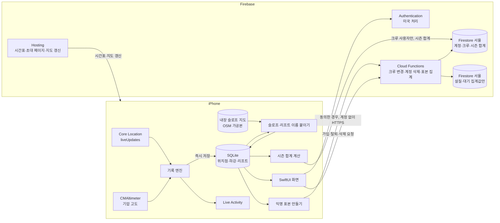
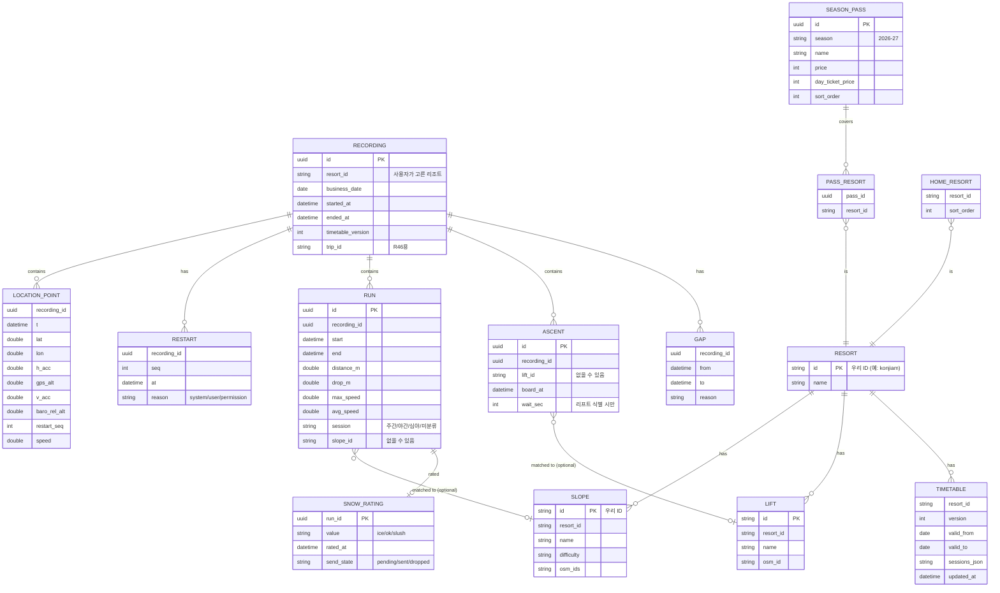
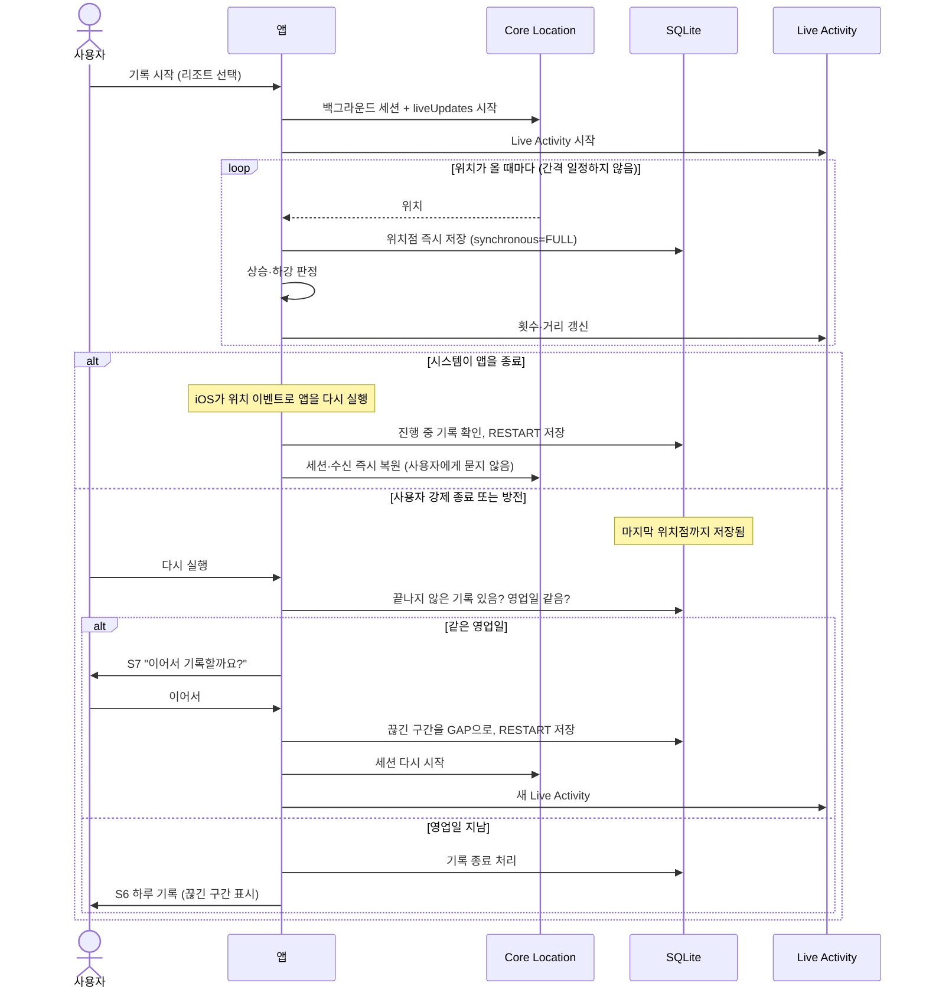

# 05. 기술 설계

작성: 2026-11-08 · 깊이: 충실히 · 상태: 승인 (2026-11-08)

03-requirements의 P0(R1~R23, R31, R32, R33, R34, R35, R36, R39, R49, R50, R51, R52, R53, R54)를 만들기 위한 구조, 데이터, 외부 서비스, 개인정보 보호, 일정을 정한다. 기술 선택은 승인 후 decisions.md에 기록한다.

## 1. 기술 선택 요약

| 영역 | 선택 (제안) | 주된 이유 | 기각한 대안 |
| --- | --- | --- | --- |
| 앱 | **Swift + SwiftUI (iOS 17 이상)** | 백그라운드 위치, 기압계, Live Activity가 모두 Apple 고유 API. Live Activity UI는 SwiftUI로만 만듦 | Flutter, React Native: 핵심 기능이 전부 네이티브 연동이라 이점이 작음 |
| 기기 저장소 | **SQLite (GRDB 라이브러리), WAL + `synchronous=FULL`** | 하강·방문일·시즌 합계를 SQL로 집계하기 쉽고, 트랜잭션과 디스크 동기화 수준을 직접 정할 수 있음(R4) | SwiftData: 명시적 저장은 되지만 대량 위치점 집계와 저장 정책 통제가 GRDB보다 번거로움 |
| 서버 | **Firebase (Authentication + Cloud Firestore 서울 리전)** | 안드로이드도 같은 서버를 씀(R48). Sign in with Apple·Google 지원. Firestore는 서울 리전. **Authentication은 미국에서 처리되므로 국외 이전 고지 필요** (6장) | CloudKit: iPhone 전용(R48 위반). Supabase: 무료 프로젝트는 활동이 없으면 일시 정지. 자체 서버: 1인 개발에 운영 부담 |
| 서버 함수 | **Cloud Functions (Blaze 요금제)** | 크루 가입·탈퇴·소유권 같은 권한 변경과 계정 삭제를 서버 트랜잭션으로 처리. 익명 표본 집계 | 클라이언트 직접 쓰기: 동시 가입, 부분 삭제를 막기 어려움 |
| 지도 데이터 | **OpenStreetMap 가공본을 앱에 내장 + 정적 파일로 갱신** | 산에서 인터넷이 없어도 슬로프 식별. 가공본은 ODbL로 따로 공개 | 실시간 Overpass 조회: 느리고 공용 서버 과부하(조회 실패 경험 있음) |
| 운영 시간표 | **정적 JSON (Firebase Hosting), 버전 포함** | 앱 업데이트 없이 시간표를 고침(R7) | 앱 내장만: 고칠 때마다 앱 심사 |
| 3D 지형 보기 (R50) | **SceneKit** (`SCNView`) | iOS 17.6에서 동작. 격자를 메시로 만드는 API가 단순하고 기기 안에서만 그림. 타일·네트워크 없음 | RealityKit `RealityView`: iOS 18 이상. MapKit 3D 지형: 타일을 받음(R50 오프라인 조건) |
| 날씨 (2.0, R33·R39) | **WeatherKit** | 개발자 멤버십에 월 50만 회 포함. REST API가 있어 안드로이드에서도 사용 가능 | OpenWeatherMap: 무료 하루 1,000회. 기상청 단기예보: 정확도 비교 후 결정(06-verification) |
| 시즌 이용권 (R54) | **StoreKit 2, 기간 고정 구독(Non-Renewing) 상품 하나** | 시즌(11월~4월)에 맞는 기간은 자동 갱신 구독으로 만들 수 없음(1주~1년 단위). StoreKit 2 거래 내역은 같은 Apple 계정의 기기에 동기화되므로 로그인·서버 없이 다른 기기와 복원을 지원. 거래는 기기에서 서명(JWS) 확인 | 자동 갱신 1년·6개월: 비시즌 갱신·환불 불만, 시즌과 안 맞음. 서버 영수증 검증·계정 연동: 로그인 없는 사용자 원칙과 맞지 않고 서버 일이 늘어남. RevenueCat 등: 상품 하나에 의존성 추가 |
| 초대 링크 | **Universal Links + Firebase Hosting** | 앱이 있으면 앱으로 열림. 앱이 없으면 웹페이지가 열리므로 그 페이지에 크루 이름과 앱스토어 링크를 둠 | Firebase Dynamic Links: 2025년에 서비스 종료 |
| 분석·오류 수집 | **App Store Connect와 Xcode Organizer만** | 위치가 외부 도구로 새 나갈 경로를 원천 차단(R17). 의존성 없음 | Firebase Analytics, Crashlytics: 로그에 위치가 섞일 위험, 고지 항목 증가 |

## 2. 전체 구조



**경계선:** GPS 좌표, 경로, 하강별 기록은 기기 밖으로 나가지 않는다. 서버로 가는 것은 시즌 합계(계정과 연결)와 익명 표본(계정과 분리, 서버에서 바로 집계하고 개별 표본은 저장하지 않음) 두 가지뿐이다.

## 3. 기록 엔진 (R2~R4, R7, R10, R23)

### 위치 수집
- iOS 17의 `CLLocationUpdate.liveUpdates`와 `CLBackgroundActivitySession`으로 백그라운드에서 받는다. 이 API는 고정 간격을 보장하지 않고, 멈춰 있으면 수신을 자동으로 쉬었다가 움직이면 다시 보낸다. 그래서 **거리와 공백은 위치점의 실제 시각으로 계산한다.**
- 수신이 끊긴 이유를 구분해 기록한다: 정상 정지(움직임 없음), 위치 획득 실패(신호), 권한 상실, 앱 종료. 앞의 둘은 "기록 없음" 구간이 아니라 정상 기록이다.
- **시스템이 앱을 종료한 경우:** Apple은 백그라운드 위치 세션이 있던 앱을 위치 이벤트로 다시 실행하고, 앱이 세션과 수신을 새로 만들도록 설명한다(WWDC23 10180). 이때는 사용자에게 묻지 않고 저장된 기록 상태를 읽어 **즉시 수신을 복원**한다. 기종·iOS 버전별 신뢰성은 현장 테스트로 확인한다.
- **사용자가 강제 종료하거나 방전된 경우:** iOS가 다시 깨우지 않는다. 다음 실행 때 S7 끊김 복구로 처리한다.

### 고도
- 기압계(`CMAltimeter`)의 상대 고도를 주 입력으로 쓴다. GPS 고도는 오차가 커서 리프트·하강 판정에 불리하다.
- 기압계는 **동작 및 피트니스 권한**이 별도로 필요하다. 권한이 없거나 기기가 지원하지 않으면 GPS 고도와 수직 정확도로 대신 판정하고, 하루 기록에 "고도 정확도 낮음"을 표시한다. → R18(권한)과 S4에 동작 권한 안내 추가 필요(9장).
- 상대 고도는 수신을 시작할 때마다 0에서 다시 시작한다. 재시작 지점을 저장하고, **그 경계를 가로질러 고도차를 계산하지 않는다.**

### 저장 (R4)
- 위치점은 받는 즉시 SQLite 트랜잭션으로 쓴다. `synchronous=FULL`로 전원이 갑자기 꺼져도 완료된 쓰기가 되돌아가지 않게 한다.
- 파일 보호 등급은 "첫 잠금 해제 후 접근 가능"으로 둬서, 화면이 잠긴 동안에도 쓸 수 있게 한다. 잠금 상태 쓰기는 현장 테스트로 확인한다.
- 저장에 실패하면(공간 부족 등) 기록을 멈추고 Live Activity와 앱에 알린다. 조용히 계속하지 않는다.
- 앱 업데이트로 데이터베이스 구조를 바꿀 때는 원본 파일을 먼저 복사해 두고, 변환에 실패하면 원본을 보존한다.
- R4의 "최대 1분 손실"은 **받은 위치 데이터를 잃는 범위**다. 앱이 꺼져 있어 받지 못한 시간은 "기록 없음" 구간으로 표시할 뿐 1분 안으로 보장할 수 없다. → R4 문구 정리 필요(9장).
- 기록 파일은 iOS 기기 백업에 포함된다(기기 교체 시 옮겨짐). 우리 서버로는 가지 않는다.

### 하강·리프트 판정 (R3, 03 5장)
판정은 **지도 없이도 동작**해야 한다. 모든 리조트에서 횟수와 거리를 기록하기 때문이다(03 리조트별 지원 범위).

1. 고도가 꾸준히 오르는 구간 = **상승(리프트) 구간**. 지도가 있으면 OSM 리프트 선과 맞춰 어느 리프트인지 붙이고, 없으면 "알 수 없는 리프트"로 둔다.
2. 상승 구간이 끝난 뒤 고도가 30m 이상(제안값) 내려가면 **하강 1회**. 다음 상승 구간이나 기록 종료까지.
3. 지도가 있는 리조트에서만 하강 경로를 OSM 슬로프 선과 비교해 이름을 붙인다. 겹침이 기준보다 낮으면 "알 수 없는 슬로프".
4. **리프트 대기(R10):** 리프트를 식별한 상승 구간 직전, 탑승장 반경(예: 50m) 안에서 머문 시간. 리프트를 모르거나 탑승으로 이어지지 않은 체류는 버린다.
5. **종료를 잊은 기록(R49):** `CMMotionActivity`가 차량으로 판단한 구간은 하강·거리에서 뺀다. 60분 무하강 알림은 하강이 생길 때마다 로컬 알림 예약을 새로 걸어 앱이 쉬는 동안에도 울리게 한다. 리조트 이탈 알림과 영업일 끝 닫기는 위치를 받을 때 확인한다.
6. 판정 규칙은 **테스트 기록(R22로 받은 파일)과 기대 결과를 짝지어 저장**해 두고, 코드를 고칠 때마다 같은 결과가 나오는지 확인한다. 안드로이드를 만들 때도 같은 파일로 같은 결과를 확인한다(R48).

### Live Activity (R23)
- 기록 시작 시(앱이 화면에 떠 있을 때) 시작하고, 기록 엔진이 백그라운드에서 내용을 갱신한다(소리 없음).
- **제약:** Live Activity는 최대 8시간까지만 활동 상태로 갱신된다. 끝난 뒤 잠금 화면에는 최대 4시간 더 남을 수 있지만 다이나믹 아일랜드에서는 사라진다(Apple 문서). 앱이 백그라운드에 있을 때 `Activity.request`로 새로 시작하면 오류가 난다. 백그라운드 시작 방법은 서버 푸시(push-to-start), 사용자 동작으로 실행되는 `LiveActivityIntent`, 최신 iOS의 예약 시작이 있다.
- **v1 제안:** 8시간이 지나면 Live Activity를 "기록 중 · 앱을 열면 다시 표시"로 끝낸다. 이 카드가 계속 보인다고 약속하지 않는다. **기록은 계속된다.** 사용자가 앱을 열면 새 Live Activity를 시작한다. 서버 푸시는 쓰지 않는다. → R23 문구 수정 필요(9장).

### 배터리 (G4)
- 먼저 `liveUpdates`의 기본 동작(멈추면 자동으로 쉼)만으로 배터리를 잰다. 부족하면 그때 움직임 센서(`CMMotionActivity`)를 이용한 추가 절전을 검토한다.

## 4. 데이터 모델

### 기기 안 (SQLite)



- **ID 규칙:** 슬로프·리프트 ID는 우리가 정한 값이다. OSM ID는 편집 때 바뀔 수 있어 참고용(`osm_ids`)으로만 둔다. D3·D4 표본은 우리 ID를 쓴다(R40·R41 대비).
- **시간표(R7):** 시간표마다 버전과 적용 기간이 있다. 세션은 저장하지 않고 읽을 때 계산하므로, 새 버전이 오면 그 적용 기간의 기록이 자동으로 다시 분류된다. 적용 기간이 겹치면 버전이 큰 것을 쓴다. `updated_at`이 지난 시즌이 끝나기(5월 1일) 전이면 "오래됨"으로 보고 세션을 나누지 않는다. **운영 시간 표시(R34)와 강풍 안내 구간(R35)용 유효성:** 시간표 항목에 `verifiedSeason`(예: "2026-27")을 두고, 리조트 공식 안내와 손으로 대조한 뒤에만 채운다. R34·R35는 같은 판단을 쓴다: `verifiedSeason`이 이번 시즌이고 그날이 적용 기간 안이면 유효, 아니면 미확인. 파일 수정일만으로 확인됐다고 보지 않는다. JSON 키는 다른 필드처럼 `verifiedSeason`이다. 영업일을 덮는 시간표 중 버전이 가장 큰 것을 먼저 고른 뒤 확인 여부를 본다(옛 확인본으로 돌아가지 않음). 비시즌은 미확인이다. 홈은 앞에 있는 동안 5분마다 기준 시각을 새로 잡아 다시 계산하므로, 운영 종료·06:00 영업일 전환은 최대 5분 늦게 반영된다.
- **서버 설정 파일(R7, R9):** Firebase Hosting의 `config.json`(슬로프 이름을 켤 리조트 목록, 크루 동기화·표본 차단 스위치, 내 리프트 대기(R32) 표시 켜기 `liftWait`)과 `timetables.json`(앱 내장 시간표와 같은 형식). 앱은 앞에 있는 동안 1시간에 한 번 받아 기기에 저장하고, 받지 못하거나 형식이 틀리면 마지막으로 받은 값을 쓴다. 시간표는 내장분과 합쳐 쓰며 겹치면 버전이 큰 것을 쓰므로, 고칠 때는 버전을 올린다. 슬로프 이름은 목록에서 빠지면 꺼진다.
- **시즌권(R8):** 시즌권마다 시즌을 둔다. 다음 시즌 시즌권을 등록하거나 고쳐도 지난 시즌 계산은 바뀌지 않는다.
- 시즌 합계, 방문일, 세션은 저장하지 않고 위 테이블에서 계산한다(규칙 변경 시 재계산).

### 내장 고도 격자와 지형 바탕 (R50, K)

하루 기록 지도의 슬로프 선 아래에 지형 음영과 등고선을 그린다. 결정과 기각한 대안은 decisions 2026-11-13, 모양은 07-visual-design 6장 "S6 지형 바탕 v1".

- **데이터:** Copernicus DEM GLO-30. 위경도 1초 간격(국내에서 남북 약 31m, 동서 약 25m) 격자를 다시 계산하지 않고 그대로 잘라 쓴다. 나무·건물 높이가 들어간 표면 고도다.
- **가공:** `tools/dem/build.py`가 `Resources/maps/osm-<리조트>.json`의 슬로프·리프트 범위에 여백(긴 변의 85%, 최소 1,500m)을 더해 자르되 한 변이 400칸을 넘지 않게 여백을 줄인다(`MARGIN`, `MIN_MARGIN_M`, `MAX_CELLS`). 여백은 2D 기본 배율의 세로 화면과 3D의 낮은 시점(3D v4)을 덮기 위한 값이다. 작은 리조트는 넓어지고(지산 127×152칸), 큰 리조트는 상한 때문에 그대로다(하이원 329×352, 용평 319×358). 원본 타일(1도 단위, 국내 12곳은 4장)은 `tools/dem/cache/`에 받고 저장소에 올리지 않는다. GeoTIFF 읽기는 도구에서만 rasterio를 쓴다(`tools/dem/.venv`에 설치, 저장소에 올리지 않음. 준비 명령은 build.py 주석).
- **파일:** `SlopeMate/Resources/maps/dem-<리조트>.json`. `resort_id`, `source`(출처 문구), `generated`, `north`, `west`, `step`(도), `rows`, `cols`, `heights`(0.1m 단위 Int16 리틀 엔디언을 base64로, 북쪽 행부터 서→동). OSM 파일과 합치지 않는다(라이선스가 다름).
- **크기 예산:** 12곳 합쳐 1.5MB 이하, 한 곳 350KB 이하(실측 2026-11-14: 12개 합계 1,412,743바이트, 가장 큰 하이원 309KB·격자 329×352). 넘으면 여백을 줄인다.
- **없는 리조트:** 파일이 없거나 읽지 못하면 바탕 없이 지금처럼 그린다. 출처 표기에서도 고도 데이터를 뺀다.
- **계산 (기기 안):** `Terrain`이 파일을 읽어 리조트별로 한 번만 계산해 메모리에 둔다(`SlopeMap.cached`와 같은 방식). ① 3×3 평균으로 한 번 고르게 한다(나무 높이 잡음). ② 음영: 칸마다 기울기를 구해 빛 방향과의 각도로 밝기를 정하고 격자 크기의 이미지 한 장으로 만든다. 빛은 **화면 기준** 왼쪽 위에서 온다. 지도가 리프트 방향으로 돌아가므로 `MapProjection`으로 화면의 위쪽이 실제 어느 방위인지 구해 빛 방위를 정한다. 밝게·어둡게 판은 색만 다르게 따로 만든다. ③ 등고선: 음영보다 두 번 더 고른 격자에서 20m 간격으로 선분을 뽑아(marching squares) 격자 좌표의 CGPath 2개(20m 가는 선, 100m 굵은 선)로 둔다. 리조트마다 한 번만 만든다(회전·색과 무관).
- **그리기:** `DayMapDrawing.draw`가 바탕색 다음, 슬로프 선 앞에 지형 층을 그린다. 음영 이미지는 격자 세 모서리를 `MapProjection.point`로 옮겨 만든 변환으로 한 번에 그린다(투영이 회전과 배율뿐이라 정확히 맞음). 등고선은 경로를 다시 만들지 않고 음영 이미지와 같은 아핀 변환만 걸어 그린다. 굵기는 확대해도 그대로, 선 끝은 butt. 프레임마다 이미지 1장과 경로 2개(가는 선·굵은 선)만 그린다. 음영 이미지와 등고선 모두 바깥 10%는 바탕색으로 서서히 사라지게 한다.
- **동영상:** `ShareVideo`가 같은 `DayMapDrawing`을 쓰므로 바탕이 그대로 들어간다. 리조트 슬로프·리프트 선과 이름은 그리지 않는다(`layers = .none`, 아래 "지도 표시·난이도 색·슬로프 누르기"). OSM 출처 줄 아래에 Copernicus 출처 문구와 면책 문장 원문을 넣는다(약 5줄, 오른쪽 맞춤).
- **성능 목표:** 가장 큰 리조트에서 읽기와 계산을 합쳐 0.1초 이내, 재생 중 프레임이 떨어지지 않음, 동영상 만드는 시간이 눈에 띄게 늘지 않음. 못 맞추면 등고선을 기본 배율 이미지로 한 번 구워 쓴다.
- **범위 밖:** 등고선 고도 숫자, 봉우리 이름, 고도 격자로 기록 고도 보정. 기울이고 돌려 보는 3D는 화면에만 넣는다(아래 "화면용 3D 보기"). 공유 동영상은 2D다.

### 화면용 3D 보기 (R50, K)

S6의 지도 층을 3D 지형으로 바꿔 볼 수 있다. 결정과 기각한 대안은 decisions 2026-11-13 "화면용 3D 보기", 모양은 07-visual-design 6장 "S6 3D 보기 v1"·"v2 (겨울 산 색)"·"v3 (겨울 산 색 다듬기)". 색·가장자리는 v3을 따른다(decisions 2026-11-13 "3D 겨울 산 색"). **v4(2026-11-14)가 색·눈 띠·시점·과장·경로·슬로프 선을 다시 바꾼다. 아래 글머리표에서 v4와 다른 값은 뒤의 "3D v4" 절을 따른다.**

- **기술:** SceneKit. `SCNView`를 `UIViewRepresentable`로 감싼다. 앱 최소 버전이 iOS 17.6이라 `RealityView`(iOS 18 이상)는 쓰지 못한다. 장면은 내장 고도 격자와 OSM 선만으로 기기 안에서 만든다.
- **2D와 같이 쓰는 것:** 재생 시계(`PlayClock`), 시간 막대, 아래 시트, 하강 선택, 출처 표시, 공유 메뉴는 그대로다. 3D는 `Canvas` 자리의 지도 층만 바꾼다. 2D의 확대·이동 값과 3D 카메라 값은 따로 두고, 전환해도 각자 남는다.
- **진입:** 툴바 오른쪽, 공유 버튼 왼쪽에 전환 버튼(`view.3d` ↔ `view.2d`). 기본은 2D이고 선택을 기억하지 않는다(S6를 열 때마다 2D). 고도 파일이 없는 리조트(`Terrain.layer`가 nil)와 하루 데이터를 읽기 전에는 버튼이 없다. 하강 0회인 날에도 버튼은 있다(지형과 슬로프만).
- **좌표:** 단위는 m. 원점은 슬로프·리프트 경계의 가운데(`MapProjection`과 같은 계산: 모든 점의 위도·경도 최소·최대의 중간). 동쪽 = (경도 − 경도0) × cos(위도0) × 111,320, 북쪽 = (위도 − 위도0) × 111,320. `MapProjection.angle(map)`으로 돌린 u(화면 오른쪽)·v(화면 위)를 장면 x = u, z = −v로 둔다. y = (고도 − 격자 최저 고도) × 과장. 과장 = 1.5 × clamp(750 ÷ 슬로프·리프트 높이 차(1.5배 기준 m), 1, 2.5): 하이원·용평은 1.5배 그대로, 지산은 상한 2.5배 더(3.75배). `Terrain3D`가 리조트마다 정하고 메시·리본·지형 높이·띄우는 높이·카메라가 같은 값을 쓴다. 2D 음영은 1.5배 그대로다. 카메라가 +z 쪽에서 −z를 보면 2D처럼 산 위가 화면 위다.
- **지형 메시:** 격자 칸 중심마다 정점 하나(줄이지 않음. 하이원 329×352 = 115,808개, 삼각형 약 23만 개). 칸마다 삼각형 둘: (r,c)·(r+1,c)·(r,c+1)과 (r,c+1)·(r+1,c)·(r+1,c+1)(위에서 볼 때 시계 반대). 법선은 이웃 칸 높이 차로 구한다. 정점마다 눈 마스크용 UV(열 ÷ (cols − 1), 행 ÷ (rows − 1))를 둔다. 바깥 10%가 사라지는 값(`edge` 1 → 0)은 정점이 아니라 눈 마스크에 둔다.
- **지형 높이 조회:** 메시와 같은 삼각형 분할로 보간한다(선이 면에 묻히지 않게). 칸 안 위치 a(행 방향)·b(열 방향)가 a + b ≤ 1이면 z00 + a(z10 − z00) + b(z01 − z00), 아니면 z11 + (1 − a)(z01 − z11) + (1 − b)(z10 − z11). 격자 밖은 가장 가까운 가장자리 값. `RoutePoint`에는 고도가 없으므로 경로도 이 높이에 붙인다.
- **선(슬로프·리프트·경로):** 지형에 붙인 납작한 리본. 15m보다 긴 구간은 나눠 지형을 따라가게 하고, 리본 양쪽 가장자리 정점마다 높이를 따로 읽는다. 지형 위로 띄우는 높이는 max(2m, 화면 1pt 길이)에 같은 과장 배율(1.5배 대비)을 곱한다. 굵기는 2D의 pt 값(슬로프 3, 리프트 1.5 점선 4·4, 하강 5, 탄 리프트 2.5 점선 5·4, 그 밖 2·알파 0.5, 강조 7)에 "화면 1pt가 목표점에서 몇 m인지"를 곱한 m 값이다. 확대·축소 손짓이 끝났을 때 그 값이 15% 넘게 바뀌었으면 리본을 다시 만든다(손짓 중에는 지형과 함께 커지고 작아짐). 리본끼리는 깊이를 쓰지 않고 그리는 순서(슬로프 < 리프트 < 경로 < 강조 < 점)로 겹친다. 면 슬로프는 테두리 선만 그린다. 슬로프 이름과 등고선은 3D에 그리지 않는다.
- **재질·조명:** v1의 값이다. 지형 색·조명·안개·가장자리는 아래 "겨울 산 색 (v3)"이 바꾼다. 배경은 `Palette.bg`. 지형은 Lambert, 색 `hillLight`. 주변광 + 방향광 하나(그림자 없음)로 빛을 받는 면은 `hillLight`, 등진 면은 `hillShadow`, 평지는 바탕색 근처가 되게 세기를 맞춘다(화면 보고 조정). 빛은 처음 시점 기준 화면 왼쪽 위·높이 45도에서 오고 장면에 고정한다(오는 쪽 x, y, z = −0.5, 0.707, −0.5). 리본은 조명을 받지 않는 단색(`lift`, `fill`, `text`, 슬로프는 밝게 `slopeOnTerrain` `#A9C1C8`·어둡게 3D용 `#4D707C`), 양면. 안개는 바탕색으로 처음 거리 + 반지름 × 2에서 시작해 × 6에서 끝난다. 메시 바깥 10%는 `edge`를 정점 알파로 써서 사라지게 한다. 밝게·어둡게가 바뀌면 색만 바꾼다.
- **겨울 산 색 (v3):** 위 "재질·조명"의 색·세기·안개·가장자리와 "선"의 슬로프 굵기·면 슬로프를 아래로 바꾼다. 데이터는 고도 격자와 OSM 선 그대로다. 색 값은 밝게/어둡게 순서.
    - **정점 색(숲·높은 곳 눈):** `Terrain3D.colors(mesh, dark:)`. 지형 재질의 diffuse는 흰색, 알파는 1. SceneKit은 정점 색을 선형 값으로 읽으므로 sRGB로 섞은 뒤 선형으로 바꿔 넣는다. 정점 (r, c)마다:
        - 빛 받는 정도 `ndl` = max(0, 법선 · 빛 방향). 빛 방향은 (−0.5, 0.707, −0.5)를 정규화한 값.
        - 얼룩 `noise` = 0.7 × 굵은 얼룩 + 0.3 × 잔 얼룩, 0~1. 잔 얼룩은 `hash(r, c)`, 굵은 얼룩은 8칸(약 240m)마다 둔 `hash` 값을 가로·세로로 선형 보간. `hash`는 격자 좌표만 쓰는 정수 해시(`x = r × 73856093 ^ c × 19349663; x ^= x >> 13; x *= 0x5bd1e995; x ^= x >> 15`, 아래 16비트 ÷ 65535). 난수를 쓰지 않아 매번 같은 그림이다.
        - 침엽수 비율 = clamp(0.30 + 0.30 × (1 − `ndl`) + 0.6 × (`noise` − 0.5), 0, 1). 얼룩을 빼면 정면으로 빛을 받는 면 30%, 평지 약 39%, 등진 면 60%. 숲 색 = 활엽수 `#8C8378`/`#44525B`와 침엽수 `#46594A`/`#273E3A`를 이 비율로 섞은 값.
        - 높은 곳 눈 = 0.35 × smoothstep(0.6, 1.0, 상대 고도). 상대 고도 = 정점 높이 ÷ 메시 최고 높이(격자 최저가 0).
        - 정점 색 = 숲 색에 눈 색 `#E9EFF2`/`#768C9B`를 높은 곳 눈만큼 섞은 값.
        - 메시와 격자 크기가 안 맞으면 모두 흰색을 돌려준다.
    - **눈 마스크(슬로프·리프트 눈, 가장자리):** `Terrain3D.snowMask(map:)`이 `SnowMask`(RGBA 8비트 텍스처 하나)를 만든다. 크기는 격자의 4배, 한 변 최대 2048(하이원 1408×1316, 한 칸 약 7m, 약 7.4MB). 첫 행이 북쪽이고 메시 UV로 입힌다. 밝게·어둡게가 같은 텍스처를 쓴다.
        - R 슬로프 눈 = 1 − smoothstep(25, 55, d). d는 가장 가까운 슬로프 선까지 수평 거리(m). 면 슬로프는 안쪽이면 d = 0(홀짝 교차), 바깥이면 테두리까지 거리 + 25.
        - G 리프트 길 눈 = 1 − smoothstep(15, 45, 가장 가까운 리프트 선까지 거리).
        - B 가장자리 = `edge`(1 안쪽 … 0 격자 경계, 바깥 10%).
        - 거리는 텍셀마다 모든 선을 보지 않고, 선 조각을 감싸는 범위(60m 넓힘) 안의 텍셀만 재서 최솟값을 남긴다. 장면 x·z(m)로 잰다.
        - 이미지 색 공간은 linearSRGB로 둬서 SceneKit이 값을 바꾸지 않고 읽게 한다.
    - **셰이더 수정자:** 마스크를 재질의 `multiply` 칸에 실어 surface 수정자에서 읽고 `multiply`는 1로 되돌린다. 정점 색(선형)을 감마 2.2 근사로 sRGB 쪽으로 옮겨, 리프트 길 눈(높은 곳 눈 색, G × 0.6)과 슬로프 눈(`#FFFFFF`/`#9DB2BE`, R)을 차례로 섞고 다시 선형으로 돌린다. 눈 색과 안개 색은 수정자 인자(`slopeSnow`, `liftSnow`, `edgeFog`)로 넘기고 모드가 바뀌면 값만 바꾼다.
    - **가장자리:** 정점 알파를 쓰지 않는다(지형은 불투명). 수정자에서 diffuse × e + emission(안개 색 × (1 − e))로 둬서, 조명을 받은 뒤 바깥 10%가 안개 색이 된다(e = 마스크 B).
    - **밝게·어둡게:** 준비 단계에서 지오메트리 둘(위치·법선·UV·삼각형은 같이 쓰고 색 소스만 다름)을 만들고, 모드가 바뀌면 지형 노드의 지오메트리와 수정자 인자·조명·배경만 바꾼다.
    - **조명:** 주변광 `#A6B1C2`/`#8C97AA`(하늘빛 그늘), 방향광 = 1 − 주변광(선형, 약 `#CEC5B5`/`#DFD9CB`), 세기 기본값, 그림자 없음, 방향은 그대로. 정면으로 빛을 받는 면은 정점 색 그대로, 등진 면은 정점 색 × 그늘 색이다.
    - **배경·안개:** 배경은 세로 그라데이션 이미지(화면 맨 위 `#BFD9EA`/`#070F16` → 위에서 45% 지점 `#D5E3EC`/`#13242D`, 그 아래는 같은 색). 안개 색 `#D5E3EC`/`#13242D`, 카메라 거리(목표점까지) + 반지름 × 0.5에서 시작해 × 5에서 끝난다. 카메라가 움직일 때마다 다시 넣는다.
    - **선:** 슬로프 리본은 1.5pt, 색은 `slope3D`(`#A9C1C8`/`#4D707C`). 눈 띠는 리본으로 만들지 않는다. 리프트 리본은 1.5pt 점선, 색은 3D용 `#34474E`/`#C4D3DA`. 하강·탄 리프트 경로 아래에 양쪽 1pt씩 넓은 테두리 리본(`Palette.dot` `#FFFFFF`/`#0B161B`, 하강 7pt, 탄 리프트 4.5pt 같은 점선)을 하나씩 더 깔고, 하강 강조 아래에도 9pt 테두리를 깐다. 그리는 순서: 슬로프 < 리프트 < 경로 테두리 < 옅은 경로 < 진한 경로 < 강조 테두리 < 강조 < 점. 테두리는 재생 중에도 전체를 그린다.
    - **준비물:** `Map3DTerrain(space:map:)`이 메시, 밝게·어둡게 지오메트리, 눈 마스크 이미지를 한 번에 만든다. `Task.detached`에서 만들고 `Map3DScene.init(space:terrain:map:route:dark:viewport:)`에 넘긴다. 2D 팔레트(`hillLight`, `hillShadow`, `bg`)는 3D에서 쓰지 않는다.
    - **성능(하이원, Release 시뮬레이터 측정):** 눈 마스크 14~28ms(목표 50ms 이내), 정점 색 두 벌 12ms, 버튼 → 3D 표시 약 0.15초. 처음 그릴 때 셰이더 컴파일로 1.67초가 걸렸다(시뮬레이터). 실기기에서 첫 렌더 시간은 확인 필요. 앱 크기는 그대로다.
    - **범위 밖:** 위성 사진, 나무·건물 모형, 마을·도로·논밭 색, 슬로프별 야간 운영 구분, 날짜·적설에 따라 바뀌는 색.
- **재생·강조:** 경로 조각마다 옅은 전체(알파 0.3배)와 진한 앞부분 두 겹. 재생 시각이 없으면 전체를 진하게 그리고 점을 숨긴다. 진한 앞부분은 리본의 `cuts`(입력 점까지의 삼각형 수)로 그릴 삼각형 수만 바꾼다(`SCNGeometryElement.primitiveRange`, 실행 중에 바뀌는지 확인 필요. 안 되면 재생 시각이 걸친 조각 하나만 다시 만든다). 재생 점은 2D와 같은 그림(흰 원 + 테두리 + 옅은 원)을 항상 카메라를 보는 판에 그리고 지형에 가려지지 않게 맨 위에 그린다. 하강 강조는 그 하강 시간 구간의 리본을 굵게 덧그린다.
- **카메라:** 목표점·거리·방위(yaw)·기울기(pitch) 네 값으로 둔다. 시야각은 세로 30도. 처음 시점은 yaw 0(2D와 같은 방향), pitch 45도이고 구가 아니라 슬로프·리프트 선에 맞춘다: 선을 화면에 투영해 보이는 영역(좌우 16, 위 110, 아래 시트 + 24)을 채우는 목표점과 거리를 3회 반복해 구한다. 목표점 높이는 그 자리 지형 높이. 두 번 누르기와 `resetCamera`도 이 시점으로 간다. 구에 맞춘 `Camera3D.home`은 거리 제한의 기준 거리로만 쓴다(구 기준으로는 슬로프가 화면의 40%쯤만 차지). 제한: pitch 20~80도, 거리는 `home` 거리의 0.15~1.3배, 목표점은 구 안(높이는 그 자리 지형 높이), 카메라가 지형 + 30m 아래로 내려가면 pitch를 올린다. pitch가 45도보다 낮을 때는 화면 아래 가운데·양 끝으로 나가는 광선이 닿는 땅의 `edge`가 0.2 이상이 될 때까지 pitch를 1도씩 올린다(최대 45도. 광선은 거리의 1/32씩 최대 3배 거리까지 걷고, 세로 화면 비율 0.46을 가정). 작은 격자(지산)에서 격자 경계가 화면 아래에 보이지 않게 하는 제한이고, 처음 시점 맞춤은 pitch 45도로 고정해 이 제한의 영향을 받지 않는다. 시트 높이가 바뀌면 방향·거리는 그대로 두고 카메라를 화면 세로 방향으로 평행 이동해 목표점이 시트 위 보이는 영역 가운데에 오게 한다.
- **손짓:** 한 손가락 끌기 = 돌리기·기울이기(화면 너비만큼 끌면 180도, 높이만큼 끌면 90도), 두 손가락 벌리기 = 확대, 두 손가락 끌기 = 목표점 이동, 두 번 누르기 = 처음 시점. 관성은 없다. `SCNView.allowsCameraControl`은 쓰지 않는다.
- **재생 중 따라가기:** 2D와 같은 규칙. 재생 점이 시트 위 보이는 영역(안쪽 16pt) 밖으로 나가면 목표점을 점으로 옮긴다. 방위·기울기·거리는 바꾸지 않는다.
- **공유:** 3D에서도 공유 메뉴는 같고 동영상은 2D로 만든다. 3D일 때만 동영상 항목 설명을 "오늘 경로 재생(2D 지도), 12초"로 바꾼다. 알림 창은 더하지 않는다.
- **렌더·배터리:** `rendersContinuously`를 끄고 `isPlaying`을 켜지 않는다. 장면이 바뀔 때(손짓, 재생 시각, 색)만 그린다. 2D로 돌아가면 `SCNView`를 화면에서 뺀다(장면 객체는 S6가 열려 있는 동안 두어 다시 켤 때 바로 보임). S6를 닫으면 장면을 버린다. 계단 현상은 4배 다중 샘플링으로 줄인다.
- **준비:** 전환 버튼을 처음 누를 때 만든다(S6가 바로 열리는 조건을 지킴). `Terrain3D`와 `Map3DTerrain`(메시, 밝게·어둡게 지오메트리, 눈 마스크 이미지)은 메인 스레드 밖(`Task.detached`)에서 만들고, 그동안 2D를 그대로 보여 준다.
- **성능 목표(하이원):** 시뮬레이터(Release)에서 버튼을 누른 뒤 3D가 보이기까지 0.5초 이내, `setPlayback` 한 번 1ms 이내, 3D를 켠 뒤 메모리 증가 60MB 이하(메시 약 12MB + 눈 마스크 약 7.4MB + 프레임 버퍼, 시뮬레이터 수치는 참고). 실기기(M3 실기기 확인 묶음)에서는 지원하는 가장 오래된 기종과 최신 기종에서 돌리기·확대·재생 중 프레임, 5분 조작 뒤 발열·배터리, 메모리 증가, 손을 뗀 뒤 렌더가 멈추는지를 잰다. 프레임이 모자라면 큰 격자만 한 칸 건너 정점을 둔다.
- **접근성:** 3D 장면은 2D 지도와 같이 요소 하나("하이원 3D 지형 지도 위 오늘 경로")로 읽히고, 정보는 시트의 합계·목록이 그대로 준다. 전환 버튼 이름은 "3D로 보기"·"2D로 보기". 동작 줄이기를 켜면 전환·시트 맞춤·따라가기·처음 시점의 카메라 애니메이션을 끄고 바로 옮긴다.
- **개인정보:** 타일이나 고도 데이터를 실행 중에 받지 않는다. 장면은 기기 안에서만 그리고 저장하거나 보내지 않는다(6장).
- **범위 밖:** 3D 공유 동영상, 건물·나무, 위성 사진, 봉우리 이름, 슬로프 이름 상시 라벨(눌러서 보는 이름은 "지도 표시·난이도 색·슬로프 누르기"), 등고선, 관성, 2D·3D 선택 기억. 면 슬로프는 v2에서 눈으로 채운다.
- **자르는 순서:** 1단계(지형 메시 + 슬로프·리프트 + 경로 전체, 카메라·손짓, 전환 버튼, 시트 맞춤)와 2단계(재생 점·진한 앞부분·하강 강조·따라가기)를 모두 넣었다. 제출 전 실기기 성능 확인을 못 마치면 전환 버튼을 빼고 3D 전체를 2.1로 넘긴다(03-requirements R50 문장도 되돌림).

**파일 분할과 경계 API (동시에 구현)**

네 묶음이 서로 다른 파일만 고친다. `DayMap.swift`, `Terrain.swift`, `ShareVideo.swift`는 고치지 않는다. 프로젝트가 폴더를 그대로 읽으므로 새 파일은 `SlopeMate/`와 `SlopeMateTests/`에 두면 된다(`project.pbxproj` 수정 없음). 프로젝트 기본 격리가 MainActor라서 순수 계산 타입에는 `nonisolated`를 직접 적는다.

| 묶음 | 파일 | 맡는 일 | 기대는 것 |
| --- | --- | --- | --- |
| 3D-A | `SlopeMate/Map/Terrain3D.swift` (새 파일) | 좌표 변환, 지형 높이, 메시 배열, 리본 배열, 배열 → `SCNGeometry` | `Terrain`, `SlopeMap`, `MapProjection.angle` |
| 3D-B | `SlopeMate/Map/Map3DScene.swift` (새 파일) | `Camera3D`(순수 계산), 장면: 지형·선·점 노드, 재질·조명·안개, 재생·강조 갱신, 카메라 놓기 | 3D-A API, `DayMapDrawing.Palette`, `RouteSegment`, `RunDetector.Run` |
| 3D-C | `SlopeMate/Map/Map3DView.swift` (새 파일), `SlopeMate/Map/DayMapView.swift` | `SCNView` 감싸기·손짓·따라가기, 전환 버튼, 장면 준비, 시트·재생·강조 연결, 공유 설명, 접근성 | 3D-A·3D-B API |
| 3D-D | `SlopeMateTests/Terrain3DTests.swift` (새 파일) | 3D-A와 `Camera3D` 단위 테스트(06-verification R50) | 3D-A API, `Camera3D` |

3D-A (`Terrain3D.swift`)

```swift
import Foundation
import simd
import SceneKit

/// 장면 좌표계와 지형. 값 타입, 순수 계산. 어느 스레드에서나 만든다
nonisolated struct Terrain3D: Sendable {
    /// 고도 과장. 1.5 × clamp(750 / 슬로프·리프트 높이 차(1.5배 기준 m), 1, 2.5). 메시·리본·높이·카메라가 같이 쓴다
    let exaggeration: Float
    let terrain: Terrain
    /// 원점 위경도(MapProjection과 같은 계산), 회전각(MapProjection.angle), y = 0인 고도(격자 최저, m)
    let lat0, lon0, angle, baseHeight: Double
    /// 슬로프·리프트 전체를 감싸는 구 (지형 위 점들 기준). 카메라 거리·목표점 제한용
    let center: SIMD3<Float>
    let radius: Float

    init(terrain: Terrain, map: SlopeMap)

    /// 위경도 → 장면 (x, z), m
    func xz(lat: Double, lon: Double) -> SIMD2<Float>
    /// 장면 (x, z) → 위경도 (xz의 역)
    func coordinate(_ xz: SIMD2<Float>) -> (lat: Double, lon: Double)
    /// 지형 높이 y (과장 적용, 최저 고도 기준). 메시와 같은 삼각형 보간, 격자 밖은 가장자리 값
    func height(lat: Double, lon: Double) -> Float
    func height(_ xz: SIMD2<Float>) -> Float
    /// 지형 위 점. lift: 지형 위로 띄우는 높이(m)
    func point(lat: Double, lon: Double, lift: Float = 0) -> SIMD3<Float>

    struct Mesh: Sendable {
        var positions: [SIMD3<Float>]   // rows × cols, 행 우선(북쪽 행부터)
        var normals: [SIMD3<Float>]     // 단위 벡터, y > 0
        var uv: [SIMD2<Float>]          // (열 / (cols − 1), 행 / (rows − 1)). 눈 마스크 텍스처용
        var indices: [UInt32]           // 삼각형, (rows − 1)(cols − 1) × 6
    }
    func mesh() -> Mesh

    /// 장면 (x, z)의 가장자리 값: 1 안쪽 … 0 격자 경계(바깥 10%), 격자 밖은 음수
    func edge(_ xz: SIMD2<Float>) -> Float
    /// 정점 색(선형, 알파 1): 숲 + 높은 곳 눈
    func colors(_ mesh: Mesh, dark: Bool) -> [SIMD4<Float>]
    /// 눈 마스크: R 슬로프 눈, G 리프트 길 눈, B 가장자리. 격자의 scale배(한 변 최대 2048), 첫 행이 북쪽
    struct SnowMask: Sendable {
        let width, height: Int
        let bytes: [UInt8]              // RGBA 8비트
        var image: CGImage? { get }     // linearSRGB
    }
    func snowMask(map: SlopeMap, scale: Int = 4) -> SnowMask

    struct Ribbon: Sendable {
        var positions: [SIMD3<Float>]
        var indices: [UInt32]           // 삼각형, 입력 순서대로
        var cuts: [Int]                 // cuts[i] = 입력 점 i까지 그릴 때의 삼각형 수. 개수는 입력 점 수, 마지막 = indices.count / 3
    }
    /// 위경도 선 → 지형 위 리본. width·lift·dash·maxStep은 m. dash가 있으면 on만큼 그리고 off만큼 비운다. 점이 2개 미만이면 빈 리본
    func ribbon(_ line: [(lat: Double, lon: Double)], width: Float, lift: Float,
                dash: (on: Float, off: Float)? = nil, maxStep: Float = 15) -> Ribbon
}

nonisolated extension Terrain3D.Mesh {
    /// 위치·법선·UV·색(선형) 소스와 삼각형 요소 하나. 재질은 붙이지 않는다
    func geometry(colors: [SIMD4<Float>]) -> SCNGeometry
}
nonisolated extension Terrain3D.Ribbon {
    /// 위치 소스와 삼각형 요소 하나(법선 없음: 단색 재질용)
    func geometry() -> SCNGeometry
    /// 여러 리본을 한 지오메트리로(슬로프 전체, 리프트 전체). cuts는 버린다
    static func geometry(_ ribbons: [Terrain3D.Ribbon]) -> SCNGeometry
}
```

- `SCNGeometry`는 Sendable이 아니다. 리본의 `geometry()`는 3D-B가 MainActor에서 부른다. 지형 지오메트리는 `Map3DTerrain`이 메인 스레드 밖에서 만들어 장면에 붙이기 전에 넘긴다(`@unchecked Sendable`).
- `SIMD3<Float>`의 stride는 16바이트다. `SCNGeometrySource(data:…)`의 `dataStride`에 그 값을 넘긴다.

3D-B (`Map3DScene.swift`)

```swift
import SceneKit
import simd

/// 카메라 값. 순수 계산이라 테스트한다
nonisolated struct Camera3D: Equatable, Sendable {
    var target: SIMD3<Float>    // 바라보는 점
    var distance: Float         // target까지 m
    var yaw: Float              // 라디안. 0 = 처음 방향(카메라가 +z 쪽). 커지면 카메라가 +x 쪽으로 돈다
    var pitch: Float            // 라디안. 수평에서 내려다보는 각

    static let fovY: Float = 30 * .pi / 180
    static let pitchRange: ClosedRange<Float> = (20 * .pi / 180)...(80 * .pi / 180)
    /// 거리 제한: 처음 거리의 0.15~1.3배
    static let zoomRange: ClosedRange<Float> = 0.15...1.3

    /// 구가 들어오는 시점. 거리 제한의 기준 거리로만 쓴다(화면의 처음 시점은 Map3DScene이 선에 맞춰 정함). viewport는 화면 전체 크기(pt)
    static func home(_ space: Terrain3D, viewport: CGSize) -> Camera3D
    /// 제한을 적용한 값 (pitch, 거리는 home의 0.15~1.3배, 목표점 위치·높이, 지형 아래로 내려가지 않기)
    func clamped(_ space: Terrain3D, home: Camera3D) -> Camera3D
    /// target + distance × (sin yaw · cos pitch, sin pitch, cos yaw · cos pitch)
    var position: SIMD3<Float> { get }
    /// 목표점 거리에서 화면 1pt의 길이(m) = 2 · distance · tan(fovY / 2) / viewportHeight
    func metersPerPoint(viewportHeight: CGFloat) -> Float
}

/// 3D 지형 준비물: 밝게·어둡게 지오메트리(색 소스만 다름)와 눈 마스크 이미지. Task.detached에서 만든다
nonisolated struct Map3DTerrain: @unchecked Sendable {
    let light, dark: SCNGeometry
    let snow: CGImage?
    init(space: Terrain3D, map: SlopeMap)
}

/// S6 3D 장면. 노드·재질·카메라를 가진다. MainActor(프로젝트 기본)
final class Map3DScene {
    let scene: SCNScene
    let cameraNode: SCNNode
    private(set) var camera: Camera3D
    /// 재생 점의 장면 좌표. 점이 없으면 nil (따라가기용)
    private(set) var dot: SIMD3<Float>?

    /// route: 하강 0회면 빈 배열. viewport: 화면 전체 크기(pt). 카메라는 처음 시점
    init(space: Terrain3D, terrain: Map3DTerrain, map: SlopeMap, route: [RouteSegment], dark: Bool, viewport: CGSize)

    // 모양
    func setDark(_ dark: Bool)
    /// nil: 경로 전체를 진하게, 점 숨김. 값이 같으면 아무것도 하지 않는다
    func setPlayback(_ now: Date?)
    func setHighlight(_ run: RunDetector.Run?)

    // 카메라. 모두 제한을 적용하고 cameraNode를 옮긴다. dx·dy는 pt
    /// 화면 크기와 가려지는 높이(위 110, 아래 시트 높이 + 24)가 바뀔 때
    func setViewport(_ size: CGSize, topInset: CGFloat, bottomInset: CGFloat, animated: Bool)
    func orbit(dx: CGFloat, dy: CGFloat)
    func zoom(by factor: CGFloat)
    func pan(dx: CGFloat, dy: CGFloat)
    /// 손짓이 끝남: 화면 1pt 길이가 15% 넘게 바뀌었으면 리본을 다시 만든다
    func gestureEnded()
    /// 슬로프·리프트 선에 맞춘 처음 시점으로
    func resetCamera(animated: Bool)
    /// 목표점을 p로 (따라가기)
    func center(on p: SIMD3<Float>, animated: Bool)
}
```

- `animated`가 true면 0.25초 `SCNTransaction`, false면 바로. 동작 줄이기 판단은 부르는 쪽(3D-C)이 한다.
- 리본 만들기는 3D-A의 `ribbon`을 MainActor에서 그대로 부른다(하루 경로와 리조트 선 전체가 몇 ms).

3D-C (`Map3DView.swift`, `DayMapView.swift`)

```swift
/// SCNView 감싸기. 손짓(끌기·벌리기·두 손가락 끌기·두 번 누르기)을 장면 카메라 함수로 넘긴다
struct Map3DView: UIViewRepresentable {
    let scene: Map3DScene
    var now: Date?
    var highlight: RunDetector.Run?
    var dark: Bool
    /// 시트 높이 + 24
    var bottomInset: CGFloat
    var reduceMotion: Bool
}
```

- `updateUIView`에서 `setDark`, `setPlayback`, `setHighlight`, `setViewport`를 부르고, 재생 점이 보이는 영역 밖이면(`SCNView.projectPoint`) `center(on:)`.
- `DayMapView`: `@State is3D`(기본 false, 저장하지 않음), `@State scene3D: Map3DScene?`. 버튼을 처음 누르면 `Task.detached`로 `Terrain3D(terrain:map:)`과 `Map3DTerrain(space:map:)`을 만들고 MainActor에서 `Map3DScene`을 만든 뒤 `is3D`를 켠다. 고도 격자는 `Terrain.layer(…)?.terrain`에서 꺼낸다(다시 읽지 않음). `is3D`면 `Canvas` 대신 `Map3DView`. 툴바 버튼, 공유 동영상 설명, 접근성 이름, 동작 줄이기(`accessibilityReduceMotion`)를 잇는다.

3D-D (`Terrain3DTests.swift`)

Swift Testing. 고도는 기운 평면 격자(`TerrainTests`와 같은 방식), 지도는 JSON으로 만든 작은 `SlopeMap`. 확인 항목은 06-verification R50 "3D 보기" 단위 테스트 줄.

### 지도 표시·난이도 색·슬로프 누르기 (R50, R9, K)

2D와 3D 지도가 같이 쓰는 규칙이다. 결정은 decisions 2026-11-14 "지도 슬로프는 난이도 색 실선", "지도에서 누른 슬로프의 이름", "공유 동영상에는 슬로프·리프트 선을 그리지 않는다". 모양은 07-visual-design 6장 "S6 지도 난이도 색 v1"·"S6 지도 표시 메뉴 v1"·"슬로프 이름 말풍선 v1"·"공유 동영상 v2".

- **난이도 단계:** `SlopeMap.Slope.difficulty`(OSM `piste:difficulty`)를 다섯 단계로 묶는다. novice·easy → 초급, intermediate → 중급, advanced → 상급, expert·freeride·extreme → 최상급, 그 밖과 nil → 정보 없음. 내장 12곳의 슬로프 205개 중 34개가 정보 없음이다.
- **색:** 밝게/어둡게 순서로 초급 `#2E9E4F`/`#4CC46F`, 중급 `#3A4FB8`/`#7C8FF0`, 상급 `#D93A3A`/`#FF6B6B`, 최상급 `#111418`/`#111418`, 정보 없음 `#7C8A90`/`#7C8A90`. 2D 어둡게의 최상급만 선 아래에 양쪽 0.5pt 넓은 테두리 `#8A979D`를 깐다(밝은 리프트 선과 겹쳐 굵어 보여 낮춤). 3D는 눈 띠 위에 그리므로 어둡게에서도 밝게 값을 쓴다(`dark: false`로 부름).
- **2D 그리기:** `DayMapDrawing`이 슬로프를 단계 색 2.5pt 실선으로 긋는다(회색 3pt를 바꿈). 면 슬로프는 같은 색 알파 0.2로 채우고 테두리를 긋는다. 지형 바탕이 있든 없든 같은 색이다(`Palette.slope`·`slopeOnTerrain`은 슬로프 선에 더 쓰지 않는다). 리프트 점선은 그대로다.
- **표시 설정:** `MapLayers`(슬로프·리프트 켬·끔). `DayMapView`가 `@AppStorage("mapShowSlopes")`·`@AppStorage("mapShowLifts")`(Bool, 기본 true)로 기기에 기억한다. 리조트·날짜와 상관없는 한 값이고 서버로 보내지 않는다. 2D는 `DayMapDrawing.layers`, 3D는 `Map3DScene.setLayers`로 넘긴다.
    - 슬로프 끔: 2D는 슬로프 선·면 채우기를 그리지 않는다. 3D는 색 선 노드만 숨기고 눈 띠(마스크 텍스처)는 그대로 둔다. 누르기 판정을 하지 않고 떠 있던 말풍선을 닫는다.
    - 리프트 끔: 2D·3D의 리프트 점선과 3D 승·하차장 점을 숨긴다. 3D 리프트 길 눈은 그대로다. 내 경로(탄 리프트 점선 포함)는 표시 설정과 상관없이 그린다.
    - R9 통과 리조트의 2D 이름 라벨(`showNames`)은 슬로프를 끄면 같이 꺼진다.
- **메뉴:** 툴바의 3D 전환 버튼 왼쪽에 `Menu`(아이콘 `map`, 접근성 이름 "지도 표시"). `Toggle` 둘("슬로프", "리프트")과 `Section("난이도")` 아래 범례 5줄(색 점 + 초급·중급·상급·최상급·정보 없음, 누를 수 없음). 지도형 S6에만 있고 고도 파일·이용권과 상관없다. 메뉴가 색 점 이미지를 제 색으로 그리는지는 확인 필요(안 되면 작은 팝오버).
- **누르기 판정:** 2D와 3D가 같은 함수 `SlopePick.nearest`를 쓰고 투영만 다르게 넘긴다. 슬로프 선의 점을 화면 좌표로 옮긴 뒤 누른 점에서 선분까지의 화면 거리를 재서, 허용 거리 22pt 안에서 가장 가까운 슬로프를 고른다. 면 슬로프는 안쪽이면 거리 0(홀짝 교차). 투영이 nil인 점에 걸친 선분은 건너뛴다. 거리가 같으면 `map.slopes`에서 앞선 것.
    - 2D 투영: `proj.point(lat, lon).applying(확대·이동 변환)`. `Canvas`에 `SpatialTapGesture`.
    - 3D 투영: `SCNView.projectPoint(scene.space.point(lat:lon:))`의 x·y. 카메라 뒤(z ≥ 1)면 nil. `Map3DView`의 한 번 누르기 인식기(두 번 누르기가 실패한 뒤 인식)가 판정해 `onTap`으로 넘긴다. 능선 뒤에 가려진 슬로프도 잡힐 수 있다(확인 필요: 거슬리면 누른 점의 지형 `hitTest` 깊이보다 먼 점을 뺀다).
- **말풍선:** `DayMapView`가 `@State picked: SlopePick.Hit?`를 두고 지도 위에 SwiftUI 뷰 `SlopeBalloon`을 겹친다. 위치는 `Hit.anchor`(화면 좌표) 위 12pt, 좌우 16pt 안으로 밀어 넣는다. 글: 이름 또는 "이름 정보 없음", 단계 낱말이 있으면 " · 상급". 지도 손짓이 시작되거나, 빈 곳을 누르거나, 2D ↔ 3D를 바꾸거나, 슬로프를 끄면 `picked = nil`. 화면 좌표에 고정이라 지도가 움직이면 닫는다(따라 움직이지 않음).
- **R9와의 관계:** `SlopeNames.isShown`(하강에 붙이는 이름, 2D 이름 라벨)은 그대로 R9 통과 리조트만이다. 누르기는 이 값을 보지 않는다.
- **동영상:** `ShareVideo`는 `DayMapDrawing`을 받아 `layers = .none`, `showNames = false`로 바꿔 그린다. 지형 바탕·내 경로·출처 표기는 그대로다.
- **접근성:** 지도는 요소 하나로 읽히므로 VoiceOver로는 슬로프를 누를 수 없다. 메뉴의 체크 항목과 범례는 읽힌다. 색만으로 구분하지 않도록 범례와 말풍선에 단계 낱말을 함께 적는다.
- **범위 밖:** 이름 상시 라벨(2D·3D 모두, decisions 2026-11-14), 슬로프 번호, 리프트 이름 누르기, 하강 카드, 말풍선이 지도를 따라 움직이기.

### 3D v4 (R50, K)

"화면용 3D 보기"의 값과 규칙 가운데 아래를 바꾼다. 결정은 decisions 2026-11-14 "3D v4", 모양은 07-visual-design 6장 "S6 3D 보기 v4". 지형 색·눈 띠·질감은 아래 "3D v5"가 바꾼다. 색은 밝게/어둡게 순서이고 스냅샷으로 조정할 출발점이다. 적지 않은 것(좌표, 메시, 지형 높이 조회, 재생·강조, 손짓, 따라가기, 렌더·배터리, 공유, 개인정보)은 그대로다.

- **고도 과장:** 1.5 × clamp(550 ÷ 슬로프·리프트 높이 차(1.5배 기준 m), 1, 1.7). 하이원·용평 1.5배, 지산 2.55배.
- **가장자리(`edge`):** 네모가 아니라 원형. 격자 중심에서의 수평 거리 ÷ (격자 짧은 변 길이의 절반)이 0.8 → 1.0일 때 1 → 0, 그 밖은 음수. 눈 마스크 B와 카메라의 낮은 기울기 제한이 같은 값을 쓴다.
- **팔레트(`WinterPalette`):** 활엽수 `#8F989F`/`#2B3A52`, 침엽수 `#3E5650`/`#16243A`, 높은 곳 눈 `#E9EFF2`/`#768C9B`, 바닥 눈 `#DDE6EC`/`#6F86A8`, 슬로프 눈 `#F6F9FC`/`#EAF1FB`, 그늘(주변광) `#93A6C6`/`#6E7FA6`, 하늘 맨 위 `#8FBDE4`/`#1C2A44`, 하늘 45% 지점 `#C9DFF0`/`#5C7396`, 안개 `#DCE8F0`/`#3A4E6E`, 눈 띠 발광 0/0.3, 조명 번짐 색 `#BFD4FF`(어둡게만), 그림자 밝기 0.62/0.8, 골 음영 세기 0.12/0.2. 3D의 색은 모두 이 타입 하나에 둔다.
- **정점 색(`colors`):** 빛 방향 `L` = normalize(−0.58, 0.57, −0.58)(해 높이 35도). 얼룩은 굵은 얼룩만 쓴다(잔 얼룩 `hash(r, c)` 항 삭제, `noise` = 굵은 얼룩). 순서:
    1. 숲 색: 침엽수 비율 규칙은 v3 그대로.
    2. 바닥 눈: smoothstep(0.80, 0.97, 법선 y) × (0.25 + 0.35 × `ndl`)만큼 바닥 눈 색을 섞는다(최대 60%).
    3. 높은 곳 눈: 0.6 × smoothstep(0.45, 1.0, 상대 고도).
    4. 드리운 그림자: 칸에서 `L`의 수평 방향으로 한 칸씩 최대 48칸 걸으며 (그 칸 높이 − 내 높이) ÷ 수평 거리의 최댓값 t를 구한다(높이는 과장 적용 값). `shade` = smoothstep(0, 0.07, t − 0.70)(0.70 = tan 35도). 색 × mix(1, 그림자 밝기, `shade`).
    5. 골 음영: `ao` = clamp((내 높이 − 7×7칸 평균 높이) ÷ 60m, −1, 1)(과장 적용 값). 색 × (1 + 골 음영 세기 × `ao`).
- **눈 마스크(`snowMask`):** 덮임 값 대신 거리를 넣는다. R = 가장 가까운 슬로프 선까지 수평 거리, G = 리프트 선까지 거리, 둘 다 `255 × min(d, 64) ÷ 64`(선 위 0, 64m 이상 255, 한 단계 0.25m). 면 슬로프 안쪽은 0, 바깥은 테두리까지 거리(v3의 +25 삭제). B = `edge`(원형). 거리를 재는 범위는 선 조각 둘레 70m. 크기와 색 공간은 v3 그대로.
- **셰이더 수정자:** 인자 `slopeW`(슬로프 반폭 m), `liftW`(8), `glow`, `rimColor`를 더한다. `d = R × 64`, `a = fwidth(d)`(안 되면 화면 1pt 길이 인자), `snow = 1 − smoothstep(slopeW − a, slopeW + a, d)`. 밝게는 띠 바깥 0~6m를 색 × 0.82(나무 그늘 테두리), 어둡게는 띠 바깥 0~14m에 `rimColor`를 20%까지 섞는다(조명 번짐). 리프트 길 눈은 같은 식에 반폭 `liftW`, 세기 0.5, 높은 곳 눈 색. 슬로프 눈을 섞은 뒤 `emission += 슬로프 눈 색 × snow × glow`. `slopeW` = max(16, 2.5 × 화면 1pt 길이)를 카메라가 바뀔 때마다 넣는다(보이는 폭 32m, 멀리서도 최소 5pt).
- **숲 질감:** `Terrain3D.forestTexture()`가 256×256 회색 이미지를 만든다. 밝기 0.82 바탕에 지름 2~3px의 밝은 점(1.0)을 면적의 약 35%로 흩는다. 위치는 `hash`로 정해 매번 같다. 지형 재질의 `diffuse.contents`에 넣고 `wrapS`·`wrapT` = repeat, 밉맵 켬, `contentsTransform` 배율 = `space.forestRepeat`(격자 가로·세로 길이 m ÷ 180). 눈 띠와 가장자리는 수정자가 그 위에 섞는다.
- **조명·하늘:** 방향광은 (−0.58, 0.57, −0.58)에서 온다. 주변광은 팔레트의 그늘 색, 방향광 = 1 − 주변광(선형). 실시간 그림자는 쓰지 않는다. 배경 그라데이션은 맨 위 → 45% 지점 → 60% 지점부터 안개 색.
- **카메라:** 처음 pitch 34도. 처음 시점 맞춤의 위 여백 150. 낮게 기울일 때 격자 경계를 가리는 제한의 기준도 34도(34도보다 낮을 때만 세우고 최대 34도까지). 그 밖의 제한은 그대로.
- **슬로프 선:** 난이도 단계별로 리본을 묶어 지오메트리 5개(단계마다 단색 재질). 1.5pt, 색은 `SlopeStyle.color(difficulty:dark: false)`. 면 슬로프는 테두리 선. `setLayers`로 숨긴다.
- **리프트:** 점선은 그대로(1.5pt, `#34474E`/`#C4D3DA`). 리프트마다 양 끝에 승·하차장 점: 재생 점과 같은 방식(카메라를 보는 판 + 이미지 + 화면 1pt 길이 배율)으로 6pt 원, 점선과 같은 색, 테두리 1pt `#FFFFFF`/`#0B161B`. 지형에 가려진다(깊이 읽기 켬). 그리는 순서는 리프트 다음.
- **경로:** ① 리본 폭 고정: 두 가장자리 정점 l·r을 구한 뒤 m = (l + r) ÷ 2, l = m + normalize(l − m) × 폭 ÷ 2(r도 같게). ② 표시용 스무딩: 경로 리본만 Chaikin 2회(`smooth: 2`). `cuts`는 입력 점 기준 그대로 돌려준다(개수 = 입력 점 수, 늘기만 함, 마지막 = 삼각형 수). ③ 하강 4.5pt, 테두리는 양쪽 1.25pt(하강 7pt, 탄 리프트 5pt, 강조 9.5pt). ④ 번짐 리본: 하강 경로 아래 12pt, 같은 색 알파 0.22, 어둡게는 더하기 섞기(`blendMode = .add`). 그리는 순서: 슬로프 색 선 < 리프트 < 승·하차장 점 < 경로 번짐 < 경로 테두리 < 옅은 경로 < 진한 경로 < 강조 테두리 < 강조 < 재생 점.
- **처음 열 때:** `Map3DView`가 `SCNView.prepare(_:completionHandler:)`로 장면을 미리 그려 셰이더를 데운 뒤 `onReady`를 부르고, `DayMapView`가 그때 0.2초 겹쳐 바꾼다(그 전까지 2D). `flyIn`이 true면 `onReady`와 함께 날아 들어온다: (yaw + 0.38rad, pitch 62도, 거리 × 1.35) → 처음 시점, 1.1초, 진행 = 1 − (1 − t)³. 프레임마다 `Camera3D` 값을 보간해 제한·안개·눈 띠 폭이 같이 간다(제한에 걸리면 제한 값). 그동안만 계속 그린다. 손짓이 시작되면 그 자리에서 멈춘다. `DayMapView`는 장면을 만든 뒤 첫 표시이고 동작 줄이기가 꺼져 있을 때만 `flyIn`을 켠다.
- **성능:** 그림자 굽기는 하이원 11.6만 칸 × 48칸으로 10~25ms 추정(확인 필요), 질감 텍스처 약 5ms. 버튼 → 3D 표시 0.5초, 메모리 증가 60MB 목표는 그대로다. 첫 표시는 셰이더 데우기만큼 늦어질 수 있다(실기기 확인).
- **범위 밖:** 고도 배지, 3D 등고선, 재생 점 3D 마커·꼬리, 부드러운 따라가기, 손짓 관성, S18 3D 미리보기, 하강 카드, 속도색 경로, 공중 케이블 리프트, 3D 공유 동영상.

**v4 파일 분할과 경계 API (동시에 구현)**

(0)을 먼저 넣으면 (b)(c)(d)는 서로 기다리지 않는다. 각 묶음은 자기 파일만 고친다.

| 묶음 | 파일 | 맡는 일 | 기대는 것 |
| --- | --- | --- | --- |
| (0) | `SlopeMate/Map/MapStyle.swift` (새 파일), `SlopeMateTests/MapStyleTests.swift` (새 파일) | `MapLayers`, `SlopeStyle`, `SlopePick`과 단위 테스트 | `SlopeMap` |
| (a) | `tools/dem/build.py`, `Resources/maps/dem-*.json` | 여백 최소 1,500m·한 변 400칸 상한으로 12곳 다시 만들기 | 없음 |
| (b) | `SlopeMate/Map/Terrain3D.swift`, `SlopeMateTests/Terrain3DTests.swift` | 과장, 원형 `edge`, `WinterPalette`, `colors`(바닥 눈·그림자·골 음영), 거리 마스크, `forestTexture`, `ribbon`(폭 고정·`smooth`). 이 테스트 파일의 `Camera3D` 기대값(34도)도 함께 고침 | (a) 파일 |
| (c) | `SlopeMate/Map/Map3DScene.swift`, `SlopeMate/Map/Map3DView.swift`, `SlopeMateTests/Map3DSceneTests.swift` (새 파일) | 조명·하늘·질감 입히기, 셰이더, 카메라 34도, 난이도 색 선, 승·하차장 점, 경로 번짐·테두리, `setLayers`, 미리 데우기·`flyIn`, 3D 누르기 | (0), (b) API |
| (d) | `SlopeMate/Map/DayMap.swift`, `SlopeMate/Map/DayMapView.swift`, `SlopeMate/Records/ShareVideo.swift`, `SlopeMate/Map/SlopeBalloon.swift` (새 파일) | 2D 난이도 색·`layers`, 2D 누르기, 지도 표시 메뉴, 말풍선, `Map3DView` 새 인자 연결, 동영상에서 선 빼기 | (0), (c)의 `Map3DView` 인자 |

(0) `MapStyle.swift`

```swift
import UIKit

/// 지도 표시 설정. DayMapView가 @AppStorage("mapShowSlopes")·("mapShowLifts")로 기억한다
nonisolated struct MapLayers: Equatable, Sendable {
    var slopes = true
    var lifts = true
    /// 공유 동영상: 슬로프·리프트 선 없음
    static let none = MapLayers(slopes: false, lifts: false)
}

/// 슬로프 난이도 단계와 색 (07-visual-design "S6 지도 난이도 색 v1")
nonisolated enum SlopeStyle {
    enum Level: CaseIterable, Sendable { case beginner, intermediate, advanced, expert, unknown }
    /// OSM piste:difficulty → 단계. novice·easy / intermediate / advanced / expert·freeride·extreme / 그 밖·nil
    static func level(_ difficulty: String?) -> Level
    /// sRGB hex. 3D 눈 띠 위 선은 dark: false로 부른다
    static func hex(_ level: Level, dark: Bool) -> UInt32
    static func color(difficulty: String?, dark: Bool) -> UIColor
    /// 2D 어둡게의 최상급만 0x8A979D(선 아래 양쪽 0.5pt), 나머지는 nil
    static func casing(_ level: Level, dark: Bool) -> UInt32?
    /// "초급"·"중급"·"상급"·"최상급". unknown은 nil(범례에서는 "정보 없음")
    static func label(_ level: Level) -> String?
}

/// 지도에서 누른 슬로프 찾기. 2D·3D가 투영만 다르게 넘긴다
nonisolated enum SlopePick {
    struct Hit: Equatable, Sendable {
        let slopeId: String
        let name: String?           // OSM 이름. nil이면 "이름 정보 없음"
        let difficulty: String?
        let anchor: CGPoint         // 선 위에서 누른 점과 가장 가까운 점(화면 좌표). 말풍선 자리
    }
    /// 허용 거리(pt)
    static let tolerance: CGFloat = 22
    /// project: [위도, 경도] → 화면 좌표. 보이지 않으면 nil(그 점에 걸친 선분은 건너뜀)
    static func nearest(to point: CGPoint, in map: SlopeMap, tolerance: CGFloat = tolerance,
                        project: ([Double]) -> CGPoint?) -> Hit?
}
```

(b) `Terrain3D.swift`에서 바뀌는 것(나머지 시그니처는 그대로)

```swift
nonisolated extension Terrain3D {
    /// 눈 마스크 R·G의 255가 뜻하는 거리(m)
    static let maskRange: Float = 64
    /// 숲 질감 타일 한 변(m)
    static let forestTile: Float = 180
    /// 침엽수 점묘 질감(256², 회색, 밝기 0.82~1.0). 매번 같은 그림
    static func forestTexture(size: Int = 256) -> CGImage?
    /// 질감 반복 횟수 = 격자 가로·세로 길이(m) ÷ forestTile. contentsTransform 배율
    var forestRepeat: SIMD2<Float> { get }

    /// 3D 색 전부. sRGB 0~1
    struct WinterPalette {
        let broadleaf, conifer, highSnow, groundSnow, slopeSnow: SIMD3<Float>
        let shade, skyTop, skyMid, fog, rimColor: SIMD3<Float>
        let glow, shadow, ao: Float     // 0/0.3, 0.62/0.8, 0.12/0.2
        init(dark: Bool)
    }

    /// smooth: Chaikin 횟수(경로만 2). cuts는 입력 점 기준 그대로. 리본 3D 폭은 어디서나 width
    func ribbon(_ line: [(lat: Double, lon: Double)], width: Float, lift: Float,
                dash: (on: Float, off: Float)? = nil, maxStep: Float = 15, smooth: Int = 0) -> Ribbon
}
```

- `exaggeration`, `edge(_:)`, `colors(_:dark:)`, `snowMask(map:scale:)`은 시그니처 그대로 뜻만 바뀐다(위 규칙). `SnowMask`의 R·G는 거리, B는 원형 가장자리.

(c) `Map3DScene.swift`·`Map3DView.swift`에서 더하는 것

```swift
extension Map3DScene {
    /// 누르기 투영과 카메라 계산에 쓰는 값을 밖에서 읽게 연다
    var space: Terrain3D { get }
    var map: SlopeMap { get }
    /// 슬로프 색 선, 리프트 점선·승하차장 점 보이기·숨기기. 눈 띠와 내 경로는 그대로. 기본은 둘 다 켬
    func setLayers(_ layers: MapLayers)
    /// 날아 들어오기의 진행 0…1. 1이면 처음 시점
    func setFlyIn(progress: Float)
}

struct Map3DView: UIViewRepresentable {
    // 기존: scene, now, highlight, dark, bottomInset, reduceMotion
    var layers: MapLayers
    /// 첫 표시에 날아 들어올지(DayMapView가 동작 줄이기까지 판단해 넘김)
    var flyIn: Bool
    /// 미리 그리기가 끝남. DayMapView가 이때 겹쳐 바꾼다
    var onReady: () -> Void
    /// 한 번 누르기 결과. 슬로프가 없거나 layers.slopes가 꺼져 있으면 nil. 지도 손짓이 시작될 때도 nil로 부른다
    var onTap: (SlopePick.Hit?) -> Void
}
```

- `Map3DScene.init`의 인자는 그대로다. `Camera3D`의 타입·함수도 그대로이고 처음 pitch와 낮은 기울기 기준만 34도로 바뀐다.
- `Hit.anchor`는 `SCNView` 좌표다. `Map3DView`가 지도 영역을 꽉 채우므로 `DayMapView`의 지도 좌표와 같다.

(d) `DayMap.swift`·`DayMapView.swift`·`ShareVideo.swift`

```swift
nonisolated struct DayMapDrawing {
    // 기존: map, route, showNames, dark, terrain
    /// 슬로프·리프트 선을 그릴지. 내 경로는 늘 그린다
    var layers = MapLayers()
}

/// 슬로프 이름 말풍선 (SlopeBalloon.swift)
struct SlopeBalloon: View {
    let hit: SlopePick.Hit
}
```

- `DayMapView`: `@AppStorage("mapShowSlopes") showSlopes = true`, `@AppStorage("mapShowLifts") showLifts = true`, `@State picked: SlopePick.Hit?`, `@State flownIn = false`. 2D는 `SlopePick.nearest(to:in:project:)`를 `proj.point`로 부른다.
- `ShareVideo.Content`를 만들 때 `drawing.layers = .none`, `drawing.showNames = false`.

### 3D v5 (R50, R54, K)

"3D v4"의 지형 표면을 고해상도 지형 질감으로 바꾼다. 2026-11-15 확정(`textureVersion` 10). 결정은 decisions 2026-11-14 "3D v5"와 2026-11-15 다섯 항목, 모양은 07-visual-design 6장 "S6 3D 보기 v5". 적지 않은 것(좌표, 과장, 원형 `edge`, 난이도 색 선, 리프트, 경로, 날아 들어오기, 누르기, 표시 설정)은 v4 그대로다.

- **파이프라인:**

    | 단계 | 입력 | 출력 |
    | --- | --- | --- |
    | 1. 고도 올리기 | `Terrain`(내장 고도 격자, 약 30m) | 질감 해상도의 매끈한 고도(부드러운 보간) |
    | 2. 음영 | 1의 고도, 고정 태양 방향(v4와 같은 방향·높이 35도) | 텍셀마다 빛 받는 정도, 드리운 그림자, 약한 골 음영 |
    | 3. 슬로프 눈 | `SlopeMap`(OSM 슬로프 면·선, 리프트 선) | 텍셀마다 눈 자리 0~1. 선 슬로프 띠, 면 슬로프 채움, 리프트 길, 베이스·정상 눈밭 |
    | 4. 스키장 구역 | 슬로프·리프트 선까지 거리 | 구역 값 0(밖)~1(안). 25m 격자 |
    | 5. 땅 덮개 | 1의 고도·기울기, 상대 고도, 3·4 | 텍셀마다 숲 밀도, 침엽수·활엽수 나무, 눈(구역 밖의 높은 능선·급사면·낮은 평지·개활지) |
    | 6. 합치기 | 2~5 | sRGB RGBA 질감 한 장. 모드 색은 셰이더 |

- **질감 크기:** 긴 변 = min(2048, 16 × 격자 긴 변 칸 수), 짧은 변은 격자 가로·세로 길이(m) 비율(하이원 한 텍셀 약 5m, 지산 약 2m). 고도는 Catmull-Rom으로 올리고 법선은 텍셀마다 구한다. 첫 행이 북쪽이고 메시 UV(격자)로 입힌다. 밉맵을 켠다.
- **숲 점묘:** 나무 위치는 `hash`로 정해 같은 입력이면 같은 그림이 나온다. 리조트 전체에 한 번 그리므로 v4의 `forestTexture`(180m 반복)와 `forestRepeat`는 쓰지 않는다.
- **입히기:** 지형 재질의 `diffuse.contents`에 질감을 넣는다. 재질은 조명 없음(`.constant`)이고 메시에 법선·정점 색을 넣지 않으며 장면에 빛을 두지 않는다. 가장자리 clamp, 밉맵 선형, 비등방 8. v4의 `colors`(정점 색 숲·눈·그림자), 눈 마스크의 슬로프·리프트 거리(R·G), 셰이더 수정자의 눈 띠·그늘 테두리·발광·번짐, 인자 `slopeW`는 쓰지 않는다. 원형 가장자리를 안개 색으로 물들이는 처리는 남긴다.
- **밝게·어둡게:** 질감은 한 장이다. 셰이더가 질감 밝기(0.03 → 0.8)에 따라 `tintLow` → `tintHigh`를 곱한다. 밝게는 둘 다 1, 어둡게는 (0.34, 0.42, 0.66) → (0.50, 0.60, 0.86). 모드가 바뀌면 셰이더 인자와 하늘만 바꾼다. 두 장을 만드는 방식은 대체됨.
- **실행 위치:** `Map3DTerrain`을 만드는 `Task.detached` 안에서 메시와 함께 만든다. 그동안 2D를 그대로 보여 주는 규칙은 같다. 네트워크를 쓰지 않는다.
- **캐시:** 항상 쓴다. 리조트마다 파일 하나 `Caches/terrain3d/<resortId>.rgba`(RGBA 다음 끝 16바이트에 키·너비·높이). 읽을 때 키가 다르면 다시 만들어 덮어쓰므로 옛 파일이 쌓이지 않는다. 너비·높이는 4096 이하인지 먼저 본다. 적중하면 파일을 메모리 매핑해 복사 없이 이미지로 쓴다. 키는 입력의 FNV-1a 64비트 해시다: `textureVersion`(10), 질감 긴 변, 격자 크기·위치·고도 값, 과장값·바닥 높이, 회전각, 슬로프(면 여부 포함)·리프트 좌표. 생성 규칙을 바꾸면 `textureVersion`을 올린다. 질감에는 리조트 데이터만 들어가고 내 경로는 들어가지 않는다. 첫 생성 중에는 3D 버튼이 진행 표시로 바뀌고, 준비 중 경로가 바뀌면 결과를 버린다.
- **메모리:** 2048 × 2048 RGBA 한 장이 약 16MB, 밉맵을 더하면 약 21MB다. 한 장만 올린다. 3D를 켠 뒤 메모리 증가는 실기기에서 재서 적는다(목표 60MB 이하).
- **지도 방향:** `MapProjection.angle` = 리프트 방위의 원형 중위(다른 방위들과의 각거리 합이 가장 작은 리프트 방위, 합이 같으면 벡터 합에 가까운 쪽). 리프트 2개 이하는 벡터 합, 없으면 0. 2D·3D·질감 음영이 같이 쓴다.
- **음영:** 해 방향 (−0.58, 0.57, −0.58)(높이 35도, 처음 시점의 화면 왼쪽 위). 빛 = 하늘 (0.55, 0.62, 0.78) × (0.8 + 0.25 × 골 음영 + 0.15 × 잔 골) + 해 (0.95, 0.90, 0.84) × 법선·해 × (1 − 0.75 × 그림자). 그림자는 해 쪽으로 최대 48칸을 걸어 smoothstep(0, 0.3, 기울기 − 0.70). 골 음영은 (내 높이 − 7 × 7칸 평균) ÷ 60m. 잔 골은 5텍셀 떨어진 네 점 평균과의 차 ÷ 6m.
- **슬로프 눈:** 선 슬로프 반폭 20m, 가장자리 ±6m(중심에서 14m까지 가득, 26m에서 0). 면 슬로프는 안쪽 가득, 테두리 밖 12m까지 옅어짐. 리프트 길 반폭 6m ± 3m, 농도 0.9.
- **베이스·정상 눈밭:** 끝점 = 리프트 양 끝과 선 슬로프 양 끝(면 제외), 바깥 방향 = 끝점 − 직전 점. 고도는 장면 높이.
    - 후보: 끝점 고도 범위의 아래 15%(베이스)나 위 15%(정상) 안(`baseLevel` 0.15). 나머지는 덩어리도 없고 묶이지도 않는다.
    - 묶음: 후보 리프트 끝과, 거리 250m 미만(`baseJoin`)·같은 종류·고도 차가 범위의 7% 이하(`baseRise` 0.07)인 후보 끝점. 슬로프 끝끼리는 묶지 않는다. 끝점 둘 이상인 묶음만 칠한다.
    - 모양: 끝점에서 바깥으로 30m(`basePush`) 민 중심에 반지름 50m(`baseRadius`) 덩어리, 중심끼리 최소 신장 트리로 이은 반폭 34m(`baseBand`) 띠. smooth min 폭 13m(`baseBlend`).
    - 방향 페이드: 끝점 기준 바깥쪽 거리 −5m(`baseBack`) 이하는 0, +15m(`baseFront`) 이상은 1. 띠는 양 끝 값을 보간한다.
    - 가장자리: 잡음 ±12m(`baseWobble`, 45m 65% + 17m 35%)로 경계와 방향 페이드를 흔들고 14m(`baseFade`)에 걸쳐 0이 된다.
- **스키장 구역:** 슬로프 선·면 테두리·리프트 선까지 거리 150m(`zoneNear`) 안은 1, 250m(`zoneFar`) 밖은 0, 사이는 smoothstep. 25m(`zoneCell`) 격자에서 구해 겹선형으로 읽는다. 구역 값 z만큼 낮은 평지·높은 능선·급사면·잡음 개활지를 끈다.
- **숲:** 밀도 = 0.8 × (z + (1 − z) × 잡음 개활지) × (1 − 0.85 × 평지)(1 − 0.9 × 능선)(1 − 0.7 × 급사면)(1 − 눈 자리). 잡음은 110m 55% + 420m 45%를 0.08 → 0.3으로. 평지는 법선 y 0.985 → 0.997이고 상대 고도 0.15 → 0.3 아래, 능선은 상대 고도 0.86 → 0.97, 급사면은 법선 y 0.62 → 0.5. 숲 바닥 색은 눈에 밀도 × 0.7만큼 섞는다. 나무는 3텍셀 칸마다 하나(지름 2.8~4.3텍셀), 밀도가 있을 확률이다. 나무 그림자 0.5, 활엽 12~42%(낮은 곳에 많음).
- **카메라:** 처음 시점 거리는 선에 맞춘 값 그대로 쓴다(0.6배 당기기 삭제).
- **처음 시점 맞춤 (decisions 2026-11-14 "3D 처음 시점: 공통 맞춤 + 리조트별 값"):**
    - 안전 영역(pt): x 16 ~ W − 16, y 150 + 24 ~ H − (0.25H + 24). 시트 높이는 늘 25% 기준이다.
    - 점: 모든 슬로프·리프트 점(솎지 않음, 먼 점 제외 없음). `view3D.excludeLifts`의 리프트만 뺀다.
    - 풀기: yaw·pitch를 고정하고 최대 8번 반복한다. ① 점을 화면에 투영(실제 그릴 때와 같이 카메라를 보이는 영역 가운데로 내린 상태)해 상자를 구한다 ② 거리 × max(상자 폭 ÷ 영역 폭, 상자 높이 ÷ 영역 높이) ③ 상자 가운데가 영역 가운데에 오게 목표점 이동. 배율이 1 ± 0.002, 가운데 차이가 0.5pt 안이면 끝낸다. 여유 배수(1.05)는 쓰지 않는다.
    - pitch 42도 고정(자동으로 올리지 않음), yaw 0. `view3D.pitch`(30~60도로 제한)·`view3D.yaw`가 있으면 그 값. 맞춘 뒤 `view3D.zoom`(기본 1, 0.4~1.5로 제한)을 거리에 곱하고 다시 가운데로 옮긴다. yaw는 `Camera3D.yaw`와 같은 부호(양수 = 카메라가 오른쪽으로)이고 2D 방향과 질감 음영은 바꾸지 않는다.
    - 고도 원 밖: 시트 뒤(화면 아래 25%)는 허용. 시트 위 선(y = 0.75H)의 가운데·양 끝이 보는 땅은 `edge` 0.5 이상.
    - `resorts.json` 선택 항목: `"view3D": {"yaw": 도, "pitch": 도, "zoom": 배수, "excludeLifts": [리프트 id]}`. 항목과 각 값 모두 없어도 된다(`Resort.view3D: View3D?`, 값도 옵셔널).
    - 지금 값(2026-11-15): yaw만 쓴다. 하이원 30, 무주 20, 비발디 15, 엘리시안 15, 휘닉스 −15, 웰리힐리 −15, 곤지암 −15. 용평·알펜시아·오투·지산·에덴밸리는 항목이 없다.
    - 12곳 여백을 같게 맞추는 목표는 대체됨(decisions 2026-11-15 "3D 처음 시점: 리조트별 `view3D`로 특화").
- **데이터 제외:** `tools/osm/build.py` `NOT_SLOPES`의 OSM id는 슬로프에서 뺀다(비발디 스노위하우스 `way/545967313`, 웰리힐리 하프파이프 선 `way/1037974232`).
- **면 슬로프:** 3D는 질감의 눈 + 테두리 리본만(채움 지오메트리 없음). 2D는 난이도 색 20% 채움 + 테두리. `SlopePick.Hit.area`로 이름 없는 면의 말풍선을 "슬로프 구역"으로 한다(난이도가 있으면 뒤에 붙음).
- **화면 아래·하늘:** 지형이 끝나는 화면 아래쪽은 안개 색을 지형 색 쪽으로 이어 빈 화면이 생기지 않게 한다. 배경 그라데이션과 원형 가장자리 사이에 흰 띠가 남지 않게 가장자리 색과 배경 안개 색을 맞춘다.
- **성능 목표(하이원, Release):** 질감 한 장 생성 300ms 이하, 버튼 → 3D 표시 0.5초 이내는 그대로. 측정: 시뮬레이터 Debug 테스트에서 하이원 생성 5.7~8.0초(참고값), Release·실기기는 아직 재지 않았다. 두 번째부터는 캐시를 읽는다. 2D 지도와 공유 동영상에는 영향이 없다.
- **범위 밖:** 위성 사진, 나무·건물 3D 모형, 계절·적설량에 따른 질감, 리조트별 미리 만든 질감 내장, 질감 해상도 선택.

**v5 파일 경계**

| 파일 | 맡는 일 | 기대는 것 |
| --- | --- | --- |
| `SlopeMate/Map/Terrain3D.swift` | 질감 생성(위 1~5, 순수 계산, SceneKit 없음), `WinterPalette`의 v5 색. `colors`·거리 마스크·`forestTexture` 정리 | `Terrain`, `SlopeMap` |
| `SlopeMate/Map/Map3DScene.swift` | `Map3DTerrain`이 질감 한 장을 들고 있음(`Terrain3D.cachedGroundTexture`로 받음), 재질에 입히기, 모드 전환(셰이더 색조), 셰이더 수정자에서 눈 띠 삭제, 처음 시점 거리, 아래 안개·하늘 흰 띠 | 질감 생성 API |
| `SlopeMate/Map/Map3DView.swift`·`SlopeMate/Map/DayMapView.swift` | 바뀌지 않는다(준비는 `Map3DTerrain` 안). 캐시를 쓰면 읽기·쓰기도 `Map3DTerrain` 쪽 | 없음 |
| `SlopeMateTests/Terrain3DTests.swift`·`Map3DSceneTests.swift` | 06-verification R50 "3D v5" 단위 테스트 줄, v4 눈 띠·정점 색 기대값 정리(`homePitch34` 포함) | 위 API |

### 3D v6 숲 높이 (R50 보강, K)

"3D v5" 위에 숲 면을 실제 나무 높이로 띄운다. 2026-11-22 확정(decisions 2026-11-19~22 "3D 숲 높이" 묶음).

- **숲 경계:** `Canopy.field` = 숲 비율 판(약 3m 칸) 3×3 이항 평균, 0.6 등고선(`Terrain3D.forestLevel`). 숲 면과 지형 질감이 같은 값을 쓴다(질감은 `raised`로 눈 위 숲 그림자 없이 숲 색을 0.48 → 0.6에만).
- **숲 면:** `Terrain3D.forestMesh`. DEM 칸 ÷ 2(약 15m) 격자를 marching squares로 잘라 윗면을 나무 높이 판 값(최소 4m)만큼 띄우고 ±2.5m 굴곡. S19는 하강 경로 250m 안을 DEM 칸 ÷ 6(약 5m)으로 잘게(`near`). 벽은 등고선을 따라 어깨(바깥 0.05칸·높이 75%)에서 꺾여 지형 아래 3m까지, 바깥 0.15칸으로 벌어지고 숲 색 단색 재질(해를 보는 쪽 밝게).
- **그리기:** 숲 노드는 지형보다 먼저(`Order.terrain - 1`), 지형 재질(안개·모드 색)을 같이 쓴다. 선·표식 재질(`flat()`)은 정점을 시선 따라 (숲 높이 + 4m) ÷ 시선 수직 성분만큼 카메라 쪽으로 당겨 숲에는 안 가리고 능선에는 가린다.
- **숲 파일:** 외딴 숲 덩어리 500㎡ 미만 빼기(`tools/canopy/islands.py`), 그린 선 양쪽 15m 숲 지우기(`open_slopes.py`, 폭 30m 보장). 그린 선 고침은 `line_fixes.py`.
- **성능(하이원, 시뮬레이터 Release):** 숲 면 0.10~0.15초, 삼각형 약 77만(S19 약 81만). 오래된 기기 실측은 남음.

**S19 고해상 패치 (R50, R54, K)** — 2.0에서 뺌

S19는 리조트 질감을 그대로 쓴다. 처음 시점에 보이는 땅만 다시 그려 덮던 패치(`loadDetail`)는 뺐다(decisions 2026-11-17 "S19 고해상 패치 빼기"). 범위를 고르는 `Map3DScene.detailWindow()`와 `Terrain3D.groundTexture(window:)`는 코드에 남아 있고 테스트만 쓴다.
- **범위 밖:** S6 확대, 공유 영상 따라가기 카메라(결정 대기).

### 서버 (Firestore)


- **시즌 합계 한 문서만 보낸다.** 날짜별 기록은 서버에 저장하지 않는다. 크루 화면(R14)에 필요한 것은 시즌 합계뿐이다. 다만 합계가 바뀐 시각으로 방문 시점을 짐작할 수는 있다. → R17을 "시즌 합계와 리조트별 방문일 수"로 좁힐 것을 제안(9장).
- **크루 화면 데이터:** 기기가 `syncSummary` 함수로 이번 시즌 합계를 보내면, 함수가 `SEASON_SUMMARY`를 쓰고 같은 트랜잭션에서 그 사용자가 속한 각 크루의 `CREW_MEMBER` 문서에 합계와 시즌을 복사한다. 크루에 가입하거나 만들 때도 이미 보낸 이번 시즌 합계를 복사한다. 지난 시즌 값이 남은 멤버는 순위에서 0으로 본다. 기기는 크루에 속해 있을 때만 보낸다(앱이 켜질 때, 기록이 끝났을 때, 크루가 생길 때). 크루원은 자기 크루의 `CREW_MEMBER` 목록만 읽는다. 다른 사용자의 `SEASON_SUMMARY`는 아무도 읽지 못한다.
- **오래된 값 덮어쓰기 방지(R15):** 기기는 합계를 매번 기록에서 새로 계산하므로 보내지 못한 값은 최신 값 하나로 합쳐지고, 한 번에 하나씩 보낸다. 함수는 `computed_at`이 저장된 값보다 늦을 때만 받고, 정해진 필드(시즌, 방문일, 하강 횟수, 거리, 리조트별 방문일, 계산 시각) 밖의 값이 오면 거부한다(R17). 클라이언트는 `SEASON_SUMMARY`를 직접 쓰지 못하고 본인 것만 읽는다. 기록을 지우면 합계가 줄 수 있으므로 "큰 값 유지" 방식은 쓰지 않는다.
- **새로 설치했을 때:** 기기에 이번 시즌 기록이 없는데 서버에 합계가 있으면, 0으로 덮어쓰지 않고 "이 기기에는 기록이 없어요. 크루 합계를 이 기기 기준으로 바꿀까요?"라고 묻는다. "그대로 두기"를 고르면 이 기기에 이번 시즌 기록이 생길 때까지 보내지 않는다.
- **익명 표본은 개별로 저장하지 않는다.** 서버 함수가 받은 즉시 `SNOW_AGG`, `WAIT_AGG`의 숫자만 올리고 요청 내용은 버린다. 시간대(`slot15`)는 한국 시간 기준 날짜 + 15분 단위다. P2 결과 화면(R40, R41)은 이 집계값으로 충분하다.
- **크루 인원 상한:** 50명. 가입은 서버 함수의 트랜잭션에서 인원을 확인하므로 동시 가입에도 넘지 않는다. 크루를 새로 만들 때 이미 크루장인 크루가 5개면 막는다. 크루장이 나가 자동으로 넘겨받는 것은 이 상한과 무관하다(넘겨받아 6개가 될 수 있고, 4개 이하가 되어야 다시 만든다).

## 5. 외부 서비스, 비용, 한도

| 서비스 | 쓰는 곳 | 무료 범위 | 과금 기준 | 출처·확인 |
| --- | --- | --- | --- | --- |
| Apple Developer Program | 앱 배포, WeatherKit | 연회비 | 연 $99 (기존 멤버십) | |
| Firebase Authentication | 로그인 | 일반 사용량 무료 | | Google 공식 가격표 재확인 필요 |
| Cloud Firestore | 계정·크루·합계·집계 | 하루 읽기 5만, 쓰기 2만, 저장 1GiB | 미국 리전 기준 읽기 10만 건당 약 $0.03~0.06, 쓰기 10만 건당 약 $0.09. **서울 단가 미확인** | 2026-11 제3자 가격 정리, [공식 과금 기준](https://firebase.google.com/docs/firestore/pricing) |
| Cloud Functions | 크루 변경, 계정 삭제, 표본 집계, 합계 복사 | Blaze 요금제 무료 할당량 | 호출 수, 실행 시간 | Blaze 전환 필요 |
| Firebase Hosting | 시간표, 초대 페이지, 지도 갱신 | 무료 할당량 있음 | 전송량 | 할당량 수치는 출처마다 다름 |
| WeatherKit (2.0) | 날씨, 예상 설질 | 월 50만 회 | | Apple 공식 (2026-11-07 확인) |
| OpenStreetMap | 슬로프 지도 | 무료 (ODbL) | | 출처 표시, 가공본 공개 의무 |
| Copernicus DEM GLO-30 | 하루 기록 지도의 지형 바탕 (R50) | 무료 | | 복제·배포·가공 허용, 출처 문구와 면책 문장 표시 ([라이선스](https://documentation.dataspace.copernicus.eu/APIs/SentinelHub/Data/DEM/resources/license/License-COPDEM-30.pdf), 2026-11-13 확인). 받는 곳은 AWS 공개 버킷 `copernicus-dem-30m`(익명, 경로는 decisions 2026-11-13, 가공 때만 받고 앱은 받지 않음) |

**사용량 계산식 (하루 기준)**
- 크루 화면 읽기 = 크루 사용자 수 × 하루 조회 수 × 크루원 수
- 합계 쓰기 = 크루 사용자 중 그날 기록한 수 × (1 + 속한 크루 수)
- 표본 쓰기 = 동의한 기록 사용자 수 × 1인당 표본 수 (집계값 하나 올릴 때마다 쓰기 1건)

**예시:** 크루 사용자 1,000명, 하루 10회 조회, 크루원 10명이면 읽기 하루 10만(무료분 초과 5만 × 30일 = 월 150만 건 유료). 기록 사용자 1,000명이 표본을 하루 30개 보내면 쓰기 하루 3만(무료분 초과). 미국 단가로 둘 다 합쳐 월 수천 원 수준이지만 서울 단가 확인 전에는 확정하지 않는다.

**비용 통제**
- 예산 알림은 지출을 막지 않는다. 월 1만 원을 **알림 기준**으로 건다.
- 실제 차단 수단: 원격 설정 파일(Hosting `config.json`의 `crewSync`·`samples`)로 크루 합계 동기화와 표본 수집을 끌 수 있게 한다. 앱은 앞에 있는 동안 1시간에 한 번(켤 때·다시 볼 때 마지막으로 받은 지 1시간이 지났으면 바로) 받아 기기에 저장한다. 끈 뒤 반영은 앱이 앞에 있으면 약 1시간(파일 캐시 5분 포함) 안, 백그라운드에 있던 앱은 다음에 열 때다. 스위치는 보내기 직전에도 확인한다. Functions에는 Firebase 지출 제한도 건다(적용 지연이 있고 Firestore 전체는 막지 못함).
- 표본 함수는 계정 없이 열려 있으므로 요청 크기, 요청당 표본 1개, 값 범위, 리조트별 허용 슬로프·리프트 ID(내장 지도에서 생성, 지난 판 ID 유지)를 검사하고, App Check(App Attest, 요청마다 일회용 토큰)로 앱이 아닌 요청을 거른다. 일회용 토큰이라 같은 토큰으로 표본끼리 묶이지 않는다. 첫 차단은 `config.json`의 `samples`, 함수 삭제는 최후 수단(그동안 표본은 사라짐).

## 6. 개인정보와 보안

| 항목 | 설계 |
| --- | --- |
| GPS 비전송 (R17) | 위치점·하강 테이블은 서버 전송 코드에서 접근하지 않는다. 서버는 정해진 형식(시즌 합계, 표본) 외 필드를 거부한다 |
| 익명 표본 (R12) | 계정 토큰 없이 일반 HTTPS 요청으로 보낸다(Firebase SDK의 Callable 함수는 로그인 토큰을 자동으로 붙이므로 쓰지 않음). 서버는 받은 즉시 집계값만 올리고 요청 내용을 저장하지 않는다. 함수 요청 로그는 **로그 제외 설정**으로 남기지 않는다(기본 30일, IP 필드 포함). 운영자가 IP와 시각을 볼 수 있는 경로는 막아 둔다: Hosting Cloud Logging 연동 끔, 데이터 액세스 감사 로그 끔, 다른 싱크 없음. Hosting 로그를 켜야 할 일이 생기면 먼저 `config.json` `samples:false`로 내린다. 같은 사람의 하루 표본이 한 요청에 묶이지 않도록 하강 직후가 아니라 하루 기록이 끝난 뒤 표본마다 따로, 무작위 지연을 두고 보낸다 |
| 표본 동의 철회 | 끄면 아직 안 보낸 표본은 버린다(`dropped`). 다시 켜도 과거 표본은 보내지 않는다 |
| 표본 전송 (R12) | 보낼 수 있는 기록은 차량 재조회 대상과 캐시 갱신 대상 어디에도 없는 끝난 기록(동작 권한이 없으면 차량 조회를 기다리지 않음). 설질은 캐시 하강에 겹침 기준(`SnowPrompt.attach`)으로 붙는 답만. 기기 전체에서 같은 리조트·슬로프(리프트)·한국 날짜·정시 1시간에 이미 보낸 표본이 있으면 버린다(먼저 확정된 하나). **최대 한 번:** App Check 토큰을 받은 뒤 `sent`로 저장하고 요청, 연결이 안 된 오류(오프라인·DNS·연결 실패 등)만 `pending`으로 되돌린다. 응답 유실은 버려 중복 집계를 드물게 한다. 한국 날짜 D의 표본은 D+7일 24:00에 버리고, 서버는 오늘−D ≤ 8일·미래 날짜 거부. 백업 복원·기기 이전 때 재전송은 막지 않는다(드묾). 서버가 집계 전에 거부한 응답(401·429·503)은 `pending`으로 되돌린다. **남은 위험:** 개수가 1인 집계 문서는 사실상 표본 하나이고 Firestore 메타데이터(만든·고친 시각)가 남아, 같은 때의 Hosting 접속 기록(IP)과 맞춰 볼 여지가 있다. 보낸 기록을 지우면 그 시간의 중복 제거 기준이 사라진다. 동작 권한이 있으면 종료 15분 뒤 차량 조회로 확정될 때까지 기다리고, 6일이 지나도록 확정되지 않으면 버린다. 기록 뒤 동작 권한을 끄면 판정 없이 바로 보낸다("권한 없으면 바로"의 귀결). 하루 기록을 지운 뒤 같은 시간에 다시 기록하면 그 시간의 중복 제거 기준이 없다(보낸 키를 따로 두면 지운 기록의 흔적이 남아 P2 결과 화면 전에 다시 정함). **크루 가입자:** 합계 동기화가 계정 문서에 서버 시각과 리조트별 방문일을 남기므로, 그 리조트·시간대 이용자가 적으면 운영자가 시각만으로 표본을 계정과 맞춰 볼 수 있다. 로그 설정으로 막을 수 없어 방침에 "이용자가 적은 시간대에는 한 사람의 답일 수 있음"을 적는다 |
| 크루 권한 | 가입·탈퇴·추방·크루장 넘기기·초대 링크 교체·인원수 변경은 **서버 함수만** 한다. 함수는 보안 규칙을 거치지 않으므로 함수 안에서 권한을 직접 확인한다. 클라이언트는 크루 문서를 쓸 수 없다 |
| 읽기 규칙 | `CREW_MEMBER`는 같은 크루에 내 멤버 문서가 있을 때만 읽는다. 탈퇴·추방되면 즉시 읽을 수 없다. 탈퇴·추방을 서버 응답으로 확인하면 화면과 앱의 Firestore 캐시를 비운다(문서 단위 삭제가 없어 캐시 전체를 비우고 남은 크루는 다시 받는다). 오프라인 중에 내보내진 사람은 다시 연결될 때까지 마지막 순위를 볼 수 있고, 이미 받아 본 순위를 회수할 수 있다고 약속하지 않는다 |
| 신고 (R16) | **거르기:** 크루 이름·표시 이름은 저장 전에 함수가 금지어(욕설·비하·성적 표현, 음절 단위 포함 비교)와 사칭(이름 전체가 "관리자" 등이거나 앱 이름+운영 역할)을 거른다. 비교할 때만 이름을 정규화한다(NFKC, 소문자, 한글 자모·영문 외 문자 제거, 자모를 음절로 다시 묶음: "시 1 발", "시ㅂㅏㄹ"도 걸림). 가입도 `signUp` 함수로만 한다(계정 문서 직접 생성 규칙은 닫음). 가입 화면은 Apple 로그인 전에 `checkName`으로 미리 알린다(안내용, 저장할 때 다시 검사). **신고:** 같은 크루 멤버가 `reportName`으로 크루 이름이나 크루원 표시 이름을 신고한다. 신고 당시 이름을 복사해 두고, 문서 ID에는 uid를 넣지 않는다. 같은 신고자·대상·이름의 미처리 신고는 하나만 두고, 이름이 바뀌면 새 신고다. 5초에 한 번, 새 신고는 하루 10건. 새 신고는 로그(신고 ID만)로 개발자에게 알리고, 개발자는 처리 스크립트(`functions/scripts/moderate.mjs`)로 표시 이름 초기화, 크루 이름 바꾸기, 크루 닫기, 계정 이용 제한, 조치 없음을 한다. 이름 사본(계정, 크루 멤버, 차단 기록)은 신고 당시 이름과 같은 것만 바꾼다. 실제로 바꾼 것이 있으면 조치(resolved), 대상이 이미 이름을 바꿨거나 크루·계정이 없어 바꿀 것이 없으면 검토(dismissed)로 닫는다. 이용 제한은 신고 ID로 해 신고도 함께 닫는다. 조치와 신고 닫기는 한 트랜잭션이고, 이미 닫힌 신고로 다시 실행하면 아무것도 하지 않고 기존 결과를 유지한다. 이용 제한 계정은 만들기·가입·이름 바꾸기·합계·신고를 못 하고(다시 로그인해도 유지), 나가기와 계정 삭제는 된다. 처리 목표는 접수 48시간 안이고, 시즌 중 매일 미처리 목록(가장 오래된 접수 시각 포함)을 본다. 신고가 처리되면 신고자에게 앱을 켤 때 한 번 알린다(조치·검토). 신고는 신고자 본인만 읽고, 접수 90일 뒤 상태와 무관하게 지운다. 가입 전 초대 미리보기의 이름은 앱 안 문의 연락처로 신고한다. **크루장 내보내기:** 크루장은 크루원을 내보낼 수 있다. 내보낸 계정은 크루장만 읽는 `crews/{id}/bans`에 남아 새 초대 링크로도 그 크루에 다시 참여할 수 없고, 크루장이 차단을 풀면 다시 참여할 수 있다(스스로 나간 사람은 링크로 재참여 가능). **사용자 차단:** 누구나 크루원을 차단할 수 있다(순위 행의 메뉴 버튼, 길게 누르기, VoiceOver 동작). 차단한 사람은 모든 크루 순위에서 행을 숨기고(순위 번호는 원래 값), 크루 설정·신고 목록·크루원 내보내기·초대 미리보기에서 이름을 가린다. 차단은 계정별로 기기에만 저장되고 앱을 지우면 풀린다(차단 화면에 안내) |
| 계정 삭제 (R13) | 1) 앱이 Apple 재로그인으로 재인증하고, 기기에 삭제 진행 표시를 남긴 뒤 새 인증 코드로 Apple 연결을 해제한다. 2) `deleteAccount` 함수가 삭제를 접수한다: 처음 접수는 최근 10분 안에 재인증한 토큰만 받고, 계정 문서를 `deleting=true`와 요청 시각만 남기고 덮어쓴다(표시 이름은 이때 사라진다). 이후 이 사용자의 모든 함수 호출은 거부된다(남아 있는 로그인 토큰으로도 쓸 수 없음). 3) 함수가 크루 멤버 문서를 지우고(크루장이면 다음 가입자에게 넘기고, 마지막 멤버면 크루와 초대를 지운다), 모든 시즌 합계와 다른 크루에 남은 차단 기록을 지운다. 4) Firebase Authentication 사용자를 지우고, 계정 문서를 지우면서 `deleted_users/{uid}`에 완료 표시를 남긴다. 지워진 계정의 남은 로그인 토큰은 이 표시가 있는 동안 계정 문서를 다시 만들 수 없고, 표시는 uid와 시각뿐이며 하루 뒤 지운다. 5) 각 단계는 여러 번, 동시에 실행해도 안전하다. 중간에 실패하면 스케줄 함수가 매시간 `deleting=true`인 계정을 다시 시도하고, 세 번 넘게 실패하면 오류 로그를 남긴다(끝나는 시간을 약속하지 않는다). 6) 앱은 서버의 성공 응답이나 `deletionStatus` 함수의 완료 답을 받았을 때만 완료를 알린다. 로그아웃된 것만으로 완료로 보지 않는다. 앱이 중간에 꺼지면 다음 실행 때 진행 표시를 보고 잇는다(해제 여부를 모르면 Apple 재로그인부터, 해제했으면 서버 호출만). 서버 삭제가 확인되면 대기 중인 익명 표본, 크루 캐시, 계정별 동기화 상태를 기기에서 지운다. 진행 표시는 기기 정리까지 끝나야 지우고(사용자가 시트를 닫아도 남김), 표본 폐기와 크루 캐시 비우기가 모두 성공해야 완료로 알리고, 하나라도 실패하면 실패로 알린 뒤 다음 실행에 다시 한다. 크루 캐시는 따로 남긴 표시로 로그아웃 상태에서도 끝날 때까지 다시 비운다. 기기의 스키 기록·시즌권·설정은 그대로 둔다. 신고는 내가 낸 것은 신고자 정보만 지우고(신고된 이름 판단 근거), 내가 대상인 것은 지운다. 기기의 차단 목록과 본 신고 기록도 지운다. 삭제 뒤 다시 가입하면 새 계정이므로 크루 차단은 이어지지 않는다 |
| 초대 링크 (R14) | 추측하기 어려운 무작위 토큰. 크루장이 새로 만들면 이전 초대 문서를 지운다(없는 토큰 = "이 초대 링크는 더 이상 쓸 수 없어요"). 크루가 사라지면 초대도 지운다. 링크 미리보기(크루 이름·인원·크루장 표시 이름)는 로그인 없이 함수로 본다. 크루를 만들 때와 크루장 설정에서 "초대 링크를 받은 사람은 가입 전에도 크루장 표시 이름을 볼 수 있어요"라고 알린다. 정원이 찼으면 "크루가 가득 찼어요" 화면. **Universal Links:** `slopemate-f9a5b.web.app`의 `/.well-known/apple-app-site-association`(앱 ID `CH7CDR7288.com.Joe.SlopeMate`, `/i/*`)과 앱의 연결 도메인으로 링크를 누르면 앱이 열려 S16을 띄운다. 앱이 없거나 웹으로 열리면 `/i/{토큰}` 웹페이지가 previewInvite로 크루 이름·인원·크루장 이름을 보여 주고, App Store 링크와 "설치한 뒤 받은 초대 링크를 다시 눌러 주세요"(설치로 초대가 이어지지 않음), 링크 복사, 이름 신고(문의 메일)를 둔다. 없는 링크(NOT_FOUND)만 무효로, 그 밖의 실패는 다시 시도. 초대는 화면을 열 수 있을 때(첫 실행 설정·가입 화면이 닫힌 뒤) 열고 S16이 나타나면 비운다. 여러 개가 오면 마지막 것, 같은 링크를 다시 눌러도 연다(받을 때마다 수신 횟수를 올림). 가입 전 이름 신고 메일(웹·S16)에는 초대 링크·당시 크루 이름·크루장 이름을 넣는다. 링크 해석은 https·우리 호스트·정확히 `/i/{22자}`만 받는다 |
| 위치정보법 | GPS는 기기 안, 리조트는 사용자가 선택(01-idea 4장). 출시 전 위치정보지원센터에 이 구조와 R22(테스터 기록 받기)를 함께 확인 |
| 개인정보처리방침 | 수집 항목: 표시 이름, Apple 로그인 식별자, 시즌 합계, 리조트별 방문일 수, 크루 소속, 신고 내용(신고 대상 이름, 접수 후 90일 보관). Firestore는 서울, **Firebase Authentication(로그인 정보, 접속 IP 수 주간 보관)은 미국**, Firebase Hosting(웹페이지·설정 파일 방문 IP, 수개월, 가입하지 않아도 처리), WeatherKit(리조트 좌표, 접속 IP, 가입과 무관)과 함수 접속 기록(IP, 30일), 문의 메일(답변 뒤 1년) → 국외 이전 항목(이전 국가, 받는 자, 항목, 보유 기간) 고지. 익명 표본은 개별로 저장하지 않고 집계값만 남긴다고 고지. 익명성에 대한 최종 판단은 위치정보지원센터·개인정보 상담과 함께 확인. 초안은 `/privacy`(hosting/public/privacy.html)에 공개하고 M3에서 최종 점검 |
| R22 테스트 빌드 | 테스트 기록 내보내기는 별도 빌드 설정(TestFlight 전용 플래그)에서만 컴파일된다. 앱스토어 제출 전 체크리스트에서 이 기능이 빠졌는지 확인한다 |
| OSM 라이선스 | 앱 안에 "© OpenStreetMap contributors"와 라이선스 링크. 가공한 슬로프·리프트 데이터 묶음은 앱 코드와 분리해 ODbL로 공개한다(예: 공개 저장소). 앱 코드 공개 의무는 없다 |
| 고도 데이터 라이선스 (R50) | Copernicus DEM GLO-30 라이선스는 복제·배포·공중 전달·가공을 무료로 허용하고 상업 이용을 막지 않는다. 의무: 가공본에는 "produced using Copernicus WorldDEM-30 © DLR e.V. 2010-2014 and © Airbus Defence and Space GmbH 2014-2018 provided under COPERNICUS by the European Union and ESA; all rights reserved" 문구, 배포 고지에 면책 문장(라이선스 6조 (c) 영문 원문 + 한국어 번역, 07-visual-design 참고), 공식 후원처럼 보이지 않게 할 것. 설정의 지도 데이터 출처 화면에 영문 원문 전체와 한국어 번역을, 지도 모서리에 짧은 표기를, 공유 동영상에 영문 전체를 넣는다. 가공한 격자를 따로 공개할 의무는 없다 |
| 지형 바탕 (R50) | 고도 격자는 앱에 들어 있고 음영·등고선은 기기 안에서 계산한다. 지도 타일이나 고도 데이터를 실행 중에 받지 않으므로 사용자가 어느 리조트의 어느 곳을 보는지 밖으로 나가지 않는다. 인터넷 없이 동작한다. 고도 격자는 지도 바탕에만 쓰고 기록과 섞어 저장하거나 서버로 보내지 않는다 |
| 3D 보기 (R50) | 3D 장면은 앱에 든 고도 격자와 OSM 선, 기기 안 경로로 SceneKit이 기기에서 그린다. 지도·지형 타일을 받지 않고 네트워크 요청이 없다. 장면과 카메라 위치는 저장하거나 보내지 않는다. 지형 질감을 캐시에 둘 때도 리조트 데이터로 만든 그림뿐이고 경로는 들어가지 않는다. 공유 동영상에는 3D가 들어가지 않는다 |
| 시즌 이용권 (R54) | 결제와 환불은 Apple이 처리하고 우리는 결제 정보를 받지 않는다. 이용권 여부는 기기에서 StoreKit 거래(`Transaction.all`에서 환불 거래를 뺀 상품 구입일 중 가장 늦은 끝. `currentEntitlements`는 상품별 최신 거래 하나뿐이라 그것만 환불되면 앞 거래까지 잠김)로 계산한다: 구입일이 속한 시즌의 4월 30일 23:59(한국 시간)까지, 5~10월 구입은 다음 해 4월 30일까지. 거래 내용과 이용권 여부를 서버·크루 계정으로 보내지 않는다(앱스토어 개인정보 항목에 "구입 내역" 수집 없음). 환불되면(`revocationDate`) 바로 잠근다. 홍보용 일회용 오퍼 코드로 받은 이용권도 같은 상품의 거래로 들어오므로 같은 계산을 쓴다(코드 입력은 StoreKit `offerCodeRedemption`. 기간 고정 구독 오퍼 코드는 iOS 16.3 이상이라 지원 기기 iOS 17 이상에서 모두 됨. 앱당 분기 100만 개(모든 인앱 상품 합산), 코드 유효 기간 최대 6개월, 고객 1명은 오퍼 하나에 코드 1개. 2026-11-14 Apple 문서 확인). 개인정보처리방침에 "결제는 Apple이 처리" 한 줄을 넣는다 |

## 7. 가장 위험한 흐름: 기록 중 앱 종료와 복구



## 8. 일정 추정 (주 40시간, 1인)

| 묶음 | 요구사항 | 추정 |
| --- | --- | --- |
| A. 기록 엔진: 위치 수집, 저장, 복구, 기압계·권한 | R2, R4, R18 일부 | 2.5주 |
| B. 상승·하강 판정, 테스트 기록 재생 | R3, R22 | 2주 |
| C. OSM 가공 도구, 슬로프·리프트 식별, ODbL 공개 | R9, R10 일부 | 1.5주 |
| D. 화면: 홈 리조트, 기록 시작·중, 하루·시즌, 목록 | R1, R5, R6 | 1.5주 |
| K. 하루 기록 지도·움직임 재생·동영상 공유: OSM 선을 기기 안에서 그리기, 기록 종료 때 경로 단순화·저장(판정 기준 버전과 함께), 재생·시간 막대, 아래 시트, 공유 동영상 만들기(AVAssetWriter). 지형 바탕(내장 고도 격자로 음영·등고선 계산, 4장)은 이틀. 화면용 3D 보기(SceneKit, 4장)는 2~3일 | R50 | 1.5주 + 2일 + 2~3일 |
| E. 세션 구분, 시간표 입력 12곳, 시즌권 여러 장 | R7, R8 | 1주 |
| F. Live Activity | R23 | 0.5주 |
| G. 설질 칸, 표본 집계 함수, 리프트 대기 | R10~R12 | 1주 |
| H. Firebase: 로그인, 크루 함수, 동기화, 보안 규칙, 신고, 계정 삭제 | R13~R16 | 3주 |
| I. 권한·고지·연령·접근성·개인정보처리방침 | R17~R21 | 1주 |
| L. 시즌 이용권과 유료 기능: StoreKit 2 구입·복원·이용권 계산, S18, 잠금 표시, 동영상 화질 두 단계, 하강 상세(S19), 시즌 결산(S20)·카드 이미지, 시즌 목표(무료), 내 리프트 대기 표시(서버 설정으로 켬) (2026-11-14 추가, 합계 밖) | R32, R36, R50 일부, R52~R54 | 1.5주 |
| J. 출시마다: TestFlight 점검 대응, 심사, 수정 여유 | | 출시당 1.5주 |
| **합계 (출시 1번)** | | **약 15.5주** |

- (처음 추정, 아래 출시 계획으로 대체됨) 11월 16일 시작 기준, 한 번에 내면 **3월 초**다. 시즌이 거의 끝난다.
- **현장 수집은 개발과 겹친다.** A·B가 끝나는 대로 TestFlight 내부 빌드로 테스터 기록을 받아 판정을 다듬는다. 테스터가 정해지는 시점이 일정의 가장 큰 변수다.

**출시 계획 (2026-11-08 변경: 이번 시즌 개장 출시)**

M0·M1(A·B) 코드가 하루 만에 끝나 위 추정은 보수적이었다. 남은 코드도 11월 안에 가능하다고 보고, **이번 시즌 개장에 P0 전체를 2.0으로 낸다.** 슬로프 이름 표시만 출시 후 켠다.

| 시기 | 할 일 |
| --- | --- |
| 11월 중순 | A·B 실기기 확인, TestFlight 첫 배포 |
| 11월 25일쯤 | 03의 P0 전체 → **2.0 심사 제출**. 슬로프 이름 표시는 꺼 둠. 늦어지면 기능을 빼지 않고 출시를 다음 시즌으로 미룸 |
| 11월 말 | 개장에 맞춰 2.0 출시. 테스터 현장 기록 수집 시작 |
| 12월~1월 | 현장 기준을 통과한 리조트부터 슬로프 이름 켜기(서버 설정 파일), 2.0에서 빠진 기능과 판정 수정은 업데이트 |
| 3월~10월 | 기준값 확정, OSM 정리, P1 검토, 다음 시즌 시간표 |

- 시즌 이용권(R54)의 인앱 구매 상품은 앱 버전과 함께 처음 심사받는다. App Store Connect에 상품(가격, 표시 이름, 심사용 스크린샷)을 만들어 제출 빌드에 붙이고, 이용약관(Apple 표준 EULA 링크)을 앱과 앱스토어 설명에 둔다.
- 2.0에 로그인·크루·서버가 들어가므로 개인정보처리방침(Firebase Authentication 국외 이전 포함), 계정 삭제, 신고 기능이 심사 전에 갖춰져야 한다.
- 테스터는 같은 앱의 TestFlight 빌드를 쓴다. 기록 파일 내보내기(R22)가 TestFlight 빌드에만 있기 때문이다.
- 현장 검증 전에 출시하므로, 기록 정확도 문제는 업데이트로 빠르게 고친다. 핵심 약속인 기록 보존(R4)은 실기기 확인을 마친 뒤 제출한다.

## 9. 승인이 필요한 변경

| 항목 | 내용 | 바뀌는 문서 |
| --- | --- | --- |
| R4 | "최대 1분 손실"은 받은 위치 데이터의 저장 손실로 한정. 앱이 꺼져 받지 못한 시간은 "기록 없음" 구간으로 표시 | 03 (2026-11-08 승인, 반영 완료) |
| R18 | 기압계용 동작 및 피트니스 권한 추가. 거부 시 GPS 고도로 대신하고 "고도 정확도 낮음" 표시 | 03, 04(S4) (2026-11-08 승인, 반영 완료) |
| R23 | 8시간이 지나면 Live Activity를 끝내고 "앱을 열면 다시 표시"로 안내. 카드가 계속 보인다고 약속하지 않음. 기록은 계속 | 03 (2026-11-08 승인, 반영 완료) |
| R17 | 서버로 보내는 계정 데이터를 "시즌 합계와 리조트별 방문일 수"로 좁힘. "날짜별 기록을 서버에 저장하지 않는다"로 표현 | 03 (2026-11-08 승인, 반영 완료) |
| R12 | 익명 표본은 서버에서 바로 집계하고 개별로 저장하지 않음 | 03 (2026-11-08 승인, 반영 완료) |
| 출시 | ~~2단계 출시~~ → 결정됨: 이번 시즌 개장에 P0 전체를 2.0으로, 슬로프 이름만 출시 후 켬 (8장) | 03 8장, 01-idea (반영 완료) |
| "베타" 표시 | ~~앱 안 베타 표시~~ → 출시 계획 변경으로 03 8장에서 삭제됨. 공개 출시판은 완결된 제품으로 낸다(Apple 심사 지침 2.2) | 03 (반영 완료) |
| G1 | 로그인 없는 사용자의 방문일은 서버에서 알 수 없으므로, App Store 유지 지표와 테스터 기록으로 평가 | 03 (2026-11-08 승인, 반영 완료) |
| 크루 | 인원 상한 50명, 크루장인 크루가 5개 이상이면 새로 만들기 불가(승계는 허용) | 03 (2026-11-08 승인, 반영 완료) |

## 10. 독립 검토 결과

Codex 독립 검토(아스트라, high) 2회.

**1회차 (사용량 한도로 중단, 2026-11-08):** 지적 4건 반영
- Firebase Authentication 미국 처리 → 국외 이전 고지
- Callable 함수 토큰 자동 첨부 → 일반 HTTPS 요청
- Universal Links 미설치 시 웹페이지 → 앱스토어 링크
- Live Activity 백그라운드 시작 방법 정정

**2회차 (2026-11-08):** 지적 12건 모두 반영

| 지적 | 반영 |
| --- | --- |
| 하강 판정이 OSM 리프트 데이터에 묶임 | 고도만으로 판정, OSM은 이름 보강 (3장) |
| liveUpdates는 고정 1초 간격이 아님. 시스템 재실행 동작이 공식 문서에 있음 | 실제 시각 기준 계산, 끊김 원인 구분, 시스템 재실행 시 즉시 복원 (3장, 7장) |
| 기압계 권한과 재시작 기준점 | 권한·대체 동작·재시작 경계 (3장, 9장 R18) |
| SQLite WAL 기본 설정은 전원 손실 시 되돌아갈 수 있음 | `synchronous=FULL`, 저장 실패 처리, 마이그레이션 보존, 잠금 중 쓰기 (3장) |
| 하루 묶음 전송과 요청 로그로 익명성이 깨질 수 있음 | 개별 표본 저장 안 함, 로그 제외, 표본별 분산 전송 (4장, 6장) |
| 크루 권한 변경 구조가 없음, 동시 가입 | 서버 함수 트랜잭션, 캐시 처리 (4장, 6장) |
| 계정 삭제 중간 실패, Auth 사용자 삭제 누락 | 삭제 6단계 (6장) |
| 오래된 합계가 최신 값을 덮을 수 있음 | `computed_at` 비교, 새 설치 시 확인 (4장) |
| 비용 "0원"과 "상한" 표현 | 계산식, 알림과 차단 구분, 표본 함수 제한 (5장) |
| 일정 8주+5주가 표에서 나오지 않음 | 재산정, 출시 2안 비교 (8장) |
| R7·R8·R12·R16·R22·G1 설계 누락 | 시간표 버전, 시즌권 시즌, 동의 철회, 신고 경로, 빌드 분리, G1 (4장, 6장, 9장) |
| ODbL 가공본 배포 조건, App Store "베타" 출시 | 가공본 공개, 베타 표시 삭제 (6장, 9장) |
| SwiftData 기각 근거가 틀림 | 근거 수정 (1장) |

## 11. 확인할 것

- `CLBackgroundActivitySession` 재실행의 기종·iOS별 신뢰성, 잠금 중 SQLite 쓰기: 현장 테스트
- Firestore·Functions·Hosting 서울 리전 무료 할당량과 단가: Google 공식 가격표
- Firebase Authentication의 현재 처리 지역: Firebase 개인정보 페이지
- WeatherKit 국내 산악 지역 정확도: 기상청과 비교 (06-verification)
- 익명 집계 구조의 개인정보 판단: 위치정보지원센터·개인정보 상담
