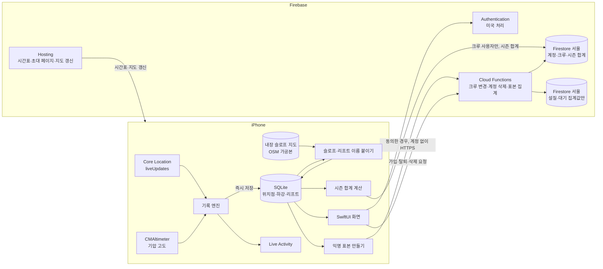
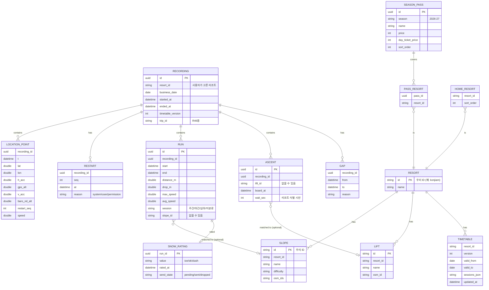
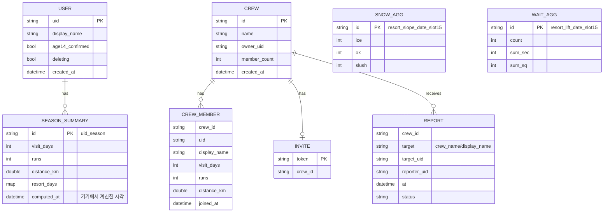
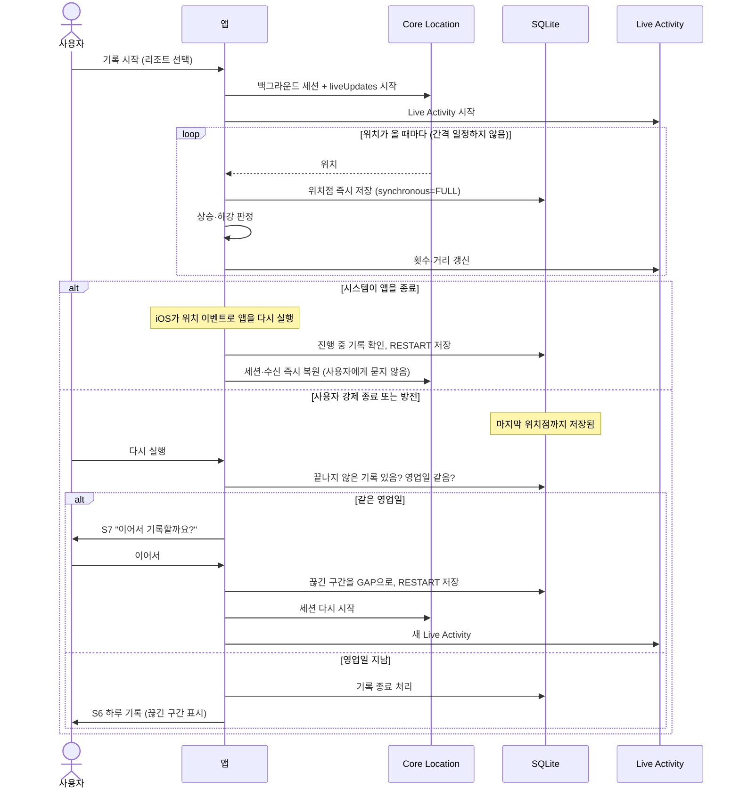

# 05. 기술 설계

작성: 2026-11-08 · 깊이: 충실히 · 상태: 승인 (2026-11-08)

03-requirements의 P0(R1~R23, R49, R50)를 만들기 위한 구조, 데이터, 외부 서비스, 개인정보 보호, 일정을 정한다. 기술 선택은 승인 후 decisions.md에 기록한다.

## 1. 기술 선택 요약

| 영역 | 선택 (제안) | 주된 이유 | 기각한 대안 |
| --- | --- | --- | --- |
| 앱 | **Swift + SwiftUI (iOS 17 이상)** | 백그라운드 위치, 기압계, Live Activity가 모두 Apple 고유 API. Live Activity UI는 SwiftUI로만 만듦 | Flutter, React Native: 핵심 기능이 전부 네이티브 연동이라 이점이 작음 |
| 기기 저장소 | **SQLite (GRDB 라이브러리), WAL + `synchronous=FULL`** | 하강·방문일·시즌 합계를 SQL로 집계하기 쉽고, 트랜잭션과 디스크 동기화 수준을 직접 정할 수 있음(R4) | SwiftData: 명시적 저장은 되지만 대량 위치점 집계와 저장 정책 통제가 GRDB보다 번거로움 |
| 서버 | **Firebase (Authentication + Cloud Firestore 서울 리전)** | 안드로이드도 같은 서버를 씀(R48). Sign in with Apple·Google 지원. Firestore는 서울 리전. **Authentication은 미국에서 처리되므로 국외 이전 고지 필요** (6장) | CloudKit: iPhone 전용(R48 위반). Supabase: 무료 프로젝트는 활동이 없으면 일시 정지. 자체 서버: 1인 개발에 운영 부담 |
| 서버 함수 | **Cloud Functions (Blaze 요금제)** | 크루 가입·탈퇴·소유권 같은 권한 변경과 계정 삭제를 서버 트랜잭션으로 처리. 익명 표본 집계 | 클라이언트 직접 쓰기: 동시 가입, 부분 삭제를 막기 어려움 |
| 지도 데이터 | **OpenStreetMap 가공본을 앱에 내장 + 정적 파일로 갱신** | 산에서 인터넷이 없어도 슬로프 식별. 가공본은 ODbL로 따로 공개 | 실시간 Overpass 조회: 느리고 공용 서버 과부하(조회 실패 경험 있음) |
| 운영 시간표 | **정적 JSON (Firebase Hosting), 버전 포함** | 앱 업데이트 없이 시간표를 고침(R7) | 앱 내장만: 고칠 때마다 앱 심사 |
| 날씨 (2.0, R33·R39) | **WeatherKit** | 개발자 멤버십에 월 50만 회 포함. REST API가 있어 안드로이드에서도 사용 가능 | OpenWeatherMap: 무료 하루 1,000회. 기상청 단기예보: 정확도 비교 후 결정(06-verification) |
| 초대 링크 | **Universal Links + Firebase Hosting** | 앱이 있으면 앱으로 열림. 앱이 없으면 웹페이지가 열리므로 그 페이지에 크루 이름과 앱스토어 링크를 둠 | Firebase Dynamic Links: 2025년에 서비스 종료 |
| 분석·오류 수집 | **App Store Connect와 Xcode Organizer만** | 위치가 외부 도구로 새 나갈 경로를 원천 차단(R17). 의존성 없음 | Firebase Analytics, Crashlytics: 로그에 위치가 섞일 위험, 고지 항목 증가 |

## 2. 전체 구조

**경계선:** GPS 좌표, 경로, 하강별 기록은 기기 밖으로 나가지 않는다. 서버로 가는 것은 시즌 합계(계정과 연결)와 익명 표본(계정과 분리, 서버에서 바로 집계하고 개별 표본은 저장하지 않음) 두 가지뿐이다.

## 3. 기록 엔진 (R2~R4, R7, R10, R23)

### 위치 수집
- iOS 17의 `CLLocationUpdate.liveUpdates`와 `CLBackgroundActivitySession`으로 백그라운드에서 받는다. 이 API는 고정 간격을 보장하지 않고, 멈춰 있으면 수신을 자동으로 쉬었다가 움직이면 다시 보낸다. 그래서 **거리와 공백은 위치점의 실제 시각으로 계산한다.**
- 수신이 끊긴 이유를 구분해 기록한다: 정상 정지(움직임 없음), 위치 획득 실패(신호), 권한 상실, 앱 종료. 앞의 둘은 "기록 없음" 구간이 아니라 정상 기록이다.
- **시스템이 앱을 종료한 경우:** Apple은 백그라운드 위치 세션이 있던 앱을 위치 이벤트로 다시 실행하고, 앱이 세션과 수신을 새로 만들도록 설명한다(WWDC23 10180). 이때는 사용자에게 묻지 않고 저장된 기록 상태를 읽어 **즉시 수신을 복원**한다. 기종·iOS 버전별 신뢰성은 현장 테스트로 확인한다.
- **사용자가 강제 종료하거나 방전된 경우:** iOS가 다시 깨우지 않는다. 다음 실행 때 S7 끊김 복구로 처리한다.

### 고도
- 기압계(`CMAltimeter`)의 상대 고도를 주 입력으로 쓴다. GPS 고도는 오차가 커서 리프트·하강 판정에 불리하다.
- 기압계는 **동작 및 피트니스 권한**이 별도로 필요하다. 권한이 없거나 기기가 지원하지 않으면 GPS 고도와 수직 정확도로 대신 판정하고, 하루 기록에 "고도 정확도 낮음"을 표시한다. → R18(권한)과 S4에 동작 권한 안내 추가 필요(9장).
- 상대 고도는 수신을 시작할 때마다 0에서 다시 시작한다. 재시작 지점을 저장하고, **그 경계를 가로질러 고도차를 계산하지 않는다.**

### 저장 (R4)
- 위치점은 받는 즉시 SQLite 트랜잭션으로 쓴다. `synchronous=FULL`로 전원이 갑자기 꺼져도 완료된 쓰기가 되돌아가지 않게 한다.
- 파일 보호 등급은 "첫 잠금 해제 후 접근 가능"으로 둬서, 화면이 잠긴 동안에도 쓸 수 있게 한다. 잠금 상태 쓰기는 현장 테스트로 확인한다.
- 저장에 실패하면(공간 부족 등) 기록을 멈추고 Live Activity와 앱에 알린다. 조용히 계속하지 않는다.
- 앱 업데이트로 데이터베이스 구조를 바꿀 때는 원본 파일을 먼저 복사해 두고, 변환에 실패하면 원본을 보존한다.
- R4의 "최대 1분 손실"은 **받은 위치 데이터를 잃는 범위**다. 앱이 꺼져 있어 받지 못한 시간은 "기록 없음" 구간으로 표시할 뿐 1분 안으로 보장할 수 없다. → R4 문구 정리 필요(9장).
- 기록 파일은 iOS 기기 백업에 포함된다(기기 교체 시 옮겨짐). 우리 서버로는 가지 않는다.

### 하강·리프트 판정 (R3, 03 5장)
판정은 **지도 없이도 동작**해야 한다. 모든 리조트에서 횟수와 거리를 기록하기 때문이다(03 리조트별 지원 범위).

1. 고도가 꾸준히 오르는 구간 = **상승(리프트) 구간**. 지도가 있으면 OSM 리프트 선과 맞춰 어느 리프트인지 붙이고, 없으면 "알 수 없는 리프트"로 둔다.
2. 상승 구간이 끝난 뒤 고도가 30m 이상(제안값) 내려가면 **하강 1회**. 다음 상승 구간이나 기록 종료까지.
3. 지도가 있는 리조트에서만 하강 경로를 OSM 슬로프 선과 비교해 이름을 붙인다. 겹침이 기준보다 낮으면 "알 수 없는 슬로프".
4. **리프트 대기(R10):** 리프트를 식별한 상승 구간 직전, 탑승장 반경(예: 50m) 안에서 머문 시간. 리프트를 모르거나 탑승으로 이어지지 않은 체류는 버린다.
5. **종료를 잊은 기록(R49):** `CMMotionActivity`가 차량으로 판단한 구간은 하강·거리에서 뺀다. 60분 무하강 알림은 하강이 생길 때마다 로컬 알림 예약을 새로 걸어 앱이 쉬는 동안에도 울리게 한다. 리조트 이탈 알림과 영업일 끝 닫기는 위치를 받을 때 확인한다.
6. 판정 규칙은 **테스트 기록(R22로 받은 파일)과 기대 결과를 짝지어 저장**해 두고, 코드를 고칠 때마다 같은 결과가 나오는지 확인한다. 안드로이드를 만들 때도 같은 파일로 같은 결과를 확인한다(R48).

### Live Activity (R23)
- 기록 시작 시(앱이 화면에 떠 있을 때) 시작하고, 기록 엔진이 백그라운드에서 내용을 갱신한다(소리 없음).
- **제약:** Live Activity는 최대 8시간까지만 활동 상태로 갱신된다. 끝난 뒤 잠금 화면에는 최대 4시간 더 남을 수 있지만 다이나믹 아일랜드에서는 사라진다(Apple 문서). 앱이 백그라운드에 있을 때 `Activity.request`로 새로 시작하면 오류가 난다. 백그라운드 시작 방법은 서버 푸시(push-to-start), 사용자 동작으로 실행되는 `LiveActivityIntent`, 최신 iOS의 예약 시작이 있다.
- **v1 제안:** 8시간이 지나면 Live Activity를 "기록 중 · 앱을 열면 다시 표시"로 끝낸다. 이 카드가 계속 보인다고 약속하지 않는다. **기록은 계속된다.** 사용자가 앱을 열면 새 Live Activity를 시작한다. 서버 푸시는 쓰지 않는다. → R23 문구 수정 필요(9장).

### 배터리 (G4)
- 먼저 `liveUpdates`의 기본 동작(멈추면 자동으로 쉼)만으로 배터리를 잰다. 부족하면 그때 움직임 센서(`CMMotionActivity`)를 이용한 추가 절전을 검토한다.

## 4. 데이터 모델

### 기기 안 (SQLite)

- **ID 규칙:** 슬로프·리프트 ID는 우리가 정한 값이다. OSM ID는 편집 때 바뀔 수 있어 참고용(`osm_ids`)으로만 둔다. D3·D4 표본은 우리 ID를 쓴다(R40·R41 대비).
- **시간표(R7):** 시간표마다 버전과 적용 기간이 있다. 세션은 저장하지 않고 읽을 때 계산하므로, 새 버전이 오면 그 적용 기간의 기록이 자동으로 다시 분류된다. 적용 기간이 겹치면 버전이 큰 것을 쓴다. `updated_at`이 지난 시즌이 끝나기(5월 1일) 전이면 "오래됨"으로 보고 세션을 나누지 않는다.
- **시즌권(R8):** 시즌권마다 시즌을 둔다. 다음 시즌 시즌권을 등록하거나 고쳐도 지난 시즌 계산은 바뀌지 않는다.
- 시즌 합계, 방문일, 세션은 저장하지 않고 위 테이블에서 계산한다(규칙 변경 시 재계산).

### 서버 (Firestore)

- **시즌 합계 한 문서만 보낸다.** 날짜별 기록은 서버에 저장하지 않는다. 크루 화면(R14)에 필요한 것은 시즌 합계뿐이다. 다만 합계가 바뀐 시각으로 방문 시점을 짐작할 수는 있다. → R17을 "시즌 합계와 리조트별 방문일 수"로 좁힐 것을 제안(9장).
- **크루 화면 데이터:** 기기가 `syncSummary` 함수로 이번 시즌 합계를 보내면, 함수가 `SEASON_SUMMARY`를 쓰고 같은 트랜잭션에서 그 사용자가 속한 각 크루의 `CREW_MEMBER` 문서에 합계와 시즌을 복사한다. 크루에 가입하거나 만들 때도 이미 보낸 이번 시즌 합계를 복사한다. 지난 시즌 값이 남은 멤버는 순위에서 0으로 본다. 기기는 크루에 속해 있을 때만 보낸다(앱이 켜질 때, 기록이 끝났을 때, 크루가 생길 때). 크루원은 자기 크루의 `CREW_MEMBER` 목록만 읽는다. 다른 사용자의 `SEASON_SUMMARY`는 아무도 읽지 못한다.
- **오래된 값 덮어쓰기 방지(R15):** 기기는 합계를 매번 기록에서 새로 계산하므로 보내지 못한 값은 최신 값 하나로 합쳐지고, 한 번에 하나씩 보낸다. 함수는 `computed_at`이 저장된 값보다 늦을 때만 받고, 정해진 필드(시즌, 방문일, 하강 횟수, 거리, 리조트별 방문일, 계산 시각) 밖의 값이 오면 거부한다(R17). 클라이언트는 `SEASON_SUMMARY`를 직접 쓰지 못하고 본인 것만 읽는다. 기록을 지우면 합계가 줄 수 있으므로 "큰 값 유지" 방식은 쓰지 않는다.
- **새로 설치했을 때:** 기기에 이번 시즌 기록이 없는데 서버에 합계가 있으면, 0으로 덮어쓰지 않고 "이 기기에는 기록이 없어요. 크루 합계를 이 기기 기준으로 바꿀까요?"라고 묻는다. "그대로 두기"를 고르면 이 기기에 이번 시즌 기록이 생길 때까지 보내지 않는다.
- **익명 표본은 개별로 저장하지 않는다.** 서버 함수가 받은 즉시 `SNOW_AGG`, `WAIT_AGG`의 숫자만 올리고 요청 내용은 버린다. 시간대(`slot15`)는 한국 시간 기준 날짜 + 15분 단위다. P2 결과 화면(R40, R41)은 이 집계값으로 충분하다.
- **크루 인원 상한:** 50명. 가입은 서버 함수의 트랜잭션에서 인원을 확인하므로 동시 가입에도 넘지 않는다. 크루를 새로 만들 때 이미 크루장인 크루가 5개면 막는다. 크루장이 나가 자동으로 넘겨받는 것은 이 상한과 무관하다(넘겨받아 6개가 될 수 있고, 4개 이하가 되어야 다시 만든다).

## 5. 외부 서비스, 비용, 한도

| 서비스 | 쓰는 곳 | 무료 범위 | 과금 기준 | 출처·확인 |
| --- | --- | --- | --- | --- |
| Apple Developer Program | 앱 배포, WeatherKit | 연회비 | 연 $99 (기존 멤버십) | |
| Firebase Authentication | 로그인 | 일반 사용량 무료 | | Google 공식 가격표 재확인 필요 |
| Cloud Firestore | 계정·크루·합계·집계 | 하루 읽기 5만, 쓰기 2만, 저장 1GiB | 미국 리전 기준 읽기 10만 건당 약 $0.03~0.06, 쓰기 10만 건당 약 $0.09. **서울 단가 미확인** | 2026-11 제3자 가격 정리, [공식 과금 기준](https://firebase.google.com/docs/firestore/pricing) |
| Cloud Functions | 크루 변경, 계정 삭제, 표본 집계, 합계 복사 | Blaze 요금제 무료 할당량 | 호출 수, 실행 시간 | Blaze 전환 필요 |
| Firebase Hosting | 시간표, 초대 페이지, 지도 갱신 | 무료 할당량 있음 | 전송량 | 할당량 수치는 출처마다 다름 |
| WeatherKit (2.0) | 날씨, 예상 설질 | 월 50만 회 | | Apple 공식 (2026-11-07 확인) |
| OpenStreetMap | 슬로프 지도 | 무료 (ODbL) | | 출처 표시, 가공본 공개 의무 |

**사용량 계산식 (하루 기준)**
- 크루 화면 읽기 = 크루 사용자 수 × 하루 조회 수 × 크루원 수
- 합계 쓰기 = 크루 사용자 중 그날 기록한 수 × (1 + 속한 크루 수)
- 표본 쓰기 = 동의한 기록 사용자 수 × 1인당 표본 수 (집계값 하나 올릴 때마다 쓰기 1건)

**예시:** 크루 사용자 1,000명, 하루 10회 조회, 크루원 10명이면 읽기 하루 10만(무료분 초과 5만 × 30일 = 월 150만 건 유료). 기록 사용자 1,000명이 표본을 하루 30개 보내면 쓰기 하루 3만(무료분 초과). 미국 단가로 둘 다 합쳐 월 수천 원 수준이지만 서울 단가 확인 전에는 확정하지 않는다.

**비용 통제**
- 예산 알림은 지출을 막지 않는다. 월 1만 원을 **알림 기준**으로 건다.
- 실제 차단 수단: 원격 설정 파일(Hosting)의 스위치로 표본 수집과 크루 동기화를 끌 수 있게 한다. Functions에는 Firebase 지출 제한도 건다(적용 지연이 있고 Firestore 전체는 막지 못함).
- 표본 함수는 계정 없이 열려 있으므로 요청 크기, 요청당 표본 수(예: 30개), 값 범위를 검사하고, App Check(기기 증명, 계정과 무관)로 앱이 아닌 요청을 거른다.

## 6. 개인정보와 보안

| 항목 | 설계 |
| --- | --- |
| GPS 비전송 (R17) | 위치점·하강 테이블은 서버 전송 코드에서 접근하지 않는다. 서버는 정해진 형식(시즌 합계, 표본) 외 필드를 거부한다 |
| 익명 표본 (R12) | 계정 토큰 없이 일반 HTTPS 요청으로 보낸다(Firebase SDK의 Callable 함수는 로그인 토큰을 자동으로 붙이므로 쓰지 않음). 서버는 받은 즉시 집계값만 올리고 요청 내용을 저장하지 않는다. 함수 요청 로그는 **로그 제외 설정**으로 남기지 않거나 보관 기간을 1일로 줄인다(기본 30일, IP 필드 포함). 같은 사람의 하루 표본이 한 요청에 묶이지 않도록 하강 직후가 아니라 하루 기록이 끝난 뒤 표본마다 따로, 무작위 지연을 두고 보낸다 |
| 표본 동의 철회 | 끄면 아직 안 보낸 표본은 버린다(`dropped`). 다시 켜도 과거 표본은 보내지 않는다. 전송 실패는 하루 안에서만 재시도한다 |
| 크루 권한 | 가입·탈퇴·추방·크루장 넘기기·초대 링크 교체·인원수 변경은 **서버 함수만** 한다. 함수는 보안 규칙을 거치지 않으므로 함수 안에서 권한을 직접 확인한다. 클라이언트는 크루 문서를 쓸 수 없다 |
| 읽기 규칙 | `CREW_MEMBER`는 같은 크루에 내 멤버 문서가 있을 때만 읽는다. 탈퇴·추방되면 즉시 읽을 수 없다. 탈퇴·추방을 서버 응답으로 확인하면 화면과 앱의 Firestore 캐시를 비운다(문서 단위 삭제가 없어 캐시 전체를 비우고 남은 크루는 다시 받는다). 오프라인 중에 내보내진 사람은 다시 연결될 때까지 마지막 순위를 볼 수 있고, 이미 받아 본 순위를 회수할 수 있다고 약속하지 않는다 |
| 신고 (R16) | 신고는 함수로 `REPORT`에 쌓인다. 크루장은 크루원을 내보낼 수 있다. 내보낸 계정은 크루장만 읽는 `crews/{id}/bans`에 남아 새 초대 링크로도 그 크루에 다시 참여할 수 없고, 크루장이 차단을 풀면 다시 참여할 수 있다(스스로 나간 사람은 링크로 재참여 가능). 신고된 이름은 개발자가 확인 후 바꾸거나 크루를 닫는다. 크루 이름·표시 이름은 저장 전에 금지어 목록으로 거른다. 신고가 처리되면 신고자에게 앱 안에서 알린다 |
| 계정 삭제 (R13) | 1) 앱이 Apple 재로그인으로 재인증하고, 기기에 삭제 진행 표시를 남긴 뒤 새 인증 코드로 Apple 연결을 해제한다. 2) `deleteAccount` 함수가 삭제를 접수한다: 처음 접수는 최근 10분 안에 재인증한 토큰만 받고, 계정 문서를 `deleting=true`와 요청 시각만 남기고 덮어쓴다(표시 이름은 이때 사라진다). 이후 이 사용자의 모든 함수 호출은 거부된다(남아 있는 로그인 토큰으로도 쓸 수 없음). 3) 함수가 크루 멤버 문서를 지우고(크루장이면 다음 가입자에게 넘기고, 마지막 멤버면 크루와 초대를 지운다), 모든 시즌 합계와 다른 크루에 남은 차단 기록을 지운다. 4) Firebase Authentication 사용자를 지우고, 계정 문서를 지우면서 `deleted_users/{uid}`에 완료 표시를 남긴다. 지워진 계정의 남은 로그인 토큰은 이 표시가 있는 동안 계정 문서를 다시 만들 수 없고, 표시는 uid와 시각뿐이며 하루 뒤 지운다. 5) 각 단계는 여러 번, 동시에 실행해도 안전하다. 중간에 실패하면 스케줄 함수가 매시간 `deleting=true`인 계정을 다시 시도하고, 세 번 넘게 실패하면 오류 로그를 남긴다(끝나는 시간을 약속하지 않는다). 6) 앱은 서버의 성공 응답이나 `deletionStatus` 함수의 완료 답을 받았을 때만 완료를 알린다. 로그아웃된 것만으로 완료로 보지 않는다. 앱이 중간에 꺼지면 다음 실행 때 진행 표시를 보고 잇는다(해제 여부를 모르면 Apple 재로그인부터, 해제했으면 서버 호출만). 서버 삭제가 확인되면 대기 중인 익명 표본, 크루 캐시, 계정별 동기화 상태를 기기에서 지운다. 진행 표시는 기기 정리까지 끝나야 지우고(사용자가 시트를 닫아도 남김), 표본 폐기와 크루 캐시 비우기가 모두 성공해야 완료로 알리고, 하나라도 실패하면 실패로 알린 뒤 다음 실행에 다시 한다. 크루 캐시는 따로 남긴 표시로 로그아웃 상태에서도 끝날 때까지 다시 비운다. 기기의 스키 기록·시즌권·설정은 그대로 둔다. 삭제 뒤 다시 가입하면 새 계정이므로 크루 차단은 이어지지 않는다 |
| 초대 링크 (R14) | 추측하기 어려운 무작위 토큰. 크루장이 새로 만들면 이전 초대 문서를 지운다(없는 토큰 = "이 초대 링크는 더 이상 쓸 수 없어요"). 크루가 사라지면 초대도 지운다. 링크 미리보기(크루 이름·인원·크루장 표시 이름)는 로그인 없이 함수로 본다. 크루를 만들 때와 크루장 설정에서 "초대 링크를 받은 사람은 가입 전에도 크루장 표시 이름을 볼 수 있어요"라고 알린다. 정원이 찼으면 "크루가 가득 찼어요" 화면 |
| 위치정보법 | GPS는 기기 안, 리조트는 사용자가 선택(01-idea 4장). 출시 전 위치정보지원센터에 이 구조와 R22(테스터 기록 받기)를 함께 확인 |
| 개인정보처리방침 | 수집 항목: 표시 이름, Apple 로그인 식별자, 시즌 합계, 리조트별 방문일 수, 크루 소속, 신고 내용. Firestore는 서울, **Firebase Authentication(로그인 정보, 접속 IP 수 주간 보관)은 미국** → 국외 이전 항목(이전 국가, 받는 자, 항목, 보유 기간) 고지. 익명 표본은 개별로 저장하지 않고 집계값만 남긴다고 고지. 익명성에 대한 최종 판단은 위치정보지원센터·개인정보 상담과 함께 확인 |
| R22 테스트 빌드 | 테스트 기록 내보내기는 별도 빌드 설정(TestFlight 전용 플래그)에서만 컴파일된다. 앱스토어 제출 전 체크리스트에서 이 기능이 빠졌는지 확인한다 |
| OSM 라이선스 | 앱 안에 "© OpenStreetMap contributors"와 라이선스 링크. 가공한 슬로프·리프트 데이터 묶음은 앱 코드와 분리해 ODbL로 공개한다(예: 공개 저장소). 앱 코드 공개 의무는 없다 |

## 7. 가장 위험한 흐름: 기록 중 앱 종료와 복구

## 8. 일정 추정 (주 40시간, 1인)

| 묶음 | 요구사항 | 추정 |
| --- | --- | --- |
| A. 기록 엔진: 위치 수집, 저장, 복구, 기압계·권한 | R2, R4, R18 일부 | 2.5주 |
| B. 상승·하강 판정, 테스트 기록 재생 | R3, R22 | 2주 |
| C. OSM 가공 도구, 슬로프·리프트 식별, ODbL 공개 | R9, R10 일부 | 1.5주 |
| D. 화면: 홈 리조트, 기록 시작·중, 하루·시즌, 목록 | R1, R5, R6 | 1.5주 |
| K. 하루 기록 지도·움직임 재생·동영상 공유: OSM 선을 기기 안에서 그리기, 기록 종료 때 경로 단순화·저장(판정 기준 버전과 함께), 재생·시간 막대, 아래 시트, 공유 동영상 만들기(AVAssetWriter) | R50 | 1.5주 |
| E. 세션 구분, 시간표 입력 12곳, 시즌권 여러 장 | R7, R8 | 1주 |
| F. Live Activity | R23 | 0.5주 |
| G. 설질 칸, 표본 집계 함수, 리프트 대기 | R10~R12 | 1주 |
| H. Firebase: 로그인, 크루 함수, 동기화, 보안 규칙, 신고, 계정 삭제 | R13~R16 | 3주 |
| I. 권한·고지·연령·접근성·개인정보처리방침 | R17~R21 | 1주 |
| J. 출시마다: TestFlight 점검 대응, 심사, 수정 여유 | | 출시당 1.5주 |
| **합계 (출시 1번)** | | **약 15.5주** |

- (처음 추정, 아래 출시 계획으로 대체됨) 11월 16일 시작 기준, 한 번에 내면 **3월 초**다. 시즌이 거의 끝난다.
- **현장 수집은 개발과 겹친다.** A·B가 끝나는 대로 TestFlight 내부 빌드로 테스터 기록을 받아 판정을 다듬는다. 테스터가 정해지는 시점이 일정의 가장 큰 변수다.

**출시 계획 (2026-11-08 변경: 이번 시즌 개장 출시)**

M0·M1(A·B) 코드가 하루 만에 끝나 위 추정은 보수적이었다. 남은 코드도 11월 안에 가능하다고 보고, **이번 시즌 개장에 P0 전체와 날씨·예상 설질을 2.0으로 낸다.** 슬로프 이름 표시만 출시 후 켠다.

| 시기 | 할 일 |
| --- | --- |
| 11월 중순 | A·B 실기기 확인, TestFlight 첫 배포 |
| 11월 25일쯤 | C~I 전부 + 날씨·예상 설질 → **2.0 심사 제출**. 슬로프 이름 표시는 꺼 둠. 늦어지면 기능을 빼지 않고 출시를 다음 시즌으로 미룸 |
| 11월 말 | 개장에 맞춰 2.0 출시. 테스터 현장 기록 수집 시작 |
| 12월~1월 | 현장 기준을 통과한 리조트부터 슬로프 이름 켜기(서버 설정 파일), 2.0에서 빠진 기능과 판정 수정은 업데이트 |
| 3월~10월 | 기준값 확정, OSM 정리, P1 검토, 다음 시즌 시간표 |

- 2.0에 로그인·크루·서버가 들어가므로 개인정보처리방침(Firebase Authentication 국외 이전 포함), 계정 삭제, 신고 기능이 심사 전에 갖춰져야 한다.
- 테스터는 같은 앱의 TestFlight 빌드를 쓴다. 기록 파일 내보내기(R22)가 TestFlight 빌드에만 있기 때문이다.
- 현장 검증 전에 출시하므로, 기록 정확도 문제는 업데이트로 빠르게 고친다. 핵심 약속인 기록 보존(R4)은 실기기 확인을 마친 뒤 제출한다.

## 9. 승인이 필요한 변경

| 항목 | 내용 | 바뀌는 문서 |
| --- | --- | --- |
| R4 | "최대 1분 손실"은 받은 위치 데이터의 저장 손실로 한정. 앱이 꺼져 받지 못한 시간은 "기록 없음" 구간으로 표시 | 03 (2026-11-08 승인, 반영 완료) |
| R18 | 기압계용 동작 및 피트니스 권한 추가. 거부 시 GPS 고도로 대신하고 "고도 정확도 낮음" 표시 | 03, 04(S4) (2026-11-08 승인, 반영 완료) |
| R23 | 8시간이 지나면 Live Activity를 끝내고 "앱을 열면 다시 표시"로 안내. 카드가 계속 보인다고 약속하지 않음. 기록은 계속 | 03 (2026-11-08 승인, 반영 완료) |
| R17 | 서버로 보내는 계정 데이터를 "시즌 합계와 리조트별 방문일 수"로 좁힘. "날짜별 기록을 서버에 저장하지 않는다"로 표현 | 03 (2026-11-08 승인, 반영 완료) |
| R12 | 익명 표본은 서버에서 바로 집계하고 개별로 저장하지 않음 | 03 (2026-11-08 승인, 반영 완료) |
| 출시 | ~~2단계 출시~~ → 결정됨: 이번 시즌 개장에 P0 전체 + 날씨·예상 설질을 2.0으로, 슬로프 이름만 출시 후 켬 (8장) | 03 8장, 01-idea (반영 완료) |
| "베타" 표시 | ~~앱 안 베타 표시~~ → 출시 계획 변경으로 03 8장에서 삭제됨. 공개 출시판은 완결된 제품으로 낸다(Apple 심사 지침 2.2) | 03 (반영 완료) |
| G1 | 로그인 없는 사용자의 방문일은 서버에서 알 수 없으므로, App Store 유지 지표와 테스터 기록으로 평가 | 03 (2026-11-08 승인, 반영 완료) |
| 크루 | 인원 상한 50명, 크루장인 크루가 5개 이상이면 새로 만들기 불가(승계는 허용) | 03 (2026-11-08 승인, 반영 완료) |

## 10. 독립 검토 결과

Codex 독립 검토(아스트라, high) 2회.

**1회차 (사용량 한도로 중단, 2026-11-08):** 지적 4건 반영
- Firebase Authentication 미국 처리 → 국외 이전 고지
- Callable 함수 토큰 자동 첨부 → 일반 HTTPS 요청
- Universal Links 미설치 시 웹페이지 → 앱스토어 링크
- Live Activity 백그라운드 시작 방법 정정

**2회차 (2026-11-08):** 지적 12건 모두 반영

| 지적 | 반영 |
| --- | --- |
| 하강 판정이 OSM 리프트 데이터에 묶임 | 고도만으로 판정, OSM은 이름 보강 (3장) |
| liveUpdates는 고정 1초 간격이 아님. 시스템 재실행 동작이 공식 문서에 있음 | 실제 시각 기준 계산, 끊김 원인 구분, 시스템 재실행 시 즉시 복원 (3장, 7장) |
| 기압계 권한과 재시작 기준점 | 권한·대체 동작·재시작 경계 (3장, 9장 R18) |
| SQLite WAL 기본 설정은 전원 손실 시 되돌아갈 수 있음 | `synchronous=FULL`, 저장 실패 처리, 마이그레이션 보존, 잠금 중 쓰기 (3장) |
| 하루 묶음 전송과 요청 로그로 익명성이 깨질 수 있음 | 개별 표본 저장 안 함, 로그 제외, 표본별 분산 전송 (4장, 6장) |
| 크루 권한 변경 구조가 없음, 동시 가입 | 서버 함수 트랜잭션, 캐시 처리 (4장, 6장) |
| 계정 삭제 중간 실패, Auth 사용자 삭제 누락 | 삭제 6단계 (6장) |
| 오래된 합계가 최신 값을 덮을 수 있음 | `computed_at` 비교, 새 설치 시 확인 (4장) |
| 비용 "0원"과 "상한" 표현 | 계산식, 알림과 차단 구분, 표본 함수 제한 (5장) |
| 일정 8주+5주가 표에서 나오지 않음 | 재산정, 출시 2안 비교 (8장) |
| R7·R8·R12·R16·R22·G1 설계 누락 | 시간표 버전, 시즌권 시즌, 동의 철회, 신고 경로, 빌드 분리, G1 (4장, 6장, 9장) |
| ODbL 가공본 배포 조건, App Store "베타" 출시 | 가공본 공개, 베타 표시 삭제 (6장, 9장) |
| SwiftData 기각 근거가 틀림 | 근거 수정 (1장) |

## 11. 확인할 것

- `CLBackgroundActivitySession` 재실행의 기종·iOS별 신뢰성, 잠금 중 SQLite 쓰기: 현장 테스트
- Firestore·Functions·Hosting 서울 리전 무료 할당량과 단가: Google 공식 가격표
- Firebase Authentication의 현재 처리 지역: Firebase 개인정보 페이지
- WeatherKit 국내 산악 지역 정확도: 기상청과 비교 (06-verification)
- 익명 집계 구조의 개인정보 판단: 위치정보지원센터·개인정보 상담
